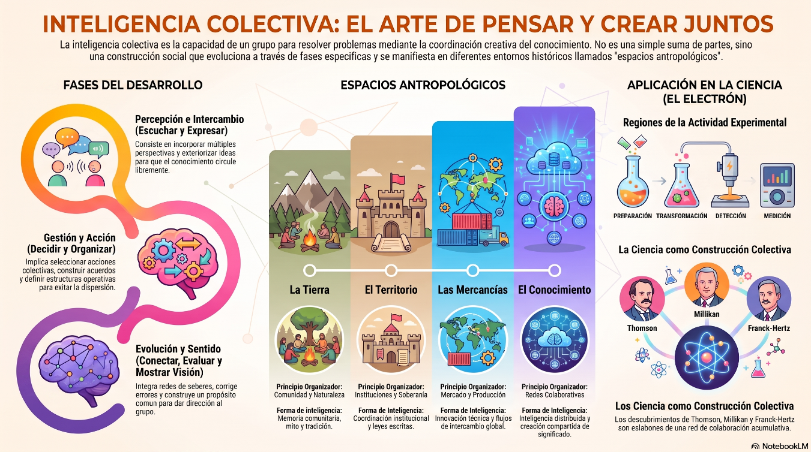
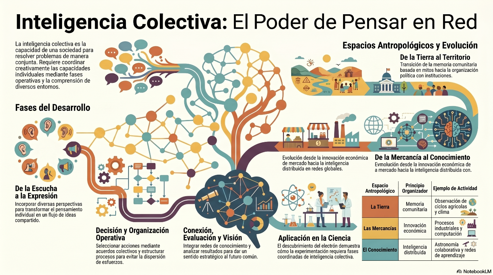
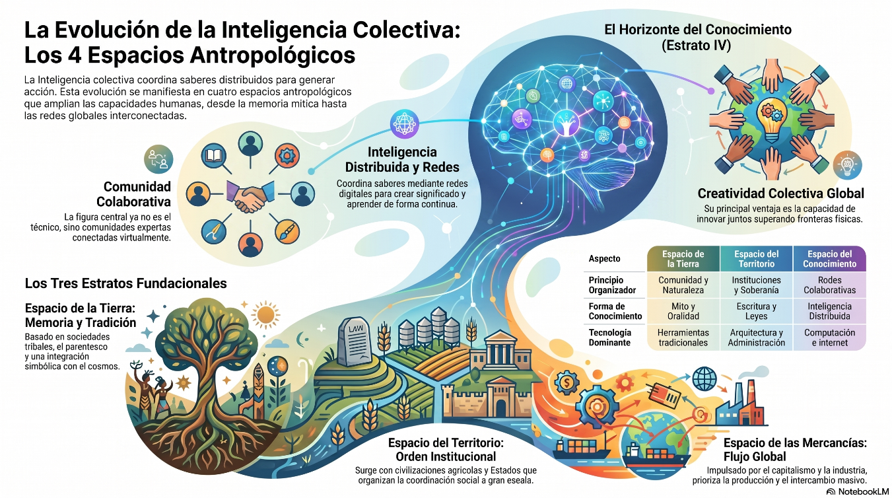

# Capítulo 2: Inteligencia Colectiva y Propiedades del Electrón

La construcción y circulación del conocimiento se da en el espacio cognitivo de las ideas, los razonamientos y las pruebas que posibilitan el desarrollo y aplicación de teorías y experimentos. Este es un proceso creativo que refleja el desarrollo de la inteligencia colectiva.
Inteligencia colectiva significa construir la capacidad de un grupo, comunidad o sociedad para pensar, comprender y resolver problemas de manera conjunta. Según <a href="https://en.wikipedia.org/wiki/Pierre_Lévy" title="Pierre Lévy: Filósofo y teórico francés de la cibercultura y pionero del concepto de inteligencia colectiva.">Pierre Lévy</a>*, el desarrollo de la inteligencia colectiva requiere reconocer que el conocimiento humano es un producto social y que las sociedades avanzan cuando logran coordinar creativamente las capacidades de muchos para transformar y fortalecer la cooperación y el compromiso de todos.
Dos elementos clave en la descripción de la inteligencia colectiva son la puesta en práctica de sus fases de desarrollo (escuchar, expresar, decidir, organizar, conectar, evaluar y mostrar visión) y la comprensión de sus espacios antropológicos (la Tierra, el Territorio, las Mercancías y el Conocimiento).

En relación con el conocimiento científico, éste avanza cuando las aportaciones teóricas y los desarrollos experimentales se enriquecen mutuamente, lo cual implica, para empezar, comprender y hacer funcionar adecuadamente cuatro regiones de realización de las actividades experimentales: Preparación, Transformación, Detección y Medición). 

Como ejemplo de aplicación práctica, aplicamos la descripción de las regiones de realización de actividades experimentales al análisis de tres experimentos que condujeron al descubrimiento del <a href="https://es.wikipedia.org/wiki/Electrón" title="Electrón: Partícula subatómica fundamental con carga eléctrica negativa que forma parte de átomos y moléculas.">electrón</a> y permitieron calcular los valores de su <a href=" https://es.wikipedia.org/wiki/Relación_carga-masa" title="	Relación carga/masa (q/m o e/m): Cociente entre la carga eléctrica y la masa de una partícula, calculated originalmente por J. J. Thomson.">relación carga/masa</a> y de su carga eléctrica, así como demostrar la existencia de niveles energéticos discretos. En este capítulo consideramos la relación entre tales regiones de realización de las actividades experimentales con las etapas de producción de las fases del desarrollo de la inteligencia colectiva. Las fases de Escuchar y Expresar corresponden a la etapa de Percepción e Intercambio, las fases de Decidir y Organizar a la etapa de Gestión y Acción y las fases de Conectar, Evaluar y Mostrar Visión a la etapa de Evolución y Sentido.

*Lévy Pierre. <i>L'intelligence collective: Pour une anthropologie du cyberspace.</i> Paris: La <i>Découverte.</i> (1994).

  Lévy Pierre. <i>Collective Intelligence: Mankind's Emerging World in Cyberspace</i> (Trad. Robert Bononno). New York: Plenum Trade. (1997).

<i>Todas las diapositivas e infografías incluidas en este capítulo han sido generadas por el Programa NotebookLM a partir de textos elaborados por el autor.</i>

**OBJETIVOS Y CONTENIDOS DE LAS SECCIONES**

## 2.1. Fases del desarrollo de la inteligencia colectiva

Analizar las características y funciones de cada fase y su participación en la integración de las correspondientes etapas de producción del conocimiento científico. Explicar cómo las etapas de producción y las fases de desarrollo expresan interacciones colectivas entre las cuales fluye y se transforma la inteligencia colectiva.

Descripción de las fases del desarrollo de la inteligencia colectiva

<ul>
  <li>Etapa de Percepción e Intercambio</li>
    <ul style="list-style-type: none; padding-left: 30px;">
      <li>Escuchar: atención activa para incorporar perspectivas</li>
      <li>Expresar: posicionamiento para compartir conocimientos</li>
    </ul>
  <li>Etapa de Gestión y Acción</li> 
    <ul style="list-style-type: none; padding-left: 30px;">
      <li>Decidir: responsabilidad para seleccionar acciones</li>
      <li>Organizar: coordinación para distribuir procesos</li>
    </ul>
  <li>Etapa de Evolución y Sentido</li> 
    <ul style="list-style-type: none; padding-left: 30px;">
      <li>Conectar: integración de redes cognitivas</li>
      <li>Evaluar: calibración para aprender y corregir</li>
      <li>Mostrar visión: dar coherencia, dirección y sentido a la perspectiva colectiva</li>
    </ul>
</ul>

## 2.2. Espacios antropológicos de la inteligencia colectiva

Describir las siguientes características de cada espacio antropológico: el espacio de la Tierra crea cosmovisiones y construye códigos; el espacio del Territorio requiere para su funcionamiento de infraestructura, gobernanza y mentalidad cultural; el espacio de las Mercancías funciona como estructura global que contiene motores, aceleradores y sistemas operativos y el espacio del Conocimiento se apoya en tres pilares que son la interconexión, la colaboración y la transformación.  

- La Tierra: Memoria comunitaria - Tradición y mito 
- El Territorio: Organización política - Instituciones y escritura 
- Las Mercancías: Innovación económica - Mercado y producción 
- El Conocimiento: Inteligencia distribuida - Redes y colaboración

## 2.3. Experimentos acerca del electrón

Explicar qué ocurre en cada una de las regiones de realización de las actividades experimentales en los siguientes casos: el descubrimiento del electrón y el cálculo de los valores de su <a href=" https://es.wikipedia.org/wiki/Relación_carga-masa" title="Relación carga/masa (q/m o e/m): Cociente entre la carga eléctrica y la masa de una partícula, calculado originalmente por J. J. Thomson.">relación carga/masa</a>, el cálculo de su carga eléctrica y la demostración de la existencia de niveles energéticos discretos.

Describir el contenido de las Conferencias Nobel dictadas por los autores de los experimentos considerados. Analizar cómo en la descripción de las regiones de realización de cada una de las correspondientes actividades experimentales se expresan las fases del desarrollo de la inteligencia colectiva en tanto elementos de las etapas de producción del conocimiento.

<ul>
  <li>Regiones de realización de las actividades experimentales</li>
   
  <li>Tres experimentos revolucionarios acerca del electrón</li>
    <ul style="list-style-type: none; padding-left: 30px;">
      <li>Experimentos para descubrir el electrón por Thomson</li>
      <li>Experimentos para medir la carga eléctrica elemental del electrón por Millikan</li>
      <li>Experimentos para demostrar la existencia de niveles de energía electrónica estacionaria por Franck y Hertz</li>
    </ul>
  <li>Relaciones entre las regiones de realización de las actividades experimentales y las fases de desarrollo de la inteligencia colectiva.</li> 
</ul>

