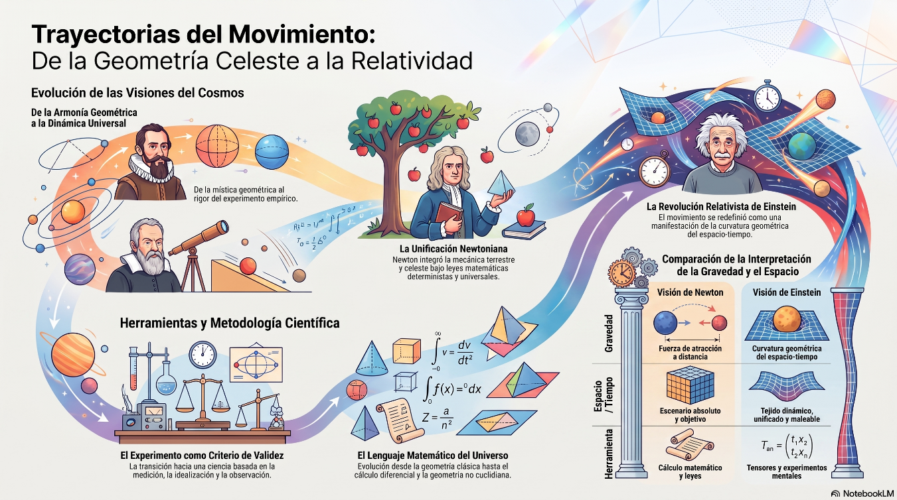
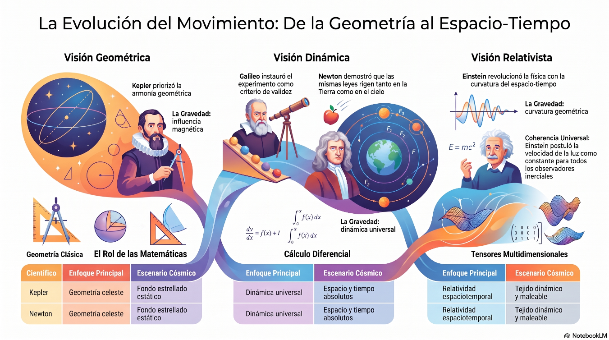
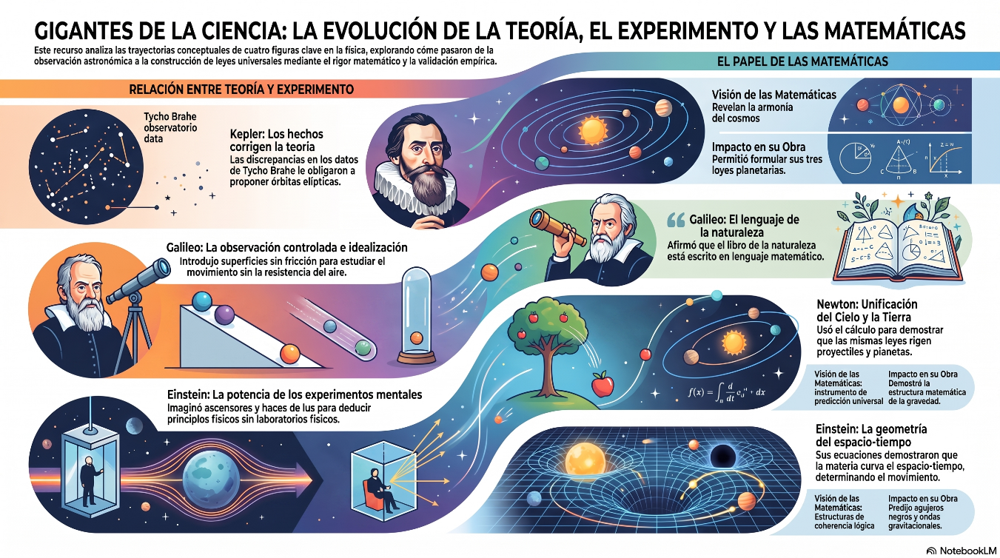
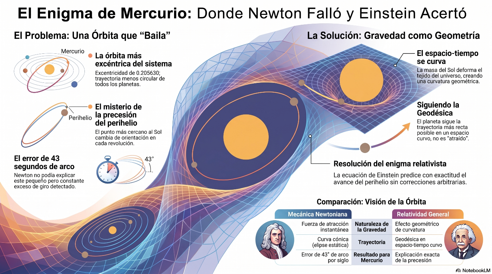
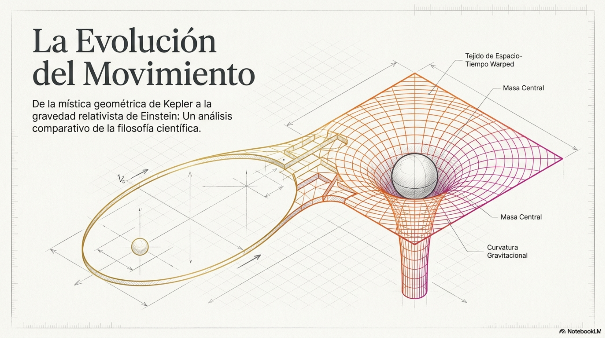
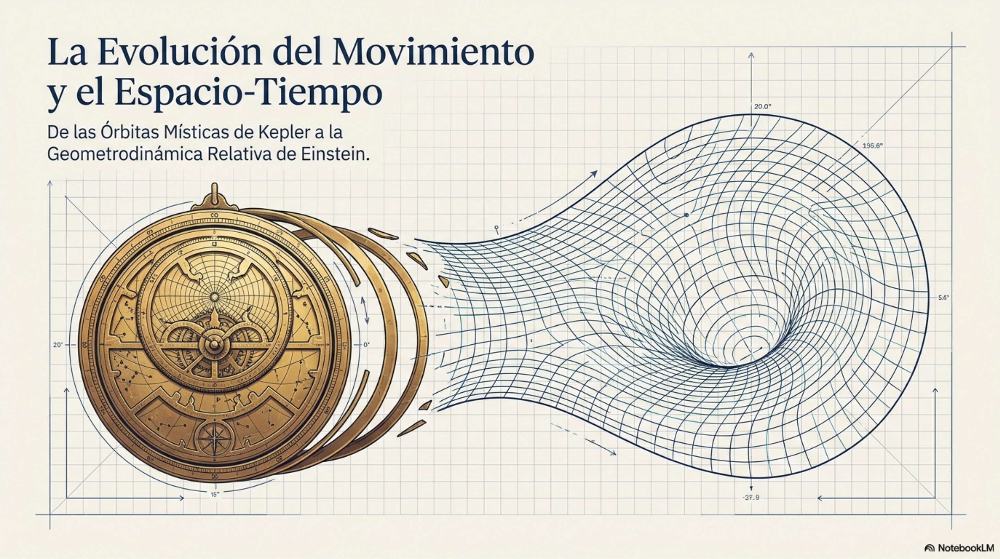

# Capítulo 4: Trayectorias conceptuales acerca del movimiento

Este capítulo es una invitación para explorar las trayectorias
conceptuales recorridas por cuatro científicos: Johannes Kepler, Galileo
Galilei, Isaac Newton y Albert Einstein. Las trayectorias en cuestión
tienen que ver con la evolución de sus conocimientos acerca del
movimiento. Tales conocimientos se refieren a dos tipos de condiciones:
las condiciones iniciales de los autores en relación con las preguntas
fundamentales que pudieron haber formulado cada uno de ellos y las
premisas que plantearon como válidas, así como las condiciones en la
frontera de la disciplina que cultivan (la física), en conexión con las
relaciones teoría – experimento y el papel de las matemáticas.

El conocimiento sirve para describir, explicar y predecir; para
representar e interpretar y para transformar e innovar; es generador de
nuevas ideas, razonamientos, pruebas y demostraciones. Promueve el
mejoramiento de productos y servicios, transforma estructuras y afina
procedimientos; es factor de progreso en ciencia, tecnología,
matemáticas, educación y cultura.

Para cada trayectoria conceptual considerada presentamos una tabla
comparativa de lo que pudieron haber sido, primero las respuestas a las
preguntas planteadas y las premisas aceptadas (condiciones iniciales de
los científicos) y segundo, las observaciones a las relaciones teoría –
experimento y el papel de las matemáticas (condiciones en la frontera de
la disciplina).

Como ejemplo práctico del recorrido de una trayectoria conceptual
consideramos el cálculo de órbitas planetarias desde los puntos de vista
de Newton y Einstein. El cálculo del avance del perihelio de la órbita
de Mercurio ha servido para demostrar que la estructura geométrica del
espacio tiempo gobierna el comportamiento físico del movimiento de la
materia en el universo.

Todas las diapositivas e infografías incluidas en este capítulo han sido generadas por el Programa NotebookLM a partir de textos elaborados por el autor.

**OBJETIVOS Y CONTENIDOS DE LAS SECCIONES**

  
**4.1. Trayectorias conceptuales relacionadas con las condiciones
iniciales de los autores**

Describir las trayectorias conceptuales acerca del movimiento que se
conectan con las preguntas que se hicieron Kepler, Galileo, Newton y
Einstein y las premisas en las cuales confiaron.

<ul>
<li>Descripción de trayectorias conceptuales</li>
<li>Preguntas fundamentales planteadas</li>
<li>Premisas consideradas válidas</li>
</ul>

  
**4.2. Trayectorias conceptuales relacionadas con las condiciones en la
frontera de la disciplina**

Describir las trayectorias conceptuales acerca del movimiento que se
conectan con las interacciones entre la teoría y el experimento y con el
uso de las matemáticas.

<ul>
<li>La relación teoría – experimento</li>
<li>La importancia de las matemáticas</li>
</ul>

  
**4.3. Avance del perihelio de la órbita del planeta Mercurio**

Describir las trayectorias conceptuales recorridas por Newton y por Einstein para explicar la órbita de Mercurio como ilustración de cómo evolucionaron la relación teoría – experimento y la importancia de las matemáticas en el proceso de geometrización de la mecánica planetaria.

<ul>
<li>Observación de la anomalía en la órbita de Mercurio</li>
<li>Determinación de la precesión de la órbita</li>
</ul>

<!-- TABLA 4.1: CARACTERIZACIONES DE TRAYECTORIAS CONCEPTUALES -->

  <table style="font-family: 'Times New Roman', Times, serif; font-size: 14px; max-width: 900px; width: 100%; border-collapse: collapse; margin: 20px 0; border: 2px solid #333333;">
    <thead>
      <!-- TÍTULO PRINCIPAL CON FONDO DE LA IMAGEN -->
      <tr style="background-color: #eaeff2;">
        <th colspan="5" style="text-align: center; vertical-align: middle; padding: 10px; font-size: 16px; border: 2px solid #333333;">
          <strong>Tabla 4.1. Caracterizaciones de trayectorias conceptuales</strong>
        </th>
      </tr>
      <!-- CABECERA CIENTÍFICOS -->
      <tr style="background-color: #ffffff; font-weight: bold;">
        <th style="padding: 8px; border: 2px solid #333333; text-align: center; vertical-align: middle; width: 20%;">Científico</th>
        <th style="padding: 8px; border: 2px solid #333333; text-align: center; vertical-align: middle; width: 20%;">Kepler</th>
        <th style="padding: 8px; border: 2px solid #333333; text-align: center; vertical-align: middle; width: 20%;">Galileo</th>
        <th style="padding: 8px; border: 2px solid #333333; text-align: center; vertical-align: middle; width: 20%;">Newton</th>
        <th style="padding: 8px; border: 2px solid #333333; text-align: center; vertical-align: middle; width: 20%;">Einstein</th>
      </tr>
    </thead>
    <tbody>
      <!-- SECCIÓN 1 CON FONDO -->
      <tr style="background-color: #eaeff2; font-weight: bold;">
        <td colspan="5" style="padding: 8px; border: 2px solid #333333; text-align: center; vertical-align: middle;">Según el paradigma vigente</td>
      </tr>
      <tr>
        <td style="padding: 8px; border: 2px solid #333333; text-align: center; vertical-align: middle; font-weight: normal;">Enfoque principal</td>
        <td style="padding: 8px; border: 2px solid #333333; text-align: center; vertical-align: middle;">Geometría celeste</td>
        <td style="padding: 8px; border: 2px solid #333333; text-align: center; vertical-align: middle;">Cinemática terrestre</td>
        <td style="padding: 8px; border: 2px solid #333333; text-align: center; vertical-align: middle;">Dinámica universal</td>
        <td style="padding: 8px; border: 2px solid #333333; text-align: center; vertical-align: middle;">Relatividad espacio-temporal</td>
      </tr>
      <tr>
        <td style="padding: 8px; border: 2px solid #333333; text-align: center; vertical-align: middle; font-weight: normal;">Visión de la gravedad</td>
        <td style="padding: 8px; border: 2px solid #333333; text-align: center; vertical-align: middle;">Influencia magnética solar</td>
        <td style="padding: 8px; border: 2px solid #333333; text-align: center; vertical-align: middle;">Aceleración local constante</td>
        <td style="padding: 8px; border: 2px solid #333333; text-align: center; vertical-align: middle;">Fuerza de atracción a distancia</td>
        <td style="padding: 8px; border: 2px solid #333333; text-align: center; vertical-align: middle;">Curvatura geométrica del espacio tiempo</td>
      </tr>
      <tr>
        <td style="padding: 8px; border: 2px solid #333333; text-align: center; vertical-align: middle; font-weight: normal;">Escenario cósmico</td>
        <td style="padding: 8px; border: 2px solid #333333; text-align: center; vertical-align: middle;">Fondo estrellado estático</td>
        <td style="padding: 8px; border: 2px solid #333333; text-align: center; vertical-align: middle;">Marco de referencia inercial</td>
        <td style="padding: 8px; border: 2px solid #333333; text-align: center; vertical-align: middle;">Espacio y tiempo absolutos</td>
        <td style="padding: 8px; border: 2px solid #333333; text-align: center; vertical-align: middle;">Tejido dinámico y maleable</td>
      </tr>
      <tr>
        <td style="padding: 8px; border: 2px solid #333333; text-align: center; vertical-align: middle; font-weight: normal;">Herramienta clave</td>
        <td style="padding: 8px; border: 2px solid #333333; text-align: center; vertical-align: middle;">Observación y geometría</td>
        <td style="padding: 8px; border: 2px solid #333333; text-align: center; vertical-align: middle;">El experimento mental</td>
        <td style="padding: 8px; border: 2px solid #333333; text-align: center; vertical-align: middle;">El cálculo matemático</td>
        <td style="padding: 8px; border: 2px solid #333333; text-align: center; vertical-align: middle;">Tensores y experimentos mentales</td>
      </tr>

      <!-- SECCIÓN 2 CON FONDO -->
      <tr style="background-color: #eaeff2; font-weight: bold;">
        <td colspan="5" style="padding: 8px; border: 2px solid #333333; text-align: center; vertical-align: middle;">Según la evolución de las premisas</td>
      </tr>
      <tr>
        <td style="padding: 8px; border: 2px solid #333333; text-align: center; vertical-align: middle; font-weight: normal;">Metodología</td>
        <td style="padding: 8px; border: 2px solid #333333; text-align: center; vertical-align: middle;">Observación empírica e ideas preconcebidas</td>
        <td style="padding: 8px; border: 2px solid #333333; text-align: center; vertical-align: middle;">El experimento es mayor que la autoridad</td>
        <td style="padding: 8px; border: 2px solid #333333; text-align: center; vertical-align: middle;">La experimentación es esencial</td>
        <td style="padding: 8px; border: 2px solid #333333; text-align: center; vertical-align: middle;">Coherencia para todo observador inercial</td>
      </tr>
      <tr>
        <td style="padding: 8px; border: 2px solid #333333; text-align: center; vertical-align: middle; font-weight: normal;">Matemáticas</td>
        <td style="padding: 8px; border: 2px solid #333333; text-align: center; vertical-align: middle;">Orden armónico inherente</td>
        <td style="padding: 8px; border: 2px solid #333333; text-align: center; vertical-align: middle;">Regularidades medibles</td>
        <td style="padding: 8px; border: 2px solid #333333; text-align: center; vertical-align: middle;">Leyes universales deterministas</td>
        <td style="padding: 8px; border: 2px solid #333333; text-align: center; vertical-align: middle;">Búsqueda de unidad conceptual</td>
      </tr>
      <tr>
        <td style="padding: 8px; border: 2px solid #333333; text-align: center; vertical-align: middle; font-weight: normal;">Espacio - Tiempo</td>
        <td style="padding: 8px; border: 2px solid #333333; text-align: center; vertical-align: middle;">Escenario celestial</td>
        <td style="padding: 8px; border: 2px solid #333333; text-align: center; vertical-align: middle;">Escenario físico implícito</td>
        <td style="padding: 8px; border: 2px solid #333333; text-align: center; vertical-align: middle;">Escenario absoluto y objetivo</td>
        <td style="padding: 8px; border: 2px solid #333333; text-align: center; vertical-align: middle;">Tejido unificado e indisoluble</td>
      </tr>
      <tr>
        <td style="padding: 8px; border: 2px solid #333333; text-align: center; vertical-align: middle; font-weight: normal;">Dinámica - Gravedad</td>
        <td style="padding: 8px; border: 2px solid #333333; text-align: center; vertical-align: middle;">Las causas físicas mueven a los astros</td>
        <td style="padding: 8px; border: 2px solid #333333; text-align: center; vertical-align: middle;">El reposo es un movimiento uniforme con velocidad nula</td>
        <td style="padding: 8px; border: 2px solid #333333; text-align: center; vertical-align: middle;">El movimiento lo describen las acciones de las fuerzas</td>
        <td style="padding: 8px; border: 2px solid #333333; text-align: center; vertical-align: middle;">La gravedad es una manifestación de una geometría física</td>
      </tr>

      <!-- SECCIÓN 3 CON FONDO -->
      <tr style="background-color: #eaeff2; font-weight: bold;">
        <td colspan="5" style="padding: 8px; border: 2px solid #333333; text-align: center; vertical-align: middle;">Según el diagnóstico epistemológico</td>
      </tr>
      <tr>
        <td style="padding: 8px; border: 2px solid #333333; text-align: center; vertical-align: middle; font-weight: normal;">Papel de la teoría</td>
        <td style="padding: 8px; border: 2px solid #333333; text-align: center; vertical-align: middle;">Ajustarse a los hechos observados</td>
        <td style="padding: 8px; border: 2px solid #333333; text-align: center; vertical-align: middle;">Guiar la observación hacia la idealización</td>
        <td style="padding: 8px; border: 2px solid #333333; text-align: center; vertical-align: middle;">Organizar y unificar fenómenos</td>
        <td style="padding: 8px; border: 2px solid #333333; text-align: center; vertical-align: middle;">Construcción intelectual en busca de coherencia</td>
      </tr>
      <tr>
        <td style="padding: 8px; border: 2px solid #333333; text-align: center; vertical-align: middle; font-weight: normal;">Función del experimento</td>
        <td style="padding: 8px; border: 2px solid #333333; text-align: center; vertical-align: middle;">Obligar a abandonar ideas tradicionales</td>
        <td style="padding: 8px; border: 2px solid #333333; text-align: center; vertical-align: middle;">Criterio de validez descubridor de regularidades</td>
        <td style="padding: 8px; border: 2px solid #333333; text-align: center; vertical-align: middle;">Descubrir relaciones y verificar matemáticas</td>
        <td style="padding: 8px; border: 2px solid #333333; text-align: center; vertical-align: middle;">Criterio final transformador de conceptos</td>
      </tr>
      <tr>
        <td style="padding: 8px; border: 2px solid #333333; text-align: center; vertical-align: middle; font-weight: normal;">Naturaleza de la observación</td>
        <td style="padding: 8px; border: 2px solid #333333; text-align: center; vertical-align: middle;">Interacción constante con la hipótesis</td>
        <td style="padding: 8px; border: 2px solid #333333; text-align: center; vertical-align: middle;">La organización debe ser racional</td>
        <td style="padding: 8px; border: 2px solid #333333; text-align: center; vertical-align: middle;">Interacción continua con la deducción</td>
        <td style="padding: 8px; border: 2px solid #333333; text-align: center; vertical-align: middle;">Guía profunda con la teoría</td>
      </tr>

      <!-- SECCIÓN 4 CON FONDO -->
      <tr style="background-color: #eaeff2; font-weight: bold;">
        <td colspan="5" style="padding: 8px; border: 2px solid #333333; text-align: center; vertical-align: middle;">Según la visión sintética</td>
      </tr>
      <tr>
        <td style="padding: 8px; border: 2px solid #333333; text-align: center; vertical-align: middle; font-weight: normal;">Premisas asumidas</td>
        <td style="padding: 8px; border: 2px solid #333333; text-align: center; vertical-align: middle;">Armonía y simetría platónicas</td>
        <td style="padding: 8px; border: 2px solid #333333; text-align: center; vertical-align: middle;">Mecanismos puramente objetivos</td>
        <td style="padding: 8px; border: 2px solid #333333; text-align: center; vertical-align: middle;">Espacio y tiempo absolutos</td>
        <td style="padding: 8px; border: 2px solid #333333; text-align: center; vertical-align: middle;">Equivalencias y dinámica en 4D</td>
      </tr>
      <tr>
        <td style="padding: 8px; border: 2px solid #333333; text-align: center; vertical-align: middle; font-weight: normal;">Método de validación</td>
        <td style="padding: 8px; border: 2px solid #333333; text-align: center; vertical-align: middle;">Ajuste visual a datos observacionales</td>
        <td style="padding: 8px; border: 2px solid #333333; text-align: center; vertical-align: middle;">Medición experimental asintótica</td>
        <td style="padding: 8px; border: 2px solid #333333; text-align: center; vertical-align: middle;">Determinismo y ecuaciones analíticas</td>
        <td style="padding: 8px; border: 2px solid #333333; text-align: center; vertical-align: middle;">Revisión empírica y constancia de la velocidad de la luz</td>
      </tr>
      <tr>
        <td style="padding: 8px; border: 2px solid #333333; text-align: center; vertical-align: middle; font-weight: normal;">Herramientas matemáticas</td>
        <td style="padding: 8px; border: 2px solid #333333; text-align: center; vertical-align: middle;">Geometría y aritmética clásicas</td>
        <td style="padding: 8px; border: 2px solid #333333; text-align: center; vertical-align: middle;">Relaciones algebraicas</td>
        <td style="padding: 8px; border: 2px solid #333333; text-align: center; vertical-align: middle;">Cálculo diferencial euclidiano</td>
        <td style="padding: 8px; border: 2px solid #333333; text-align: center; vertical-align: middle;">Geometría no euclidiana (cuatro dimensiones)</td>
      </tr>
      <tr>
        <td style="padding: 8px; border: 2px solid #333333; text-align: center; vertical-align: middle; font-weight: normal;">Logros del sistema</td>
        <td style="padding: 8px; border: 2px solid #333333; text-align: center; vertical-align: middle;">Leyes cinemáticas sin causa física</td>
        <td style="padding: 8px; border: 2px solid #333333; text-align: center; vertical-align: middle;">Ley de la inercia y método científico</td>
        <td style="padding: 8px; border: 2px solid #333333; text-align: center; vertical-align: middle;">Unificación de la mecánica con la gravitación</td>
        <td style="padding: 8px; border: 2px solid #333333; text-align: center; vertical-align: middle;">Relatividad y síntesis electromecánica</td>
      </tr>
    </tbody>
  </table>

