## 5.1. Movimientos en diferentes escalas de tiempo

En esta sección describimos la necesidad de definir distintas unidades
de tiempo para cuantificar duraciones de eventos ultrarrápidos, para
luego considerar dispositivos mecánicos y electrónicos que permiten
medir distintas duraciones temporales y finalmente explorar la
participación de laser en el funcionamiento de los relojes atómicos.

No podemos observar en detalle movimientos extremadamente rápidos como
el aleteo de un colibrí porque en un segundo sus alas vibran como 80
veces. Para percibir claramente estos movimientos necesitamos registrar
imágenes con una velocidad que sea mayor que la velocidad de vibración
de las alas.

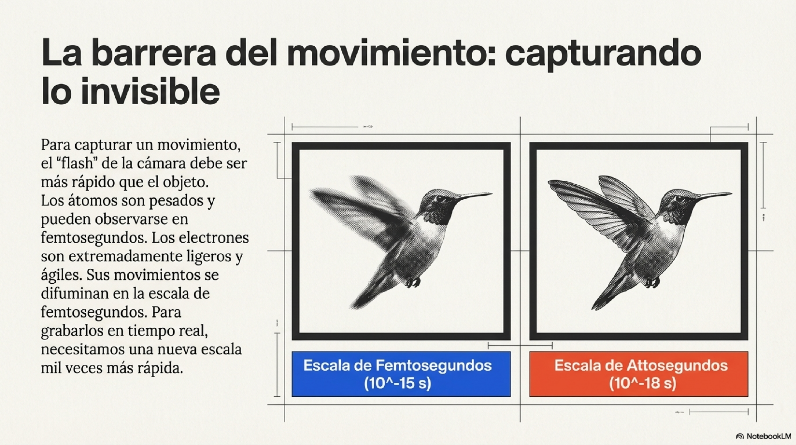

**Medición del tiempo y definición del segundo**

El tiempo se empezó a contar para cuantificar la duración de los
movimientos de objetos astronómicos: el periodo orbital de la Tierra
alrededor del Sol define un *año*, el periodo orbital de la Luna
alrededor de la Tierra define un *mes* y el tiempo que tarda la Tierra
en girar sobre su propio eje define un *día*.

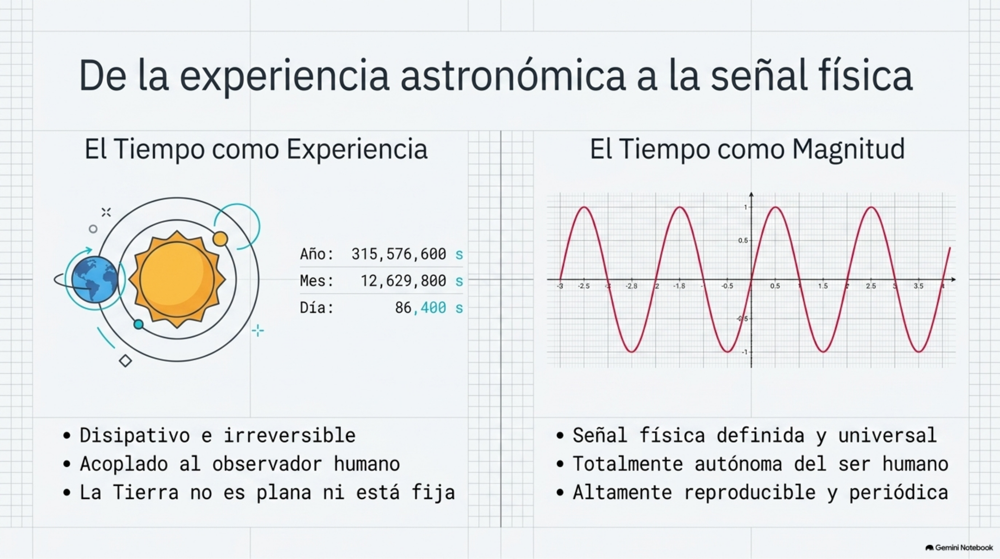

Antiguamente el tiempo era una experiencia observada, hoy es una
magnitud física medible. En la navegación antigua no había separación
clara entre medición y usuario: el ser humano era parte del sistema de
medición, como al contar campanadas u observar el paso del Sol. En
cambio, en la actualidad el sistema es autónomo y desacoplado del ser
humano. Al desarrollarse mejores métodos para medir el tiempo se operó
una transición fundamental a nivel cognitivo al pasar del tratamiento de
procesos macroscópicos disipativos e irreversibles al de osciladores
microscópicos periódicos y estables.

La Tabla 5.2 establece una comparación entre los métodos de medición del
tiempo usados por los marinos antiguos y los actuales que emplean
relojes modernos. La comparación se refiere a dos componentes que
describen la estructura y el funcionamiento de los procedimientos usados
para medir tiempos: las arquitecturas informacionales (A) y los
mecanismos de medición (M).

<table style="width: 100%; border-collapse: collapse; border: 1px solid black;">
  <tbody>
    <tr>
      <td colspan="4" style="border: 1px solid black; padding: 6px; text-align: center; vertical-align: middle; color: black;">
        <strong>Tabla 5.2. Arquitectura del sistema (A) y Mecanismo de medición (M)</strong>
      </td>
    </tr>
    <tr>
      <td style="width: 5%; border: 1px solid black; padding: 6px; text-align: center; vertical-align: middle;"></td>
      <td style="width: 22%; border: 1px solid black; padding: 6px; text-align: center; vertical-align: middle;">
        Componente
      </td>
      <td style="width: 43%; border: 1px solid black; padding: 6px; text-align: center; vertical-align: middle;">
        Navegación antigua
      </td>
      <td style="width: 30%; border: 1px solid black; padding: 6px; text-align: center; vertical-align: middle;">
        Relojes modernos
      </td>
    </tr>
    <tr>
      <td rowspan="4" style="border: 1px solid black; padding: 6px; text-align: center; vertical-align: middle;">
        A
      </td>
      <td style="border: 1px solid black; padding: 6px; text-align: center; vertical-align: middle;">
        Fuente del fenómeno
      </td>
      <td style="border: 1px solid black; padding: 6px; text-align: left; vertical-align: middle;">
        Flujo de arena, rotación terrestre (Sol/estrellas)
      </td>
      <td style="border: 1px solid black; padding: 6px; text-align: left; vertical-align: middle;">
        Oscilador físico estable (cuarzo o átomo)
      </td>
    </tr>
    <tr>
      <td style="border: 1px solid black; padding: 6px; text-align: center; vertical-align: middle;">
        Regularidad
      </td>
      <td style="border: 1px solid black; padding: 6px; text-align: left; vertical-align: middle;">
        Aproximada, dependiente del entorno
      </td>
      <td style="border: 1px solid black; padding: 6px; text-align: left; vertical-align: middle;">
        Altamente estable y controlada
      </td>
    </tr>
    <tr>
      <td style="border: 1px solid black; padding: 6px; text-align: center; vertical-align: middle;">
        Referencia
      </td>
      <td style="border: 1px solid black; padding: 6px; text-align: left; vertical-align: middle;">
        Natural (ciclos astronómicos)
      </td>
      <td style="border: 1px solid black; padding: 6px; text-align: left; vertical-align: middle;">
        Física universal (frecuencia atómica)
      </td>
    </tr>
    <tr>
      <td style="border: 1px solid black; padding: 6px; text-align: center; vertical-align: middle;">
        Control del proceso
      </td>
      <td style="border: 1px solid black; padding: 6px; text-align: left; vertical-align: middle;">
        Manual (reloj de arena)
      </td>
      <td style="border: 1px solid black; padding: 6px; text-align: left; vertical-align: middle;">
        Automático (circuitos electrónicos o lásers)
      </td>
    </tr>
    <tr>
      <td rowspan="4" style="border: 1px solid black; padding: 6px; text-align: center; vertical-align: middle;">
        M
      </td>
      <td style="border: 1px solid black; padding: 6px; text-align: center; vertical-align: middle;">
        Dispositivo base
      </td>
      <td style="border: 1px solid black; padding: 6px; text-align: left; vertical-align: middle;">
        Reloj de arena
      </td>
      <td style="border: 1px solid black; padding: 6px; text-align: left; vertical-align: middle;">
        Cuarzo / reloj atómico
      </td>
    </tr>
    <tr>
      <td style="border: 1px solid black; padding: 6px; text-align: center; vertical-align: middle;">
        Principio físico
      </td>
      <td style="border: 1px solid black; padding: 6px; text-align: left; vertical-align: middle;">
        Flujo gravitacional de arena
      </td>
      <td style="border: 1px solid black; padding: 6px; text-align: left; vertical-align: middle;">
        Oscilación mecánica o transición cuántica
      </td>
    </tr>
    <tr>
      <td style="border: 1px solid black; padding: 6px; text-align: center; vertical-align: middle;">
        Unidad de medida
      </td>
      <td style="border: 1px solid black; padding: 6px; text-align: left; vertical-align: middle;">
        Intervalos prácticos (30 min, 4 h)
      </td>
      <td style="border: 1px solid black; padding: 6px; text-align: left; vertical-align: middle;">
        Segundo definido físicamente
      </td>
    </tr>
    <tr>
      <td style="border: 1px solid black; padding: 6px; text-align: center; vertical-align: middle;">
        Reinicio
      </td>
      <td style="border: 1px solid black; padding: 6px; text-align: left; vertical-align: middle;">
        Necesario (voltear el reloj para iniciar otro ciclo)
      </td>
      <td style="border: 1px solid black; padding: 6px; text-align: left; vertical-align: middle;">
        Continuo
      </td>
    </tr>
  </tbody>
</table>

Los marinos antiguos utilizaron los relojes de arena para cuantificar el
paso del tiempo cuando navegaban en mar abierto, condiciones en las
cuales el barco vibraba y cambiaba de posición constantemente. En
consecuencia, prácticamente ningún aparato de medición que quisieran
utilizar estaba en reposo.

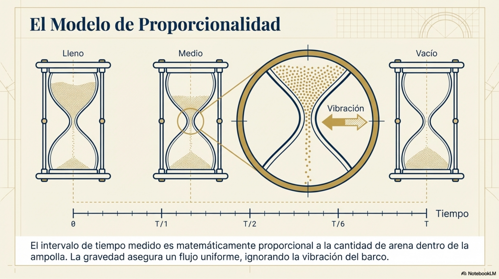

Los marinos disponían de relojes de arena que medían duraciones fijas de
30 minutos y 4 horas y por eso medían su jornada de trabajo en bloques
de 4 horas cada uno, los que contaban sonando 8 campanadas, una cada
media hora. Por otra parte, para medir la velocidad del barco lanzaban
al agua una cuerda con nudos espaciados regularmente y con la ayuda de
un reloj de arena contaban los nudos que pasaban mientras corría la
arena.

<table>
<colgroup>
<col style="width: 98%" />
<col style="width: 0%" />
<col style="width: 0%" />
</colgroup>
<thead>
<tr class="header">
<th>
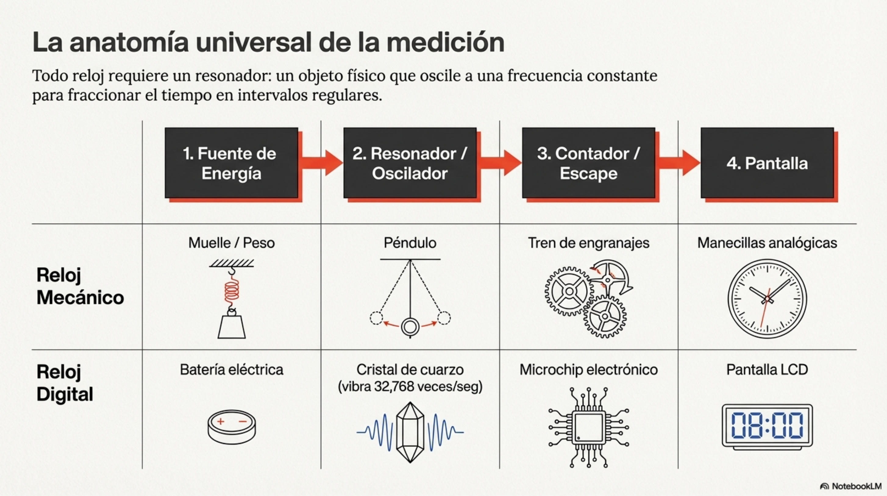

El valor del segundo como unidad de tiempo se derivó primero de
referencias astronómicas (una fracción de lo que dura una rotación de la
Tierra sobre su propio eje) y evolucionó después a definiciones basadas
en propiedades físicas (la oscilación del campo electromagnético
asociado a la transición entre niveles electrónicos).

</th>
<th></th>
<th></th>
</tr>
</thead>
<tbody>
</tbody>
</table>

Existe una coincidencia numérica entre la escala temporal del
attosegundo (1 as = 10-18 s) y la edad del universo.

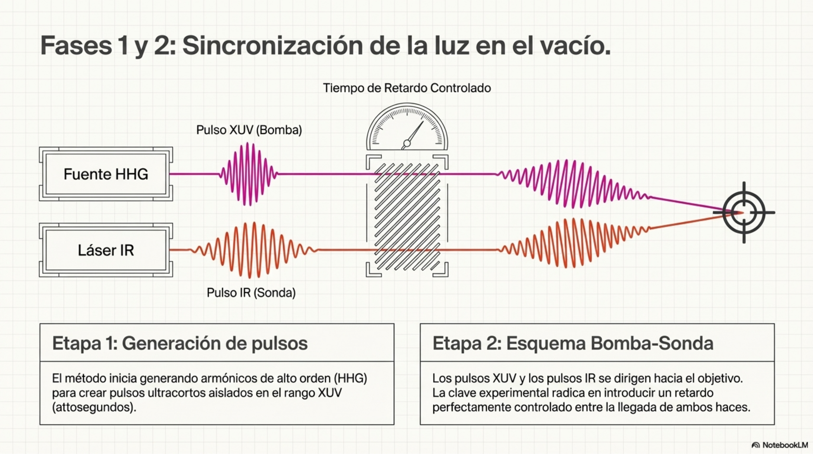

**Tipos de relojes**

Tradicionalmente, en el estudio de la medición del tiempo (la
relojería), se distingue el término reloj del término cronómetro (reloj
de mayor precisión): mientras que el primero sirve para localizar
instantes en que ocurre algún evento, el segundo cuantifica su duración
temporal medida en ciertas unidades.

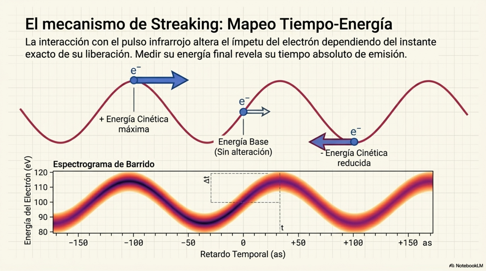

Para medir el tiempo, primero se necesita seleccionar un evento
periódico que se repita a una velocidad constante y utilizar esa
propiedad para definir una unidad básica de intervalo de tiempo, como
por ejemplo el segundo. Los sistemas de medición del tiempo cuantifican
la duración de eventos que evolucionan de un momento inicial a un
momento final posterior. La medida del tiempo es el resultado de
determinar numéricamente la duración de tales eventos en términos de la
cantidad de segundos que han transcurrido desde que el evento comenzó
hasta que terminó. En los relojes modernos se mide el tiempo
aprovechando procesos mecánicos, eléctricos o atómicos que se repiten en
intervalos regulares y predecibles.

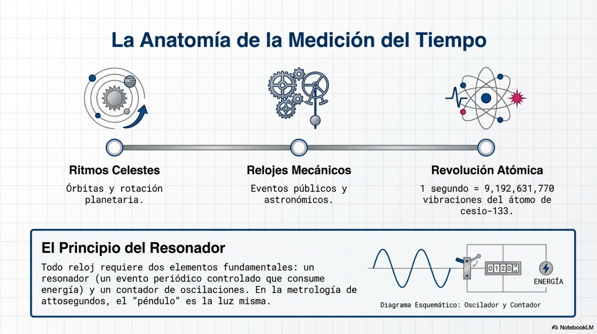

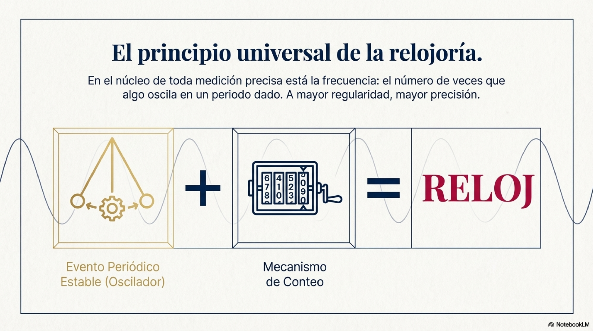

En lo que sigue hacemos un breve recorrido histórico de la evolución de
los relojes; dividiremos esa evolución en cuatro etapas, identificables
por el tipo de reloj que se utilizaba entonces: relojes primitivos,
relojes mecánicos, relojes digitales y relojes atómicos.

<u>Relojes primitivos</u>

Inicialmente se contaba el tiempo basado en la percepción que se tenía
de la evolución temporal de fenómenos naturales, posteriormente se
consideró el flujo regular de sustancias como agua o arena, así como la
cantidad de cera o incienso que se consumía al quemarse.

Fueron los antiguos egipcios y griegos quienes construyeron los primeros
relojes de Sol. La posición aparente del Sol en el cielo se modifica a
lo largo del día, reflejando el hecho de que la Tierra gira alrededor de
su propio eje, por lo que la sombra que proyecta una varilla fija sobre
una superficie plana cambia conforme pasa el tiempo cuando parece que el
Sol sube, se mueve y luego baja. Esas posiciones de la sombra de la
varilla giran al mismo tiempo que el Sol se mueve en el horizonte desde
que amanece hasta que anochece. Obviamente, es la Tierra la que gira y
el Sol quien está quieto.

Por su parte, los griegos y los chinos desarrollaron relojes de agua,
conocidos como clepsidras, donde se mide el paso del tiempo
cuantificando la cantidad líquido que sale o entra de manera regular a
un recipiente. Si el flujo es aproximadamente constante, el volumen de
agua en movimiento será la medida del tiempo que tarda el agua en entrar
o en salir.

En la Europa medieval (siglos V a XV), los relojes de vela la cantidad
de cera derretida indicaba el tiempo transcurrido. En los relojes de
arena, que aparecieron hace unos 1200 años, la cantidad de material en
movimiento no se agota, se vuelve a utilizar simplemente volteando el
reloj.

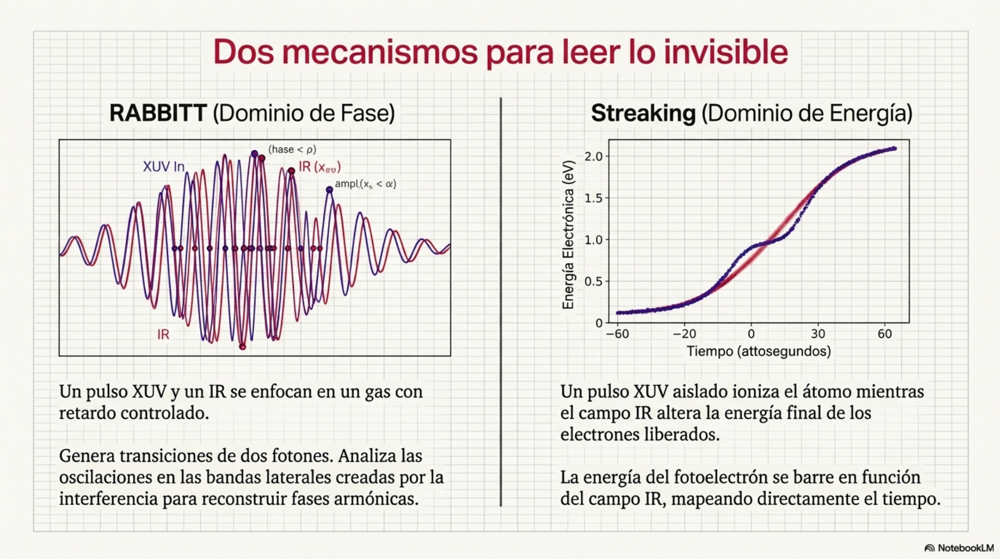

<u>Relojes mecánicos</u>

Los relojes mecánicos miden el tiempo mediante el movimiento controlado
de engranajes impulsados por una fuente de energía y regulados por un
oscilador periódico. Usan la energía que liberan pesas o resortes que
luego regula un escape y estabiliza un péndulo que oscila
periódicamente. A medida que giran los engranajes se mueven las
manecillas del reloj y el tiempo transcurre. Se mide el tiempo contando
oscilaciones.

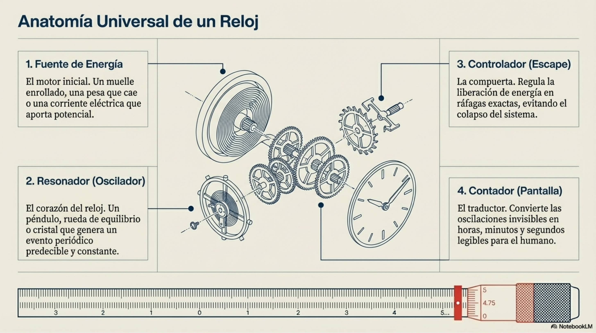

El primer reloj de engranajes conocido fue inventado por Arquímedes
durante el siglo III a.C. Tal reloj consistía en un sistema de cuatro
pesos, contrapesos y cuerdas regulados por un sistema de flotadores en
un recipiente de agua con sifones que regulaban su funcionamiento
automático. El siguiente avance en precisión se dio con la invención del
reloj de péndulo, construido en 1656 por Christiaan Huygens, quien se
apoyó en el descubrimiento que realizara Galileo en los años 1580 cuando
se topó con la isocronía de las oscilaciones del péndulo: para pequeñas
oscilaciones el tiempo de cada oscilación permanecía prácticamente
constante.

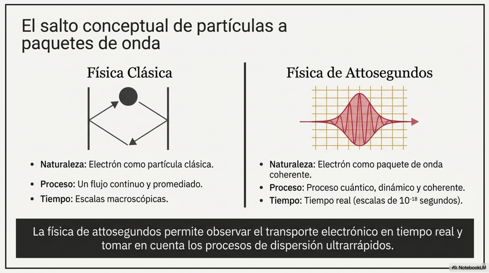

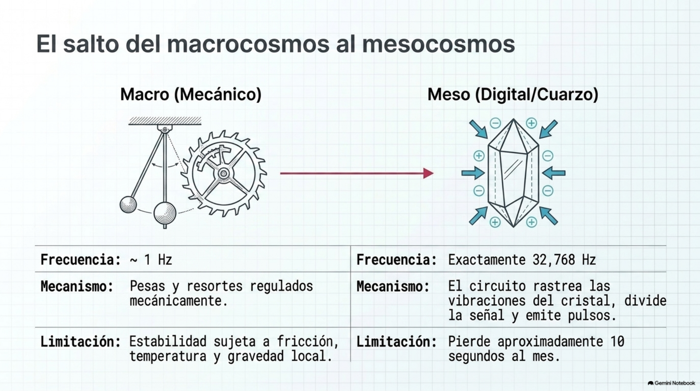

<u>Relojes digitales</u>

Estos relojes funcionan con electricidad y para generarla utilizan
circuitos eléctricos y cristales de cuarzo. Para estabilizar el
movimiento periódico que se usa para medir el tiempo, los relojes
eléctricos utilizan oscilaciones eléctricas o motores síncronos,
generalmente a frecuencias como la de la red eléctrica (50/60 Hz).
Emplean esta energía para generar una oscilación para medir el tiempo y
mantener constante la energía del sistema que lo hace funcionar sin
detenerse ni amortiguarse. El primer reloj eléctrico se construyó en
1815 en Londres.

Por otra parte, los relojes de cuarzo funcionan debido a la propiedad de
piezoelectricidad que tienen esos cristales. En el efecto piezoeléctrico
directo se produce electricidad cuando se aplica una presión mecánica
sobre el cristal, mientras que en el efecto inverso aparecen
modificaciones mecánicas tales como vibraciones cuando se aplica un
voltaje externo. Son conversiones directas entre energía mecánica y
energía eléctrica: al deformarse el cristal se separan cargas y se
genera un voltaje, mientras que al aplicar voltaje las cargas se
reorganizan y el material se deforma. Se estima que estos relojes
pierden solo unos 10 segundos al mes. El primer reloj de cuarzo fue
construido en 1927 en los laboratorios Bell Telephone.

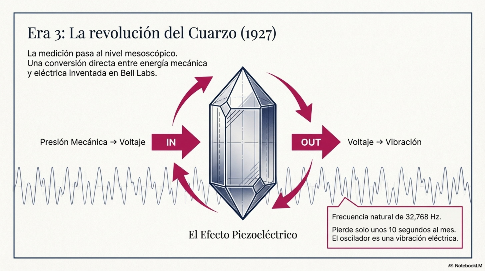

<u>Relojes atómicos</u>

Un reloj atómico usa átomos que funcionan como osciladores para
transformar las energías de transiciones cuánticas en señales de
frecuencias bien definidas. No mide el tiempo directamente: mide
frecuencias con precisión extrema y las convierte en tiempo. Los relojes
atómicos contienen una fuente de átomos de cesio o rubidio que llegan a
una cavidad de microondas donde sufren las transiciones energéticas que
producen las oscilaciones utilizadas para medir el tiempo. El primer
reloj atómico fue desarrollado en 1949 en el National Bureau of
Standards. En la actualidad existen sistemas de tiempo satelital
conformados por redes sincronizadas de relojes a bordo de satélites,
como las que se usan en sistemas de posicionamiento global (Global
Positioning System) cuyas precisiones son del orden de los nanosegundos.

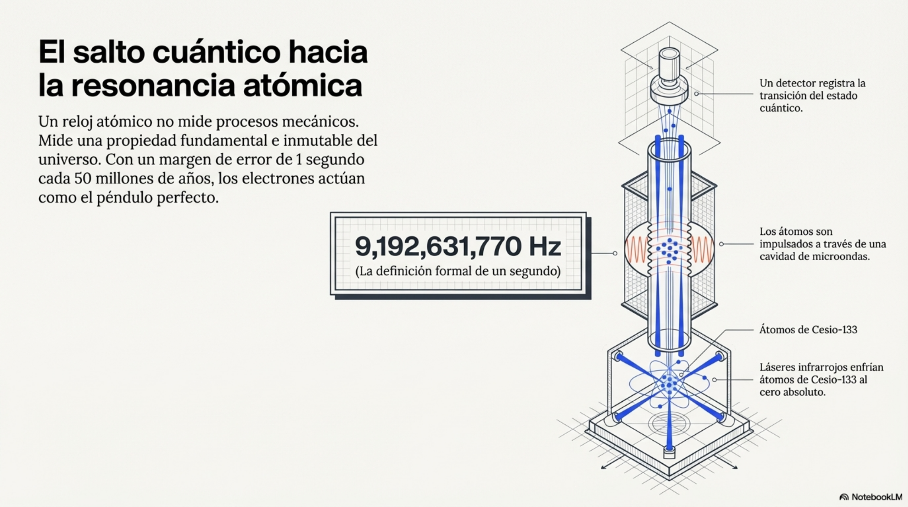

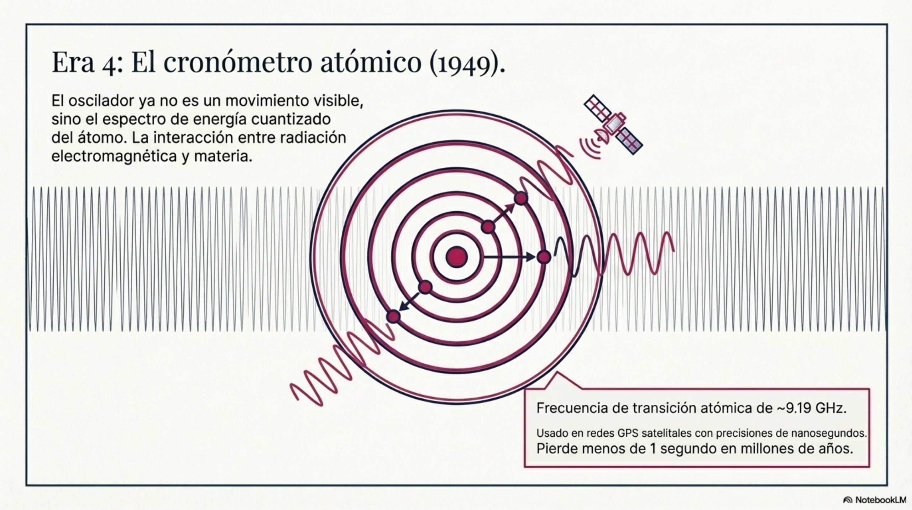

<u>Semejanzas y diferencias en los relojes modernos</u>

Aunque los relojes mecánicos, los de cuarzo y los atómicos sean
resultados de procesos tecnológicos diferentes, los tres relojes son
variantes de un mismo principio: utilizan un fenómeno periódico para
medir el tiempo (un tiempo que se mide contando ciclos de oscilación de
un proceso periódico estable). Todos estos relojes tienen en común un
oscilador, una interacción, una medición y un proceso de comparación.
Además, los tres relojes mantienen la misma arquitectura informacional
cuyas componentes son: oscilador estable, conteo de ciclos, control de
referencia y lectura del tiempo.

Todos los relojes modernos miden frecuencias: en el reloj mecánico es
una oscilación mecánica, en el reloj de cuarzo es una vibración
eléctrica y en el reloj atómico es una transición cuántica. En cada
reloj son diferentes: el nivel de operación, el factor que produce las
oscilaciones, la naturaleza del oscilador y la estabilidad de su
funcionamiento.

- En el reloj mecánico el nivel es macroscópico, el factor es el
  movimiento, el oscilador es visible como un péndulo y su estabilidad
  depende de la temperatura, la fricción y el valor de la aceleración de
  la gravedad del entorno.

- En el reloj de cuarzo el nivel es mesoscópico, el factor es la
  oscilación eléctrica del cristal, el oscilador mantiene una frecuencia
  más constante y su estabilidad depende de las propiedades
  piezoeléctricas del material.

- En el reloj atómico el nivel es microscópico, el factor es la
  estructura discreta de las oscilaciones, la naturaleza del oscilador
  está determinada por su espectro de energía cuantizada y su
  estabilidad depende de una propiedad fundamental de la naturaleza que
  es universal e invariante: la cuantización de la radiación
  electromagnética.

La siguiente Tabla 5.3 compara diversas características de los relojes
modernos.

<table style="width: 100%; border-collapse: collapse; border: 1px solid black;">
  <tbody>
    <tr>
      <td colspan="4" style="border: 1px solid black; padding: 6px; text-align: center; vertical-align: middle; color: black;">
        <strong>Tabla 5.3. Comparación estructural de componentes</strong>
      </td>
    </tr>
    <tr>
      <td style="width: 25%; border: 1px solid black; padding: 6px; text-align: center; vertical-align: middle;">
        Componente
      </td>
      <td style="width: 24%; border: 1px solid black; padding: 6px; text-align: center; vertical-align: middle;">
        Reloj mecánico
      </td>
      <td style="width: 26%; border: 1px solid black; padding: 6px; text-align: center; vertical-align: middle;">
        Reloj de cuarzo
      </td>
      <td style="width: 25%; border: 1px solid black; padding: 6px; text-align: center; vertical-align: middle;">
        Reloj atómico
      </td>
    </tr>
    <tr>
      <td style="border: 1px solid black; padding: 6px; text-align: center; vertical-align: middle;">
        Oscilador
      </td>
      <td style="border: 1px solid black; padding: 6px; text-align: left; vertical-align: middle;">
        Péndulo o volante
      </td>
      <td style="border: 1px solid black; padding: 6px; text-align: left; vertical-align: middle;">
        Cristal de cuarzo
      </td>
      <td style="border: 1px solid black; padding: 6px; text-align: left; vertical-align: middle;">
        Transición atómica
      </td>
    </tr>
    <tr>
      <td style="border: 1px solid black; padding: 6px; text-align: center; vertical-align: middle;">
        Principio físico
      </td>
      <td style="border: 1px solid black; padding: 6px; text-align: left; vertical-align: middle;">
        Mecánica clásica
      </td>
      <td style="border: 1px solid black; padding: 6px; text-align: left; vertical-align: middle;">
        Efecto piezoeléctrico
      </td>
      <td style="border: 1px solid black; padding: 6px; text-align: left; vertical-align: middle;">
        Mecánica cuántica
      </td>
    </tr>
    <tr>
      <td style="border: 1px solid black; padding: 6px; text-align: center; vertical-align: middle;">
        Frecuencia típica
      </td>
      <td style="border: 1px solid black; padding: 6px; text-align: center; vertical-align: middle;">
        ~1 Hz
      </td>
      <td style="border: 1px solid black; padding: 6px; text-align: center; vertical-align: middle;">
        ~ 32,768 Hz
      </td>
      <td style="border: 1px solid black; padding: 6px; text-align: center; vertical-align: middle;">
        ~ 9.19 GHz
      </td>
    </tr>
    <tr>
      <td style="border: 1px solid black; padding: 6px; text-align: center; vertical-align: middle;">
        Fuente de energía
      </td>
      <td style="border: 1px solid black; padding: 6px; text-align: left; vertical-align: middle;">
        Pesas o resorte
      </td>
      <td style="border: 1px solid black; padding: 6px; text-align: left; vertical-align: middle;">
        Batería
      </td>
      <td style="border: 1px solid black; padding: 6px; text-align: left; vertical-align: middle;">
        Campos electromagnéticos
      </td>
    </tr>
    <tr>
      <td style="border: 1px solid black; padding: 6px; text-align: center; vertical-align: middle;">
        Regulación
      </td>
      <td style="border: 1px solid black; padding: 6px; text-align: left; vertical-align: middle;">
        Escape mecánico
      </td>
      <td style="border: 1px solid black; padding: 6px; text-align: left; vertical-align: middle;">
        Circuito electrónico
      </td>
      <td style="border: 1px solid black; padding: 6px; text-align: left; vertical-align: middle;">
        Resonancia y retroalimentación
      </td>
    </tr>
    <tr>
      <td style="border: 1px solid black; padding: 6px; text-align: center; vertical-align: middle;">
        Señal generada
      </td>
      <td style="border: 1px solid black; padding: 6px; text-align: left; vertical-align: middle;">
        Movimiento periódico
      </td>
      <td style="border: 1px solid black; padding: 6px; text-align: left; vertical-align: middle;">
        Señal eléctrica
      </td>
      <td style="border: 1px solid black; padding: 6px; text-align: left; vertical-align: middle;">
        Transición cuántica
      </td>
    </tr>
    <tr>
      <td style="border: 1px solid black; padding: 6px; text-align: center; vertical-align: middle;">
        Dispositivo para contar el tiempo
      </td>
      <td style="border: 1px solid black; padding: 6px; text-align: left; vertical-align: middle;">
        Engranajes
      </td>
      <td style="border: 1px solid black; padding: 6px; text-align: left; vertical-align: middle;">
        Divisor digital
      </td>
      <td style="border: 1px solid black; padding: 6px; text-align: left; vertical-align: middle;">
        Contador de frecuencias
      </td>
    </tr>
    <tr>
      <td style="border: 1px solid black; padding: 6px; text-align: center; vertical-align: middle;">
        Precisión
      </td>
      <td style="border: 1px solid black; padding: 6px; text-align: left; vertical-align: middle;">
        Segundo/día
      </td>
      <td style="border: 1px solid black; padding: 6px; text-align: left; vertical-align: middle;">
        Segundo/mes
      </td>
      <td style="border: 1px solid black; padding: 6px; text-align: left; vertical-align: middle;">
        Segundo/millones de años
      </td>
    </tr>
  </tbody>
</table>

**Participación del láser en el funcionamiento de los relojes atómicos**

Un reloj atómico mide el tiempo aprovechando que los átomos de un mismo
elemento emiten luz a la frecuencia natural que produce una transición
energética entre niveles electrónicos definidos; esta frecuencia no es
visible.

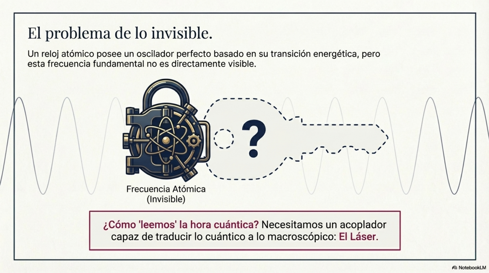

Mediante el proceso cuántico de emisión estimulada, el láser (Light
Amplification by Stimulated Emission of Radiation) convierte energía en
una radiación. El láser no solo emite luz, sino que la organiza cuando
produce fotones sincronizados en fase, frecuencia y dirección. El láser
permite convertir una propiedad cuántica invisible (la frecuencia
atómica) en una señal macroscópica medible que puede contarse como
tiempo transcurrido.

Un láser típico tiene tres componentes fundamentales: un medio activo
constituido por átomos que pueden emitir fotones, un mecanismo de bombeo
óptico que actúa como fuente de energía que provoca una inversión de la
población según la cual hay más átomos en estados excitados que en el
estado fundamental y una cavidad resonante conformada por dos espejos
enfrentados: uno completamente transparente y otro solo parcialmente.

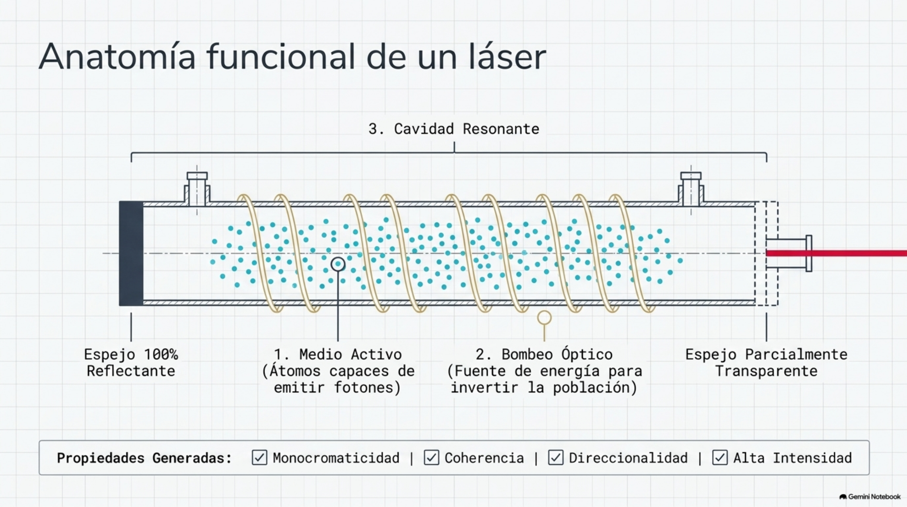

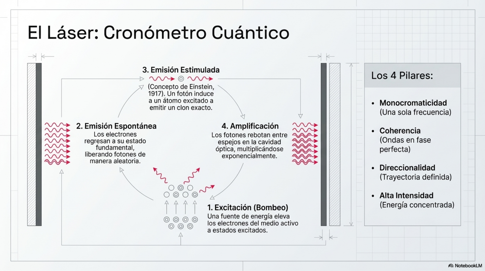

El funcionamiento del láser comprende las siguientes etapas: 1. Bombeo
para excitar al sistema, 2. Inversión de población, 3. Emisión
espontánea, 4. Emisión estimulada, 5. Amplificación óptica y 6. Emisión
láser.

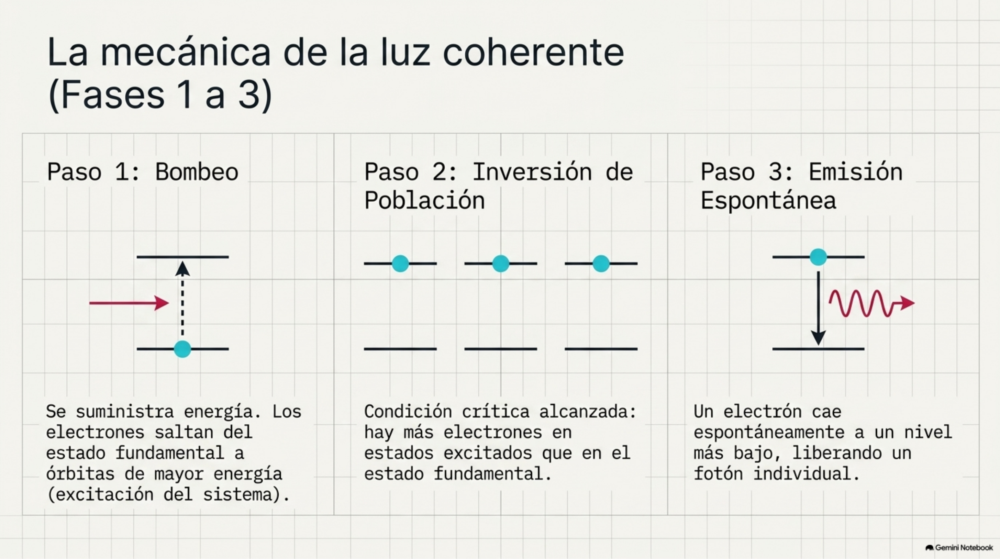

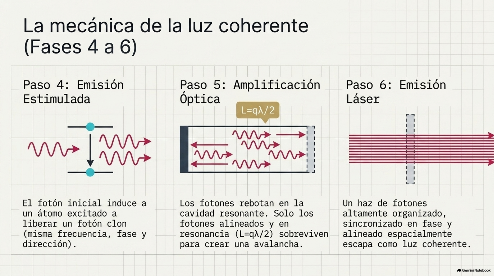

El láser cumple tres funciones simultáneas en los relojes atómicos: (1)
es una sonda que prueba, (2) establece una regla de ajuste y (3) se
convierte en un oscilador.

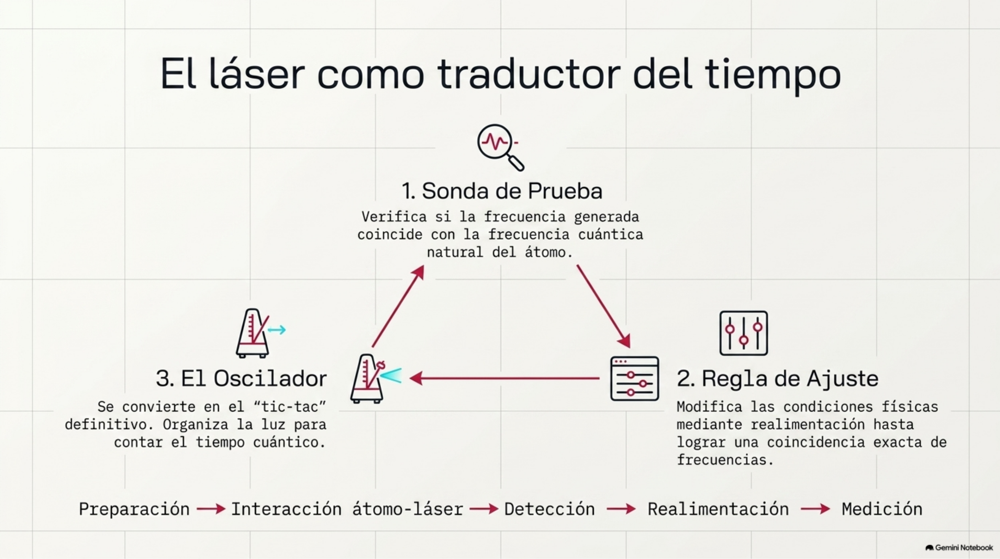

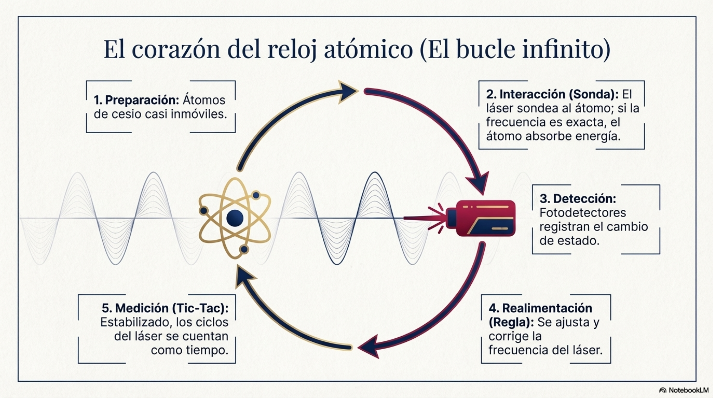

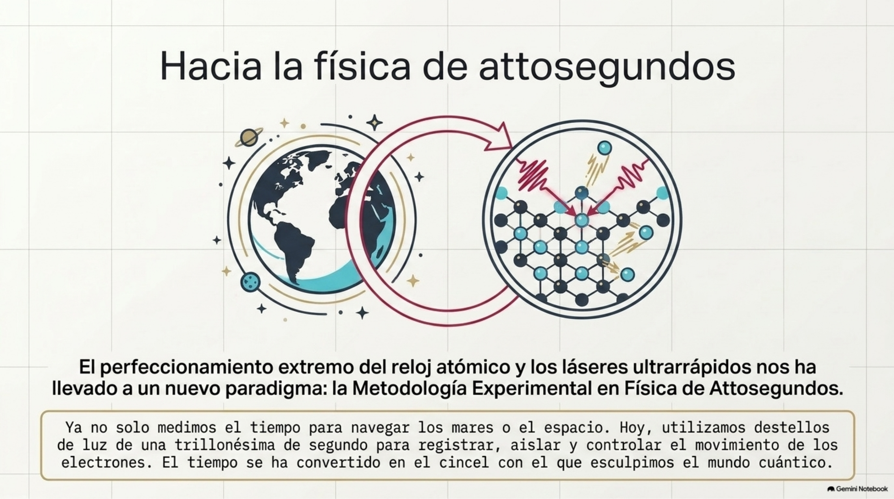
