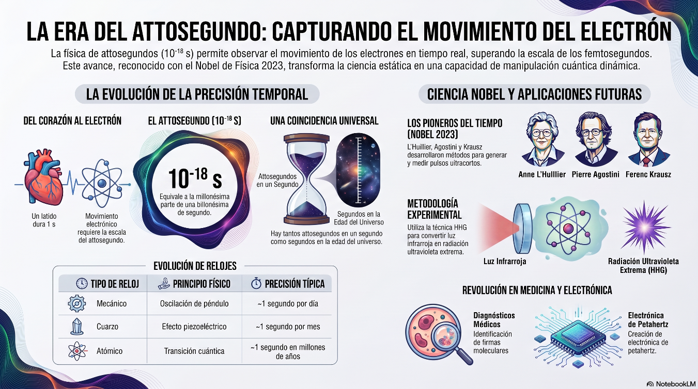
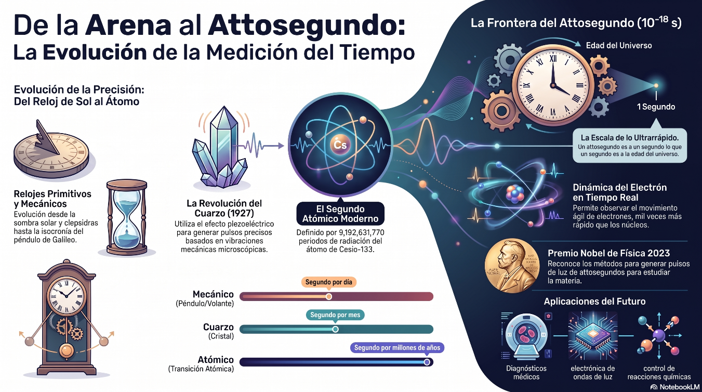
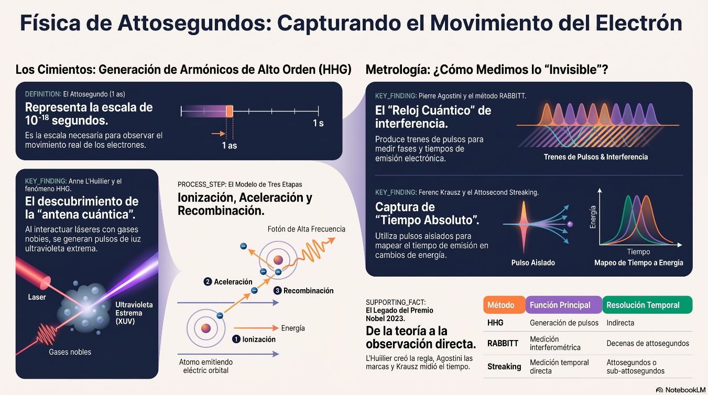
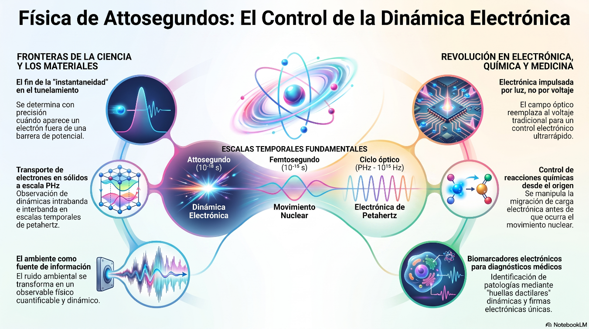
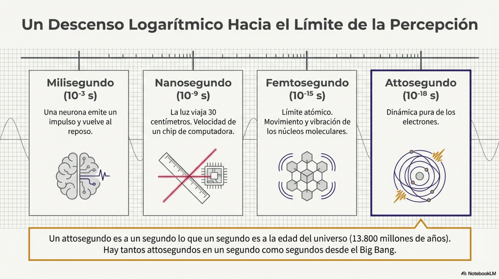

# Capítulo 5: Dinámica ultrarrápida del electrón

Los átomos y los núcleos son grandes y pesados, sus movimientos se miden
en femtosegundos (1 fs = 10-15 s), mientras que los
electrones son ligeros y ágiles; se mueven tan rápido que sus cambios
deben medirse en attosegundos (1 as = 10-18 s), que son mil
veces más cortos que los femtosegundos.

La brevedad temporal del attosegundo como unidad se refleja en la
magnitud de lo que se puede detectar y describir. La velocidad de la luz
es 3. 0 x 108 m/s, el radio del átomo mide algunos angstroms
(1 Å = 10-10 m) y el radio estimado del electrón es 2.82 x
10-15 m. Esto significa que la luz atraviesa un átomo en
tiempos del orden de 3.0 x 10-19 s y un electrón como en 3.0
x 10-24 s. Evidentemente la luz no atraviesa estas
estructuras microscópicas como si fueran esferitas diminutas. No se
trata de medir los tiempos de esos tránsitos directos a través de lo muy
muy pequeño, sino de tener una idea de la duración de las interacciones
de la luz con esas estructuras. La evolución en la manera de medir el
tiempo es la historia de los relojes como ventanas para percibir y
contabilizar duraciones.

El desarrollo gradual e integrado de los métodos para generar, medir y
aplicar pulsos de luz con una duración de attosegundos ha permitido
conformar una Metodología Experimental en la física de attosegundos.

Hoy en día la ciencia de los attosegundos ha cambiado fundamentalmente
nuestra perspectiva; hemos pasado de analizar los niveles estáticos de
la energía en el mundo cuántico al desarrollo de una capacidad para
observar, medir y manipular procesos ultrarrápidos en evolución. En esto
consiste registrar e interpretar el movimiento de los electrones en
tiempo real. Es el paso de la evolución de la percepción y el control de
lo que tardan los procesos en el átomo para llegar a los procesos en los
electrones.

Todas las imágenes incluidas en este capítulo han sido generadas por el
Programa NotebookLM basadas en fuentes generadas por el autor.

**OBJETIVOS Y CONTENIDOS DE LAS SECCIONES**

**5.1. Movimientos en diferentes escalas de tiempo**

Describir la duración en segundos de algunos fenómenos físicos y
explicar el funcionamiento de algunos relojes.

<ul>
  <li>Medición del tiempo y definición del segundo</li>
  <li>Tipos de relojes</li>
    <ul style="list-style-type: none; padding-left: 30px;">
      <li>Relojes primitivos</li>
      <li>Relojes mecánicos</li>
      <li>Relojes digitales</li>
      <li>Relojes atómicos</li>
      <li>Semejanzas y diferencias en los relojes modernos</li>
    </ul>
  <li>Participación del láser en el funcionamiento de los relojes atómicos</li>
</ul>

  
**5.2. Nacimiento de la Física de attosegundos**

Explicar los experimentos realizadas por quienes obtuvieron el Premio
Nobel de Física 2023: Anne L'Huillier, Pierre Agostini y Ferenc Krausz.

<ul>
<li>Contribuciones de Anne L´Huillier y colaboradores</li>
<li>Contribuciones de Pierre Agostini y colaboradores</li>
<li>Contribuciones de Ferenc Krausz y colaboradores</li>
<li>Metodología Experimental de la Física de Attosegundos</li>
</ul>

  
**5.3. Aplicaciones de la física de attosegundos**

Describir algunos casos que muestran cómo la física de attosegundos ha
permitido dominar la dinámica electrónica como agente de control
efectivo de transformaciones en las propiedades de la materia para pasar
de la mera observación teórica a la nueva ingeniería cuántica.

Aplicaciones en Física fundamental

<ul>
<li>Determinación del tiempo de tunelización</li>
<li>Sondeo de la correlación y el entrelazamiento de electrones</li>
<li>Transporte de electrones en sólidos </li>
<li>Efectos ambientales en la dinámica electrónica</li>
<li>Electrónica de ondas de luz</li>
<li>Estados cuánticos en materiales y nanoestructuras</li>
<li>Migración de cargas en átomos y moléculas</li>
<li>Control de reacciones químicas</li>
<li>Identificación de moléculas en muestras biológicas</li>
<li>Realización de diagnósticos de enfermedades</li>
</ul>

<table style="width: 100%; border-collapse: collapse; border: 1px solid black;">
  <tbody>
    <tr>
      <td colspan="2" style="border: 1px solid black; padding: 6px; text-align: center; vertical-align: middle; color: black;">
        <strong>Tabla 5.1. Fenómenos físicos descritos con diferentes unidades de tiempo</strong>
      </td>
    </tr>
    <tr>
      <td style="width: 38%; border: 1px solid black; padding: 6px; text-align: center; vertical-align: middle;">
        Unidad
      </td>
      <td style="width: 62%; border: 1px solid black; padding: 6px; text-align: center; vertical-align: middle;">
        Fenómeno
      </td>
    </tr>
    <tr>
      <td style="border: 1px solid black; padding: 6px; text-align: center; vertical-align: middle;">
        Segundo (1 s)
      </td>
      <td style="border: 1px solid black; padding: 6px; text-align: left; vertical-align: middle;">
        Duración de un latido humano.
      </td>
    </tr>
    <tr>
      <td style="border: 1px solid black; padding: 6px; text-align: center; vertical-align: middle;">
        Decisegundo (1 ds = 10-1 s)
      </td>
      <td style="border: 1px solid black; padding: 6px; text-align: left; vertical-align: middle;">
        Duración de un solo parpadeo: (1 – 4) s.
      </td>
    </tr>
    <tr>
      <td style="border: 1px solid black; padding: 6px; text-align: center; vertical-align: middle;">
        Centisegundo (1 cs = 10-2 s)
      </td>
      <td style="border: 1px solid black; padding: 6px; text-align: left; vertical-align: middle;">
        Reflejo humano a estímulos visuales: (10 – 20) cs.
      </td>
    </tr>
    <tr>
      <td style="border: 1px solid black; padding: 6px; text-align: center; vertical-align: middle;">
        Milisegundo (1 ms = 10-3 s)
      </td>
      <td style="border: 1px solid black; padding: 6px; text-align: left; vertical-align: middle;">
        Tiempo de disparo de una neurona: 1 ms.
      </td>
    </tr>
    <tr>
      <td style="border: 1px solid black; padding: 6px; text-align: center; vertical-align: middle;">
        Microsegundo (1 μs = 10-6 s)
      </td>
      <td style="border: 1px solid black; padding: 6px; text-align: left; vertical-align: middle;">
        Vida útil de un muón: 2.2 μs.
      </td>
    </tr>
    <tr>
      <td style="border: 1px solid black; padding: 6px; text-align: center; vertical-align: middle;">
        Nanosegundo (1 ns = 10-9 s)
      </td>
      <td style="border: 1px solid black; padding: 6px; text-align: left; vertical-align: middle;">
        Tiempo que tarda la luz en recorrer 30 cm: 1 ns.
      </td>
    </tr>
    <tr>
      <td style="border: 1px solid black; padding: 6px; text-align: center; vertical-align: middle;">
        Picosegundo (1 ps = 10-12 s)
      </td>
      <td style="border: 1px solid black; padding: 6px; text-align: left; vertical-align: middle;">
        Vida media de un quark bottom: 1 ps.
      </td>
    </tr>
    <tr>
      <td style="border: 1px solid black; padding: 6px; text-align: center; vertical-align: middle;">
        Femtosegundo (1 fs = 10-15 s)
      </td>
      <td style="border: 1px solid black; padding: 6px; text-align: left; vertical-align: middle;">
        Periodo de vibración de una molécula de hidrógeno: 7.58 fs.
      </td>
    </tr>
    <tr>
      <td style="border: 1px solid black; padding: 6px; text-align: center; vertical-align: middle;">
        Attosegundo (1 as = 10-18 s)
      </td>
      <td style="border: 1px solid black; padding: 6px; text-align: left; vertical-align: middle;">
        Pulso más corto de un láser de electrones: 53 as.
      </td>
    </tr>
    <tr>
      <td style="border: 1px solid black; padding: 6px; text-align: center; vertical-align: middle;">
        Zeptosegundo (1 zs = 10-21 s)
      </td>
      <td style="border: 1px solid black; padding: 6px; text-align: left; vertical-align: middle;">
        Tiempo que tarda un fotón en atravesar una molécula de hidrógeno: 247 zs.
      </td>
    </tr>
    <tr>
      <td style="border: 1px solid black; padding: 6px; text-align: center; vertical-align: middle;">
        Octosegundo (1 ys = 10-24 s)
      </td>
      <td style="border: 1px solid black; padding: 6px; text-align: left; vertical-align: middle;">
        Vida media de un bosón de Higgs: 156 ys.
      </td>
    </tr>
    <tr>
      <td style="border: 1px solid black; padding: 6px; text-align: center; vertical-align: middle;">
        Rontosegundo (1 rs = 10-27 s)
      </td>
      <td style="border: 1px solid black; padding: 6px; text-align: left; vertical-align: middle;">
        Vida útil media de los bosones W y Z: 300 rs.
      </td>
    </tr>
  </tbody>
</table>

