Este es el primer capítulo del segundo volumen de la serie Temas de
Física Moderna, el dedicado a la Energía, uno de los conceptos claves en
el estudio de los fenómenos físicos. Como su título lo indica,
trataremos tres temas:

- la Energía como fuente de transformaciones derivadas del conocimiento
  de las leyes fundamentales de la termodinámica y la mecánica clásica,
  apoyadas en la existencia de leyes de conservación que son
  consecuencia de propiedades de simetría en el comportamiento de la
  naturaleza;

- la Tecnología como escenario de desarrollos y aplicaciones de
  procedimientos prácticos con el fin de diseñar y realizar acciones que
  buscan resolver problemas, satisfacer necesidades, generar productos y
  servicios, o transformar situaciones que generalmente implican
  intercambios de energía, y

- la Comunicación como vehículo de transferencia de información y
  conocimientos acerca de circunstancias y procesos relacionados en este
  caso con el diseño, la explicación y la construcción de dispositivos
  tecnológicos que han tenido repercusiones económicas, culturales y
  sociales.

La evolución histórica de estos temas es consecuencia de una interacción
creativa entre el rigor del saber científico acerca de la energía, el
uso eficiente de los recursos tecnológicos proporcionados por máquinas y
dispositivos y la comunicación estructurada de los mecanismos sociales
de interacción y colaboración que puede derivarse del análisis de la
evolución de espacios y circunstancias como los escenarios
antropológicos característicos del desarrollo de la inteligencia
colectiva.

Como ejemplo de aplicación, circunscribimos el análisis de la
interacción energía-tecnología-comunicación a la explicación de dos
fenómenos físicos inversos: mientras que en las fotoceldas ocurre que la
incidencia de radiación sobre la superficie de un metal provoca la
generación de una corriente de electrones en los diodos de emisión de
luz (LED) es la circulación de una corriente de electrones en el
interior de un semiconductor la que provoca emisión de luz.

Además, en este capítulo explicamos la interacción
energía-tecnología-comunicación mediante la descripción de ejemplos de
aplicación de la Cuarteta de la Comunicación, que es una herramienta
estratégica diseñada para organizar, representar y transmitir
información y conocimiento. Sus componentes son: los **Diagramas** que
proporcionan una síntesis visual estructurada de flujos y procesos; los
**Diseños** que muestran las características de soluciones y de
prototipos de utilidad en la validación técnica de productos y
servicios; los **Diálogos** que reflejan la **c**onstrucción
colaborativa de significados que ayudan a establecer protocolos de
comunicación factibles y productivos y los **Discursos** que
corresponden a narrativas de legitimación y difusión características de
innovación y liderazgo, como es el caso de las Conferencias Nobel que
consideramos en esta sección.

Las diapositivas e infografías contenidas en este capítulo han sido
generadas por el programa NotebookLM basadas en documentos elaborados
por el autor.

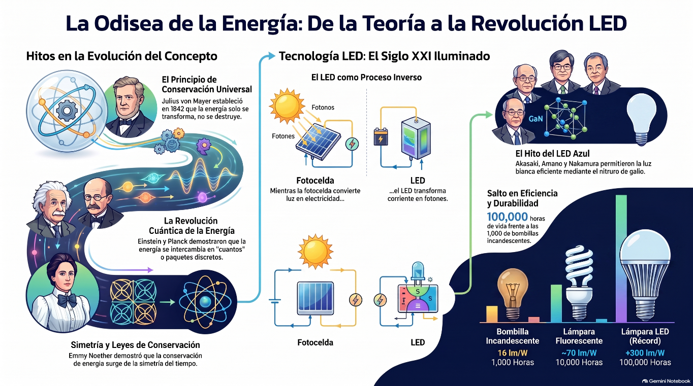

**OBJETIVOS Y CONTENIDOS DE LAS SECCIONES**

**6.1. La energía, sus transformaciones y condiciones de conservación**

Considerar ejemplos prácticos de transformaciones energéticas en
sistemas tales como el Sol, la turbina hidroeléctrica, el motor de
combustión interna y el cuerpo humano.

Describir en qué consisten el principio de mínima acción de Hamilton y
el teorema de Noether que conecta la existencia de leyes de conservación
con propiedades invariantes de transformaciones matemáticas asociadas a
propiedades de simetría.

Mostrar las principales etapas en la evolución del concepto de energía y
describir los datos bibliográficos de algunas publicaciones relevantes.

- El concepto de energía y las transformaciones energéticas

- Relación entre las leyes de conservación y las propiedades de simetría

- Etapas y publicaciones que describen la evolución del concepto de
  energía

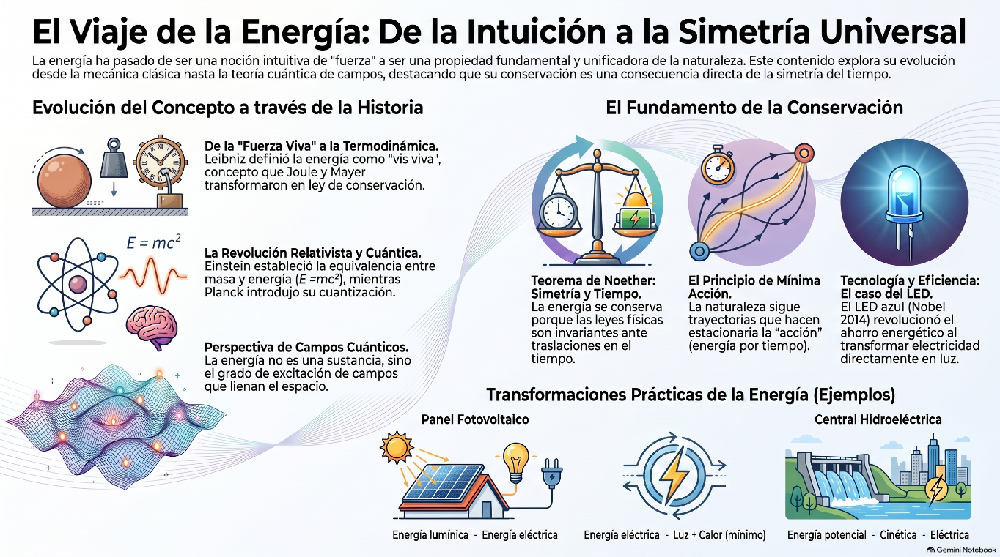

**6.2. Transformaciones de energía y funcionamiento de fotoceldas y
diodos emisores de luz (LED)**

Describir los desarrollos conceptuales y las aplicaciones tecnológicas
mayormente conectadas con transformaciones energéticas que caracterizan
a los espacios antropológicos asociados a la Tierra, el Territorio, las
Mercancías y el Conocimiento.

Discutir el funcionamiento y las aplicaciones de dos dispositivos
fuertemente conectados con el uso de la energía: las fotoceldas y los
diodos emisores de luz (LED).

Explicar las razones por las cuales el Premio Nobel de Física de 2014
fue otorgado a tres investigadores japoneses "por la invención de diodos
emisores de luz azul eficientes que han hecho posibles fuentes de luz
blanca brillante ahorradoras de energía".

- Desarrollos conceptuales y aplicaciones tecnológicas de la energía en
  espacios antropológicos

- Fotoceldas y diodos emisores de luz (LED)

La fotocelda como dispositivo transformador de energía

El diodo emisor de luz como dispositivo ahorrador de energía

- Premio Nobel de Física de 2014 a Isamu Akasaki**,** Hiroshi Amano
  **y** Shuji Nakamura

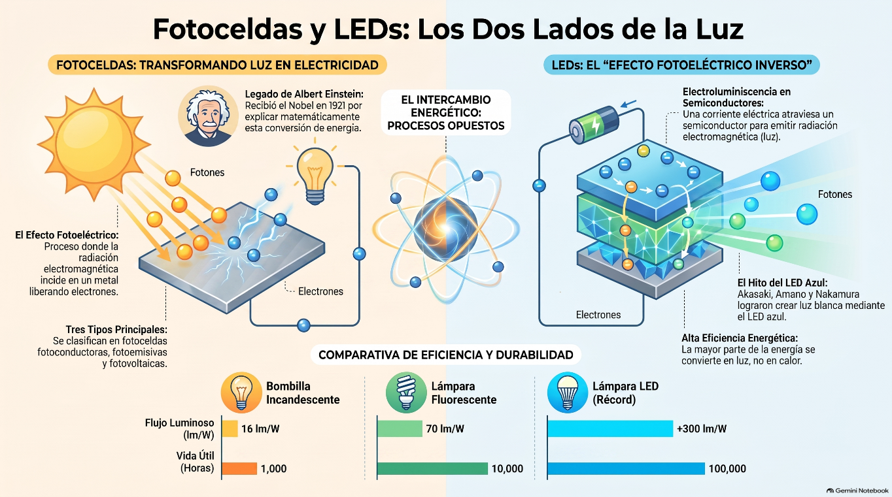

**6.3. La cuarteta de la comunicación**

Describir los componentes de la cuarteta de la comunicación (Diagramas,
Diseños, Diálogos y Discursos) y dar ejemplos de aplicación de estas
formas de organizar y representar significados. Estos ejemplos expresan
distintas maneras de construir y transmitir información y conocimiento
según las características de la cuarteta de la comunicación.

- Componentes de la cuarteta de la comunicación

- Ejemplo de Diagrama: procesos tecnológicos de transformación
  energética

- Ejemplo de Diseño: representación gráfica de estructuras y procesos

- Ejemplo de Diálogo: Albert Einstein y Willis Lamb acerca del concepto
  de fotón

- Ejemplo de Discurso: Conferencia Nobel de Kai Siegbahn acerca de
  espectroscopía electrónica

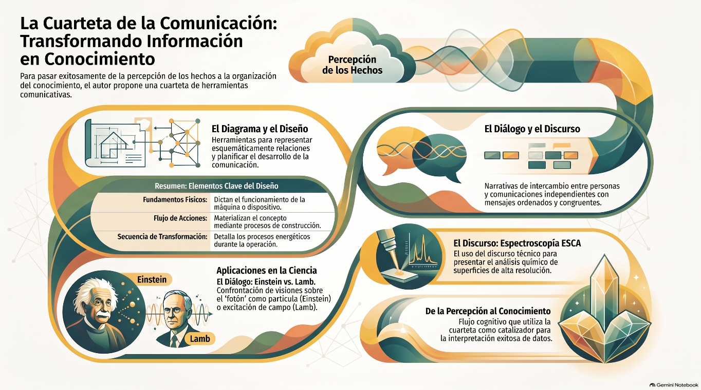

**6.1. La energía, sus transformaciones y condiciones de conservación**

Este capítulo trata del tema de la energía desde la perspectiva de un
ciclo del conocimiento científico que conecta el concepto (qué es la
energía), la aplicación (cómo se aplica la tecnología) y la
transferencia (de qué manera se comunica).

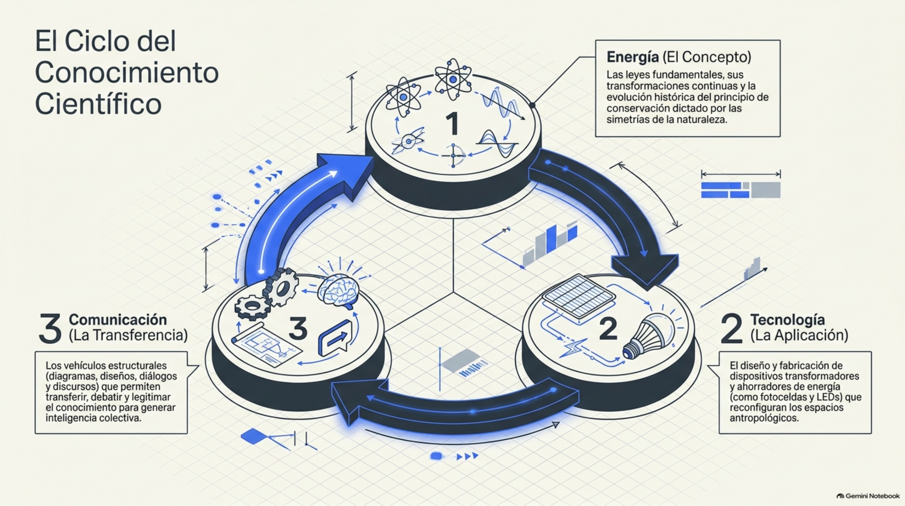

El significado del concepto de energía evolucionó desde una noción
intuitiva de "capacidad para producir trabajo" hasta convertirse en una
magnitud universal asociada a las simetrías fundamentales de la
naturaleza. Pasó de ser una idea ligada al movimiento de los cuerpos
para convertirse en un principio unificador que conecta la mecánica, la
termodinámica, la mecánica estadística, el electromagnetismo, la
relatividad, la mecánica cuántica y la teoría cuántica de campos.

En esta sección consideramos primero el concepto de energía y sus
transformaciones energéticas, después la relación entre las leyes de
conservación y ciertas propiedades de simetría en la descripción de los
fenómenos naturales y finalmente las principales publicaciones que
describen la evolución histórica del concepto de energía.

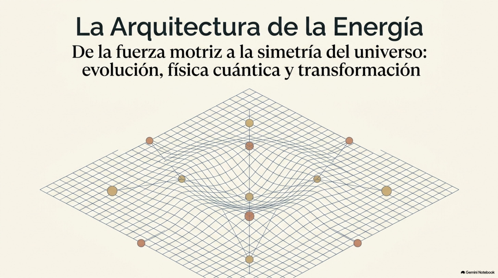

**El concepto de energía y las transformaciones energéticas**

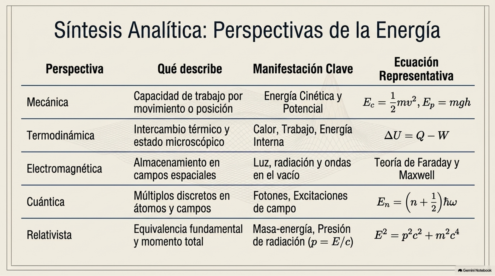

En términos generales, puede definirse que la energía es la capacidad de
un sistema físico para producir cambios o realizar trabajos. Energía es
lo que transforma. En todas sus manifestaciones la energía se conserva:
expresa maneras cómo se dan conversiones entre sus distintas
expresiones. Las siguientes diapositivas son ejemplos de
transformaciones energéticas de lo que ocurre en estrellas como el Sol,
en el planeta Tierra, en un automóvil y en el cuerpo humano.

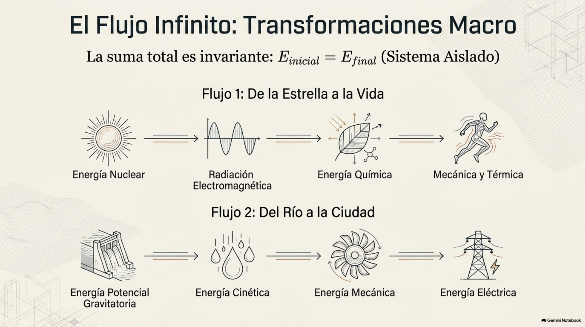

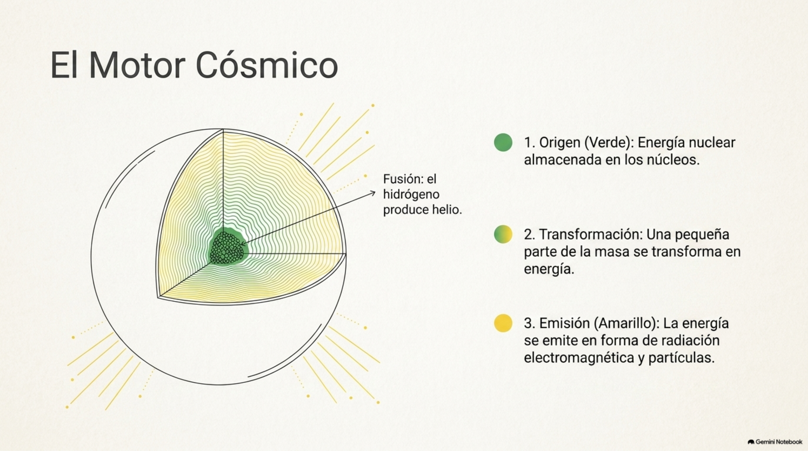

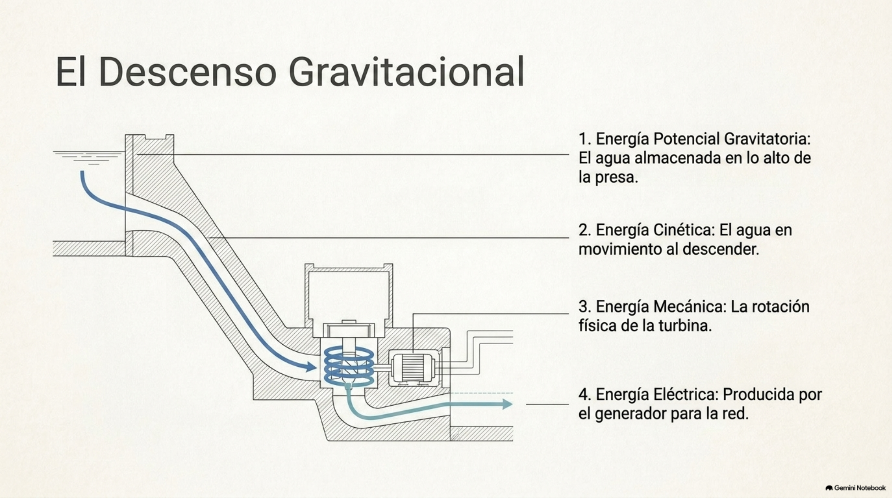

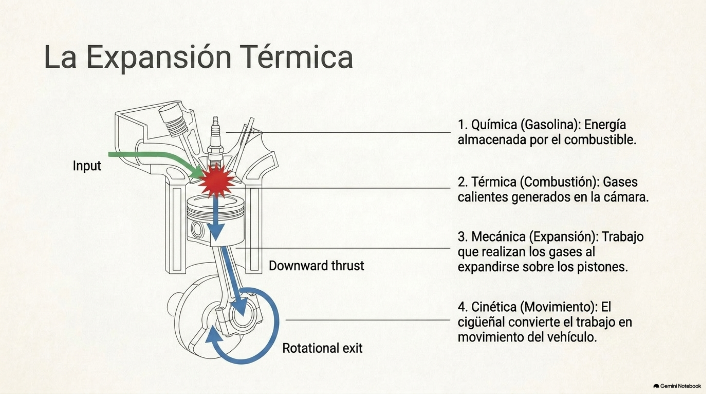

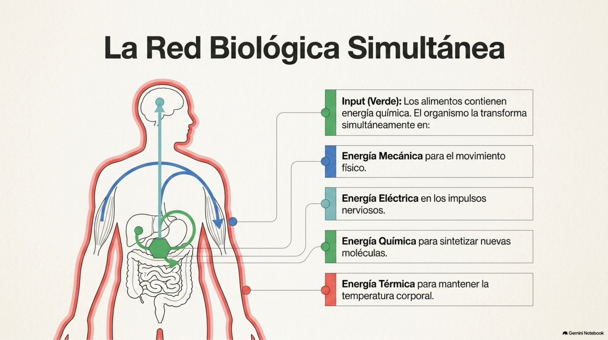

**Relación entre las leyes de conservación y las propiedades de
simetría**

La ley de conservación de la energía se expresa en termodinámica en
términos del primer principio: $\Delta U = Q - W,$ donde $\Delta U$es el
cambio de energía interna del sistema, $Q$es el calor transferido al
sistema y $W$es el trabajo realizado por el sistema sobre el entorno.
Este principio indica que cualquier cambio en la energía interna se debe
únicamente al intercambio de calor y/o a trabajo con el exterior.

La relación entre la invariancia respecto a ciertas transformaciones
matemáticas y las leyes de conservación mecánica se deriva de una
aplicación combinada del principio de mínima acción formulado en 1834
por William Rowan Hamilton (1805-1865) y uno de los teoremas
establecidos en 1918 por Amalie Emmy Noether (1882 - 1935).

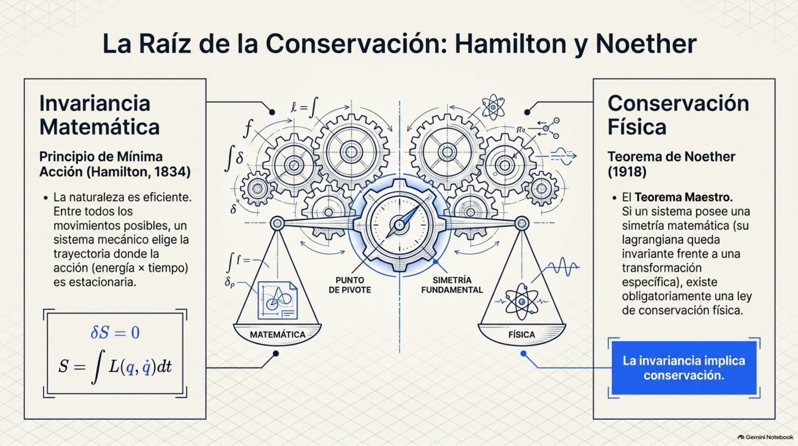

El principio de Hamilton se parece al principio de Fermat; en lugar de
minimizar el tiempo de recorrido de la luz considera trayectorias en
sistemas mecánicos y minimiza la cantidad física denominada acción, que
es el producto de la energía que interviene en un proceso por el tiempo
de duración de dicho proceso. La función denominada acción S se define
como la integral en el tiempo de la Lagrangiana:

$$\ \ \ \ \ \ S\  = \int_{t_{i}}^{t_{f}}{\left\lbrack L\left( q,\ \dot{q} \right)dt \right\rbrack,\ donde\ }L\left( q,\ \dot{q} \right)\ corresponde\ a\ L\left\lbrack \left( q_{1},q_{2},q_{3},\ldots\ q_{N} \right),\left( \dot{q_{1}},\ \dot{q_{2}},\ \dot{q_{3}},\ldots\ \dot{q_{N}} \right);t \right\rbrack$$

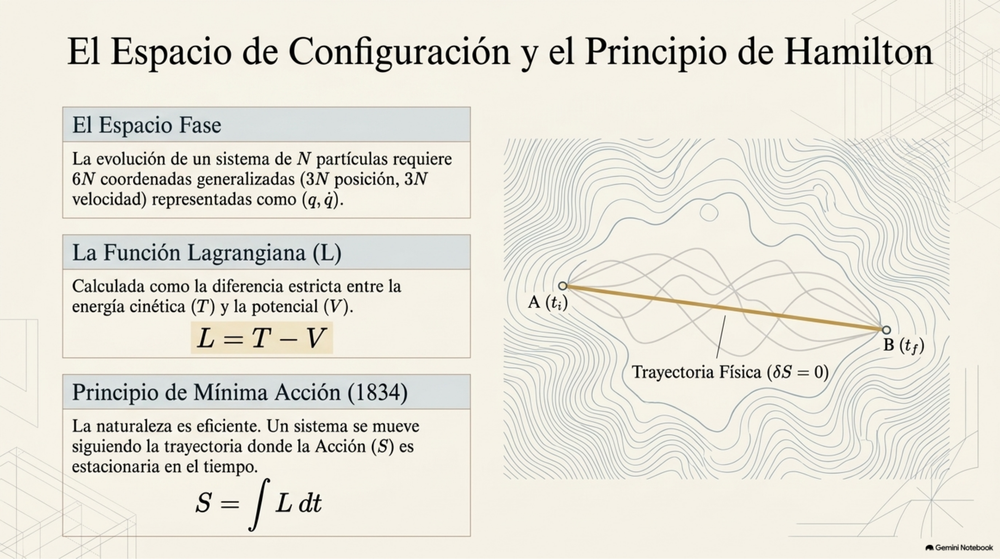

El principio de mínima acción de Hamilton establece que: entre todos los
movimientos posibles que puede realizar un sistema entre dos posibles
estados, el movimiento físico es aquel para el cual la acción es
estacionaria frente a pequeñas variaciones de la trayectoria. El
principio de Hamilton indica que $\partial S = \ 0$.

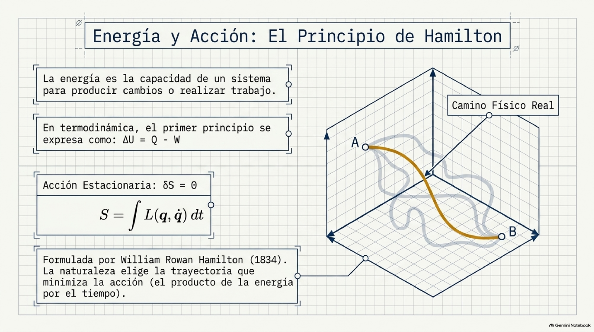

Consideremos un sistema de coordenadas generalizadas donde la
Lagrangiana L no depende de cierta variable qk. A esta
variable se le denomina ignorable o cíclica. En este caso la variación
de L respecto de tal variable es nula, lo que técnicamente significa que
su derivada parcial es cero: $\frac{\delta L}{\delta q_{k}} = 0.$ Lo
anterior se interpreta diciendo que la omisión de esa variable ignorable
en la Lagrangiana corresponde a la existencia de ciertas propiedades en
el sistema físico, las cuales se asocian con cierto tipo de simetrías
respecto de transformaciones en el espacio o en el tiempo. Noether
demostró que un sistema tiene cierto tipo de simetría y manifiesta
determinada ley de conservación cuando la Lagrangiana queda invariante
frente a alguna transformación específica.

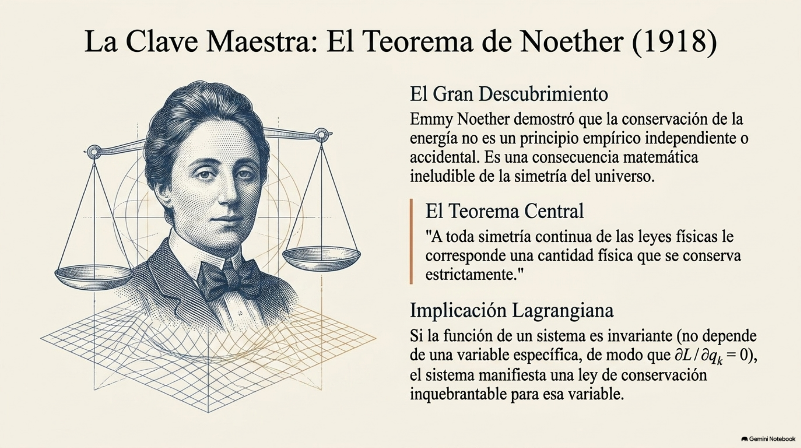

En física, una simetría significa que cierta transformación no modifica
las leyes que describen al sistema: el que algo permanezca invariante
frente a cierta transformación implica que algo se conserva.

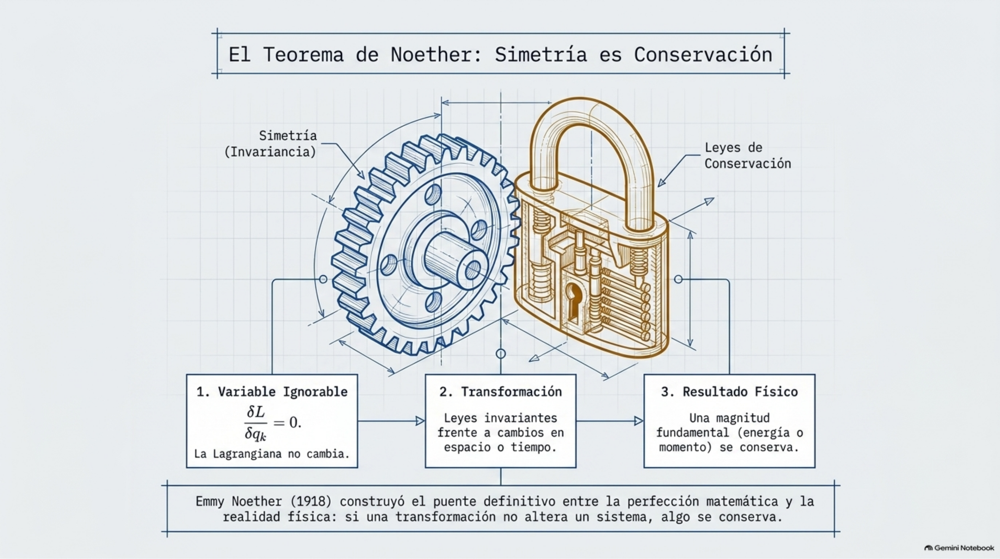

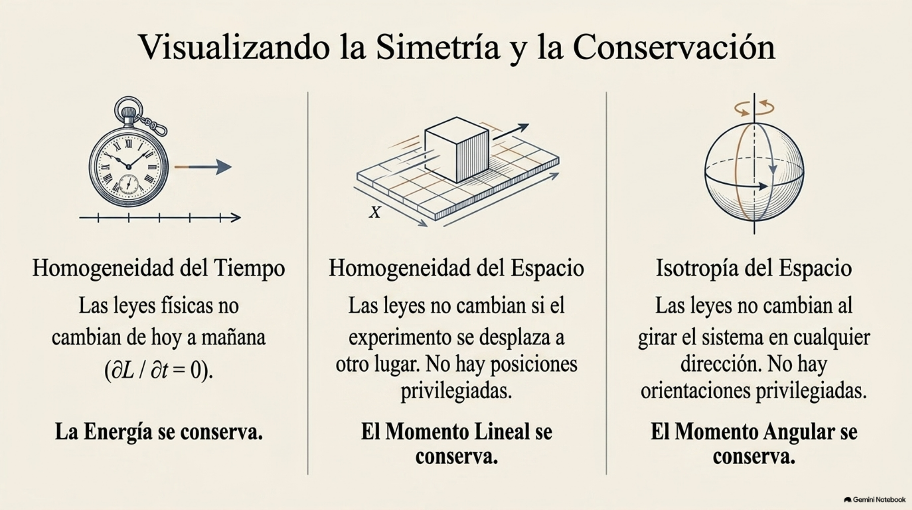

**Etapas y publicaciones que describen la evolución del concepto de
energía**

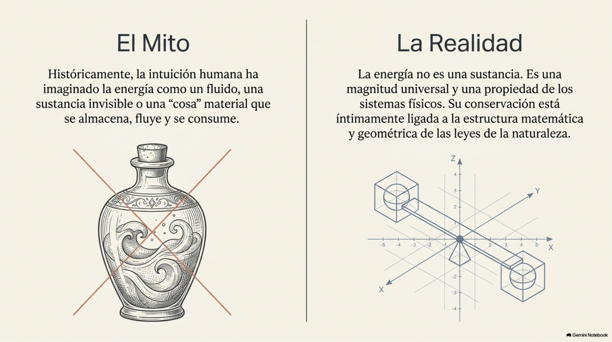

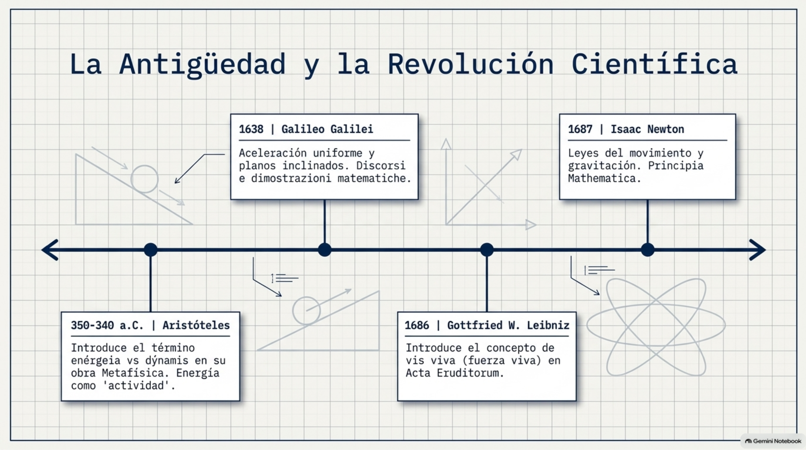

- La Antigüedad: energía como actividad o fuerza

La palabra energía proviene del griego ἐνέργεια (enérgeia) y fue
introducida por **Aristóteles** **(**384 aC - 322 aC**)** en su obra
Metafísica, especialmente en los libros Θ (Theta, Libro IX) y Η (Eta,
Libro VIII), escritos aproximadamente entre 350 y 340 a.C. En el Libro
IX (Theta) establece la distinción fundamental entre δύναμις (*dýnamis*)
y ἐνέργεια (*enérgeia*).

- La revolución científica: el movimiento como objeto de estudio

Durante los siglos XVII y XVIII, el interés se centró en comprender el
movimiento. **Galileo Galilei** **(**1564 - 1642**)** demostró que los
cuerpos se aceleran de manera uniforme en caída libre y observó que, al
descender y luego ascender por planos inclinados, recuperan
aproximadamente la misma altura. En 1638 publica en Leiden *Discorsi e
dimostrazioni matematiche intorno a due nuove scienze* ("Discursos y
demostraciones matemáticas en torno a dos nuevas ciencias").

Posteriormente, **Isaac Newton** (1642 - 1727) formuló las leyes del
movimiento y la gravitación universal, proporcionando el marco
matemático para describir tanto los fenómenos terrestres como los
celestes. Presentó en forma sistemática sus teorías en *Philosophiæ
Naturalis Principia Mathematica* ("Principios matemáticos de la
filosofía natural"), publicada en Londres em 1687.

A finales del siglo XVII, **Gottfried Wilhelm Leibniz** (1646–1716)
introdujo el concepto de vis viva ("fuerza viva"). En 1686 publicó el
artículo *Brevis demonstratio erroris memorabilis Cartesii et aliorum
circa legem naturae*, en la Revista **Acta Eruditorum**, Leipzig,
161–163.

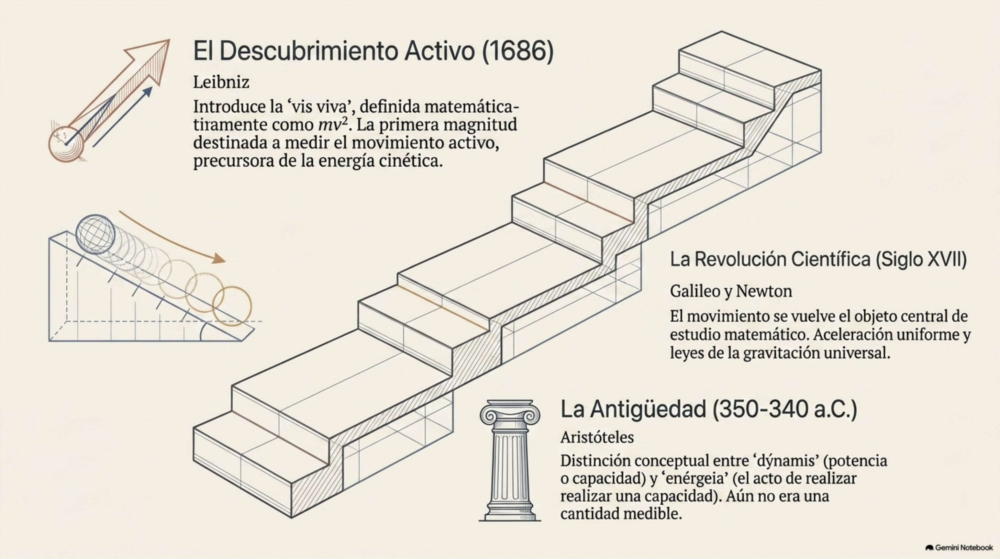

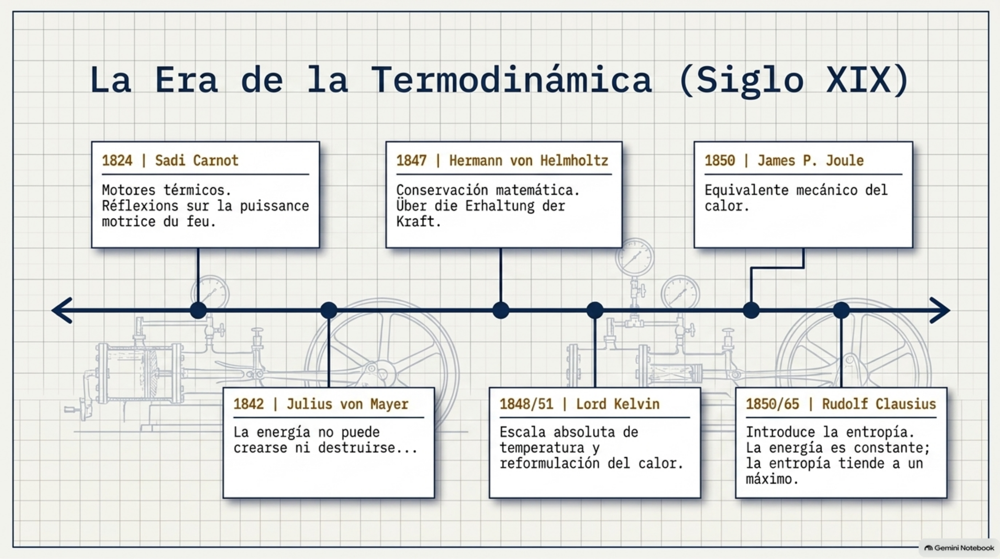

- Del trabajo mecánico al concepto de energía (siglo XIX)

La Revolución Industrial impulsó el estudio de las máquinas de vapor y
la conversión entre distintas formas de trabajo. Las contribuciones más
importantes fueron de:

## **Nicholas Sadi Carnot** (1796–1832): quien en 1824 publicó *Réflexions sur la puissance motrice du feu* ("Reflexiones sobre la potencia motriz del fuego").

**Julius Robert von Mayer** (1814–1878): quien publicó en 1842 el
artículo Bemerkungen über die Kräfte der unbelebten Natur
("Observaciones sobre las fuerzas de la naturaleza inanimada") en la
Revista **Justus Liebigs Annalen der Chemie und Pharmacie** (Anales de
Química y Farmacia de Justus Liebig) (Volumen: 42, páginas 233–240). En
este artículo declaró que: *La energía no puede crearse ni destruirse;
únicamente puede transformarse de una forma en otra***.**

**James Prescott Joule** (1818 - 1889**):** quien publicó en 1850 el
artículo *On the Mechanical Equivalent of Heat* ("Sobre el equivalente
mecánico del calor") en la Revista **Philosophical Transactions of the
Royal Society of London** (volumen 140, páginas 61–82).

**Hermann von Helmholtz** (1821–1894): quien en 1847 formuló
rigurosamente el principio general de conservación de la energía en el
libro *Über die Erhaltung der Kraft: Eine physikalische Abhandlung*.
(Sobre la conservación de la fuerza: un tratado de física).

- La termodinámica

**Rudolf Julius Emmanuel Clausius** (1822 - 1888): quien publicó en 1850
el artículo *Über die bewegende Kraft der Wärme und die Gesetze, welche
sich daraus für die Wärmelehre selbst ableiten lassen* ("Sobre la fuerza
motriz del calor y las leyes que pueden deducirse de ella para la teoría
del calor") en la Revista **Annalen der Physik und Chemie*,*** (**79**,
368 – 397 y 500 – 524).

Posteriormente, en 1865, publicó otro artículo, donde por primera vez
introdujo el concepto de entropía: Über verschiedene für die Anwendung
bequeme Formen der Hauptgleichungen der mechanischen Wärmetheorie
("Sobre diversas formas convenientes para la aplicación de las
ecuaciones principales de la teoría mecánica del calor"), publicado en
la Revista **Annalen der Physik und Chemie**, **125**, 353–400). Además,
resumió las dos leyes fundamentales de la termodinámica en la frase*:
"La energía del universo es constante; la entropía del universo tiende a
un máximo."*

**William Thomson, Lord Kelvin** (1824–1907): quien propuso en 1848 una
escala absoluta de temperatura, origen de la actual escala Kelvin; lo
publicó en *An Account of Carnot's Theory of the Motive Power of Heat*;
*with Numerical Results Deduced from Regnault's Experiments on Steam*,
en la Revista **Transactions of the Edinburgh Royal Society**,
**16**(5), 541–574.

En 1848 Kelvin definió formalmente una escala termodinámica absoluta
basada en la teoría de Carnot *On an Absolute Thermometric Scale*.
Revista **Philosophical Magazine,** Series 3, **33**, 313–317. Además,
en 1851 reformuló la teoría del calor a partir de los resultados de
Joule y formuló la segunda ley de la termodinámica *On the Dynamical
Theory of Heat, with Numerical Results Deuced from Mr. Joule's
Equivalent of a Thermal Unit, and M. Regnault's Observations on Steam*,
**Transactions of the Royal Society of Edinburgh,** **20**, 261–268.

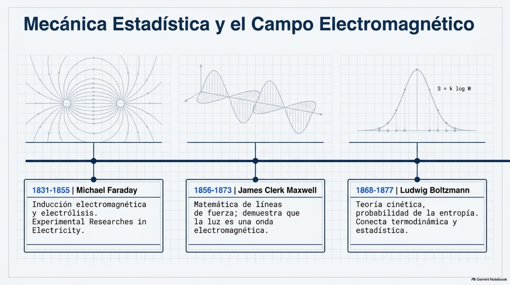

- La mecánica estadística

**Ludwig Eduard Boltzmann** (1844–1906): quien estableció en 1868 los
fundamentos de la teoría cinética y de la mecánica estadística en el
artículo *Studien über das Gleichgewicht der lebendigen Kraft zwischen
bewegten materiellen Punkten*. (Estudios sobre el equilibrio de la
fuerza viva entre puntos materiales en movimiento), Revista
**Sitzungsberichte der Kaiserlichen Akademie der Wissenschaften in
Wien,** **58**, 517–560.

En 1872 introdujo la ecuación que ahora lleva su nombre, la función de
distribución y el teorema H en el artículo *Weitere Studien über das
Wärmegleichgewicht unter Gasmolekülen* (Nuevos estudios sobre el
equilibrio térmico entre moléculas gaseosas), Revista **Sitzungsberichte
der Kaiserlichen Akademie der Wissenschaften in Wien**, **66**, 275–370.

Además, en 1877 presentó la interpretación probabilística de la entropía
y estableció el vínculo entre la segunda ley de la termodinámica y la
teoría de probabilidades en el artículo *Über die Beziehung zwischen dem
zweiten Hauptsatze der mechanischen Wärmetheorie und der
Wahrscheinlichkeitsrechnung* (Sobre la relación entre el segundo
principio de la teoría mecánica del calor y el cálculo de
probabilidades), Revista **Sitzungsberichte der Kaiserlichen Akademie
der Wissenschaften in Wien**, **76**, 373–435.

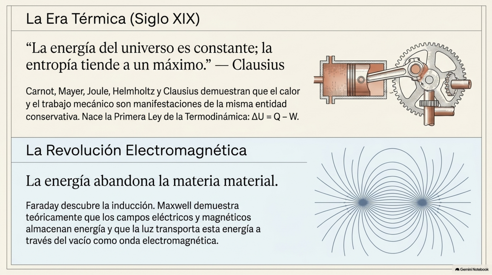

- La revolución electromagnética

<table>
<colgroup>
<col style="width: 99%" />
<col style="width: 0%" />
</colgroup>
<thead>
<tr class="header">
<th>
<strong>Michael Faraday</strong> (1791–1867): quien reportó en
1831 su descubrimiento de la inducción electromagnética en el artículo
<em>Experimental Researches in Electricity. First Series</em> en la
Revista <strong>Philosophical Transactions of the Royal Society of
London</strong>, 121, 125–16. En 1834 presentó las leyes de la
electrólisis en <em>Experimental Researches in Electricity. Seventh
Series, Revista</em> <strong>Philosophical Transactions</strong>, 124,
77–122.

Entre 1832–1855 desarrolló la teoría de la inducción electromagnética
y publicó artículos en <strong>Philosophical Transactions of the Royal
Society of London</strong>, los cuales se compilaron en tres libros bajo
el título <em>Experimental Researches in Electricity</em> y se editaron
en Londres, el Volumen I en 1839, el Volumen II en 1844 y el Volumen III
en 1855.
</th>
<th></th>
</tr>
</thead>
<tbody>
</tbody>
</table>

**James Clerk Maxwell** (1831–1879): quien desarrolló en 1856 una
formulación matemática de las líneas de fuerza propuestas por Faraday,
misma que publicó en *On Faraday's Lines of Force*, **Transactions of
the Cambridge Philosophical Society**, **10**(1), 27–83. Posteriormente,
entre 1861 y 1862, publicó la primera exposición sistemática de la
teoría del campo electromagnético, introdujo un modelo mecánico del éter
y mencionó por primera vez la idea de la corriente de desplazamiento en
el artículo *On Physical Lines of Force*, **The London, Edinburgh, and
Dublin Philosophical Magazine and Journal of Science,** Fourth Series,
**21**, 161–175, 281–291, 338–348 y Fourth Series, **23**, 12–24, 85–95.

En 1865 publicó su primera gran obra de síntesis donde demostró que la
luz es una onda electromagnética y obtuvo una velocidad de propagación
igual a la velocidad de la luz: *A Dynamical Theory of the
Electromagnetic Field*, **Philosophical Transactions of the Royal
Society of London**, **155**, 459–512. Posteriormente publicó su segunda
gran obra de síntesis compuesta de dos libros, los cuales fueron
publicados en 1873: *A Treatise on Electricity and Magnetism*. Oxford:
Clarendon Press. Por otra parte, en 1867 publicó el artículo *On the
Dynamical Theory of Gases*, Philosophical **Transactions of the Royal
Society of London**, **157**, 49–88, que tiempo después se extendió en
el libro *Theory of Heat,* editado en Londres en 1871.

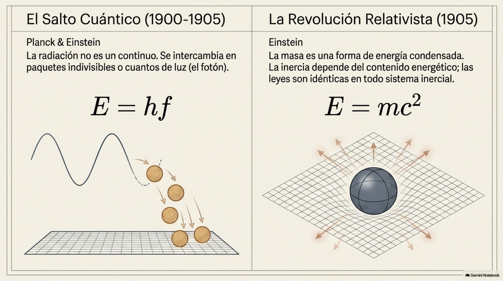

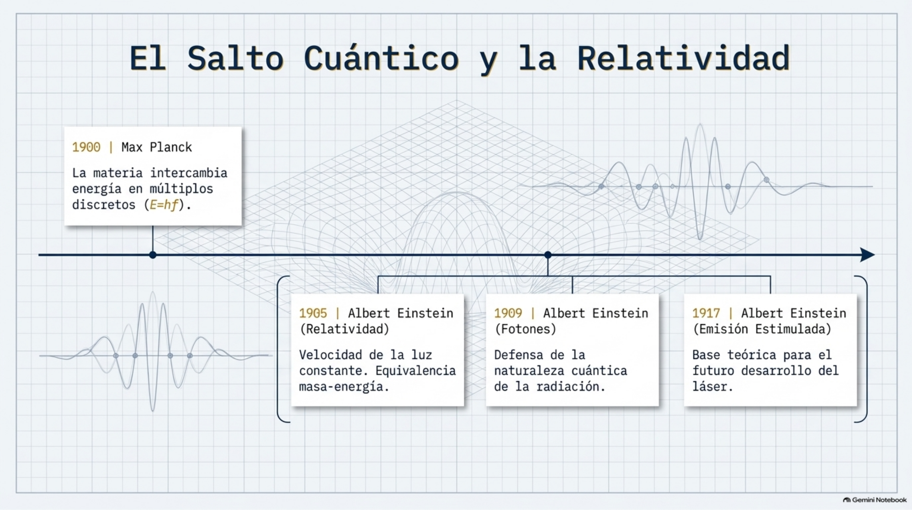

- La mecánica cuántica y la teoría de la relatividad

<table>
<colgroup>
<col style="width: 100%" />
</colgroup>
<thead>
<tr class="header">
<th>
En 1900 <strong>Max Karl Ernst Ludwig Planck</strong> (1858 -
1947) indicó que la materia intercambia energía en múltiplos de hf,
donde f es la frecuencia de la radiación. Lo señaló en el artículo
<em>Zur Theorie des Gesetzes der Energieverteilung im
Normalspectrum</em> <strong>(</strong><em>Sobre la teoría de la ley de
distribución de la energía en el espectro normal</em>),
<strong>Verhandlungen der Deutschen Physikalischen
Gesellschaft</strong>, <strong>2</strong>, 237–245.

Posteriormente, en 1901 propuso el desarrollo matemático de la ley
del cuerpo negro que propone la cuantización de la energía en el
artículo <em>Über das Gesetz der Energieverteilung im Normalspektrum
(</em>Sobre la ley de distribución de la energía en el espectro normal),
<strong>Annalen der Physik, 4</strong>(3), 553–563. Además, en 1906
publicó el primer libro donde se explica la incipiente teoría cuántica
<em>Vorlesungen über die Theorie der Wärmestrahlung</em>. Leipzig. La
correspondiente traducción inglesa apareció en 1914 <em>The Theory of
Heat Radiation</em>. Philadelphia.

Por su parte, <strong>Albert Einstein</strong> (1879 – 1955)
contribuyó con tres publicaciones: en 1905 estableció la equivalencia
entre masa y energía y discutió la dependencia de la inercia de un
cuerpo de su contenido energético en el artículo <em>Ist die Trägheit
eines Körpers von seinem Energieinhalt abhängig?</em> (¿Depende la
inercia de un cuerpo de su contenido de energía?), <strong>Annalen der
Physik</strong>, <strong>18</strong>, 639–641.

Luego, en 1909 Einstein defendió y profundizó la idea de que la
radiación es de naturaleza cuántica en el artículo <em>Über die
Entwicklung unserer Anschauungen über das Wesen und die Konstitution der
Strahlung</em> (Sobre el desarrollo de nuestras concepciones acerca de
la naturaleza y la constitución de la radiación), <strong>Physikalische
Zeitschrift</strong>, <strong>10</strong>, 817–825.

Posteriormente, en 1917 Einstein incluyó el proceso de emisión
estimulada en el tratamiento de los procesos cuánticos de emisión y
absorción que luego servirían para crear el láser; lo describió en el
artículo <em>Zur Quantentheorie der Strahlung</em> (Teoría cuántica de
la radiación) <strong>Physikalische Zeitschrift, 18</strong>,
121–128.

En lo que respecta a la teoría de la relatividad, en 1905
<strong>Albert Einstein</strong> publicó el artículo <em>Zur
Elektrodynamik bewegter Körper (</em>Acerca de la electrodinámica de los
cuerpos en movimiento) en la Revista <strong>Annalen der
Physik</strong>, <strong>17</strong>(10), 891–921. Estableció dos
postulados fundamentales de la Teoría de la Relatividad Especial: Las
leyes de la física son las mismas en todos los sistemas de referencia
inerciales y La velocidad de la luz en el vacío es constante e
independiente del movimiento de la fuente o del observador.

<ul>
<li>
La teoría cuántica de campos
</li>
</ul>

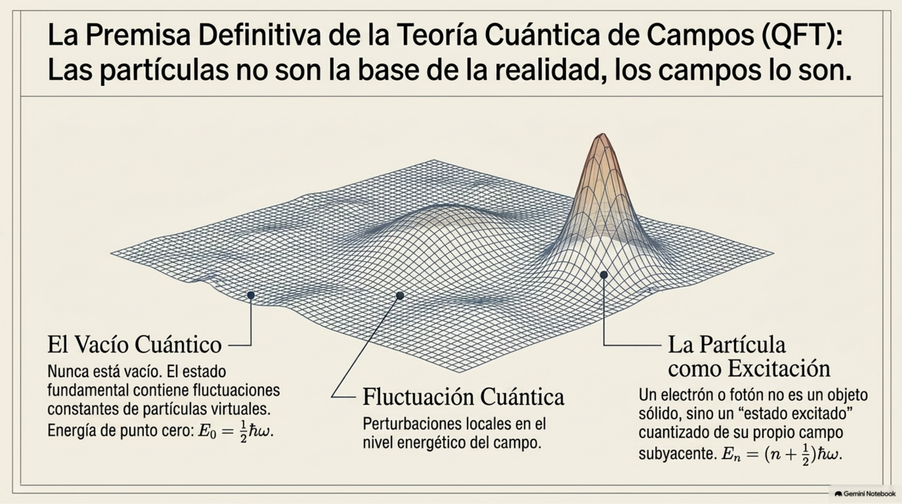

Como las excitaciones del campo se manifiestan como partículas
observables, en física de partículas la relación energía momento
relativista indica que <em>E</em>2= <em>p</em>2<em>c</em>2+ <em>m</em>2<em>c</em>4, <em>c</em><em>o</em><em>n</em>
<em>E</em> la energía total de la partícula, <em>p</em> el momento
lineal relativista, <em>m</em> la masa en reposo y <em>c</em> la
velocidad de la luz en el vacío. Existen dos casos particulares de
interés: (1) si la partícula está en reposo <em>p = 0</em> y <em>E</em> = <em>m</em><em>c</em>2;
(2) si la partícula no tiene masa como es el caso del fotón (m = 0),
entonces <em>E</em> = <em>p</em><em>c</em> y por lo
tanto $p = \ \frac{E}{c},\ lo\ cual\
$indica que la radiación posee momento lineal.

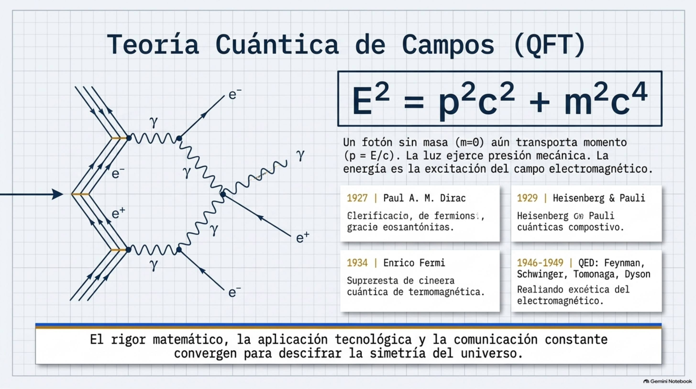

El que la luz pueda ejercer presión de radiación y transferir momento
a la materia, corresponde a que un fotón no necesita tener masa en
reposo para transportar energía y momento: su energía está asociada a la
excitación cuántica del campo electromagnético<strong>.</strong> Al
respecto, las principales publicaciones acerca del desarrollo inicial de
la teoría de campos son las siguientes:

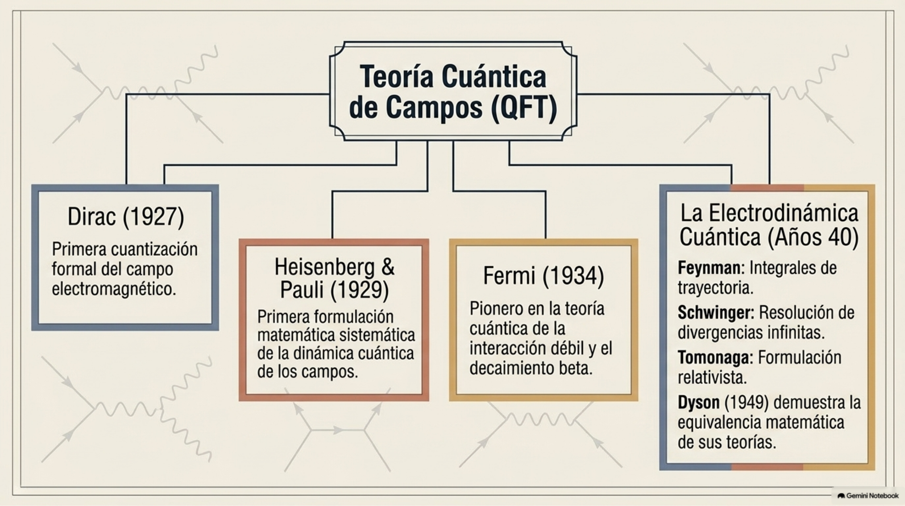

<strong>Paul A. M. Dirac</strong> (1902 – 1984): Dirac, P. A. M.
(1927). <em>The Quantum Theory of the Emission and Absorption of
Radiation,</em> <strong>Proceedings of the Royal Society A,
114</strong>(767), 243–265.

<strong>Werner Heisenberg</strong> (1901 - 1976) y <strong>Wolfgang
Pauli</strong> (1900 - 1958): Heisenberg, W., &amp; Pauli, W. (1929).
<em>Zur Quantendynamik der Wellenfelder</em> (Sobre la dinámica cuántica
de los campos de ondas), <strong>Zeitschrift für Physik,
56</strong>(1–2), 1–61.

<strong>Enrico Fermi (</strong>1901 - 1954): Fermi, E. (1934).
<em>Versuch einer Theorie der β-Strahlen</em> (Intento de una teoría de
los rayos beta), <strong>Zeitschrift für Physik, 88</strong>(3–4),
161–177. https://doi.org/10.1007/BF01351864

El desarrollo moderno de la electrodinámica cuántica se debe a la
contribución de:

<strong>Richard Phillips Feynman</strong> (1918–1988): Feynman, R. P.
(1949). <em>Space-Time Approach to Quantum Electrodynamics,</em>
<strong>Physical Review, 76</strong>(6), 769–789.
https://doi.org/10.1103/PhysRev.76.769

<strong>Julian Seymour Schwinger</strong> (1918–1994): Schwinger, J.
(1948). <em>On Quantum-Electrodynamics and the Magnetic Moment of the
Electron,</em> <strong>Physical Review, 73</strong>(4), 416–417.
https://doi.org/10.1103/PhysRev.73.416

<strong>Sin-Itiro Tomonaga (1906 - 1979):</strong> Tomonaga, S.
(1946). <em>On a Relativistically Invariant Formulation of the Quantum
Theory of Wave Fields,</em> <strong>Progress of Theoretical Physics,
1</strong>(2), 27–42.

<strong>Freeman John Dyson (</strong>1923–2020<strong>):</strong>
Dyson, F. J. (1949). <em>The Radiation Theories of Tomonaga, Schwinger,
and Feynman,</em> <strong>Physical Review, 75</strong>(3), 486–502.

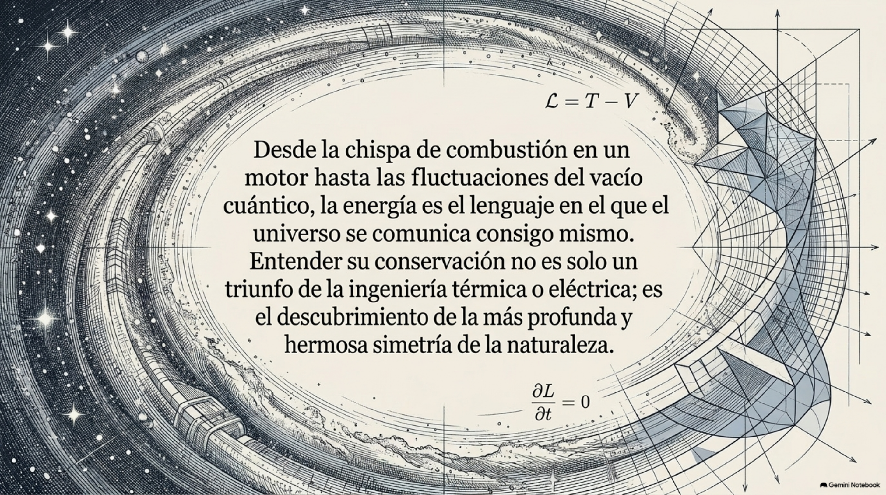
</th>
</tr>
</thead>
<tbody>
</tbody>
</table>

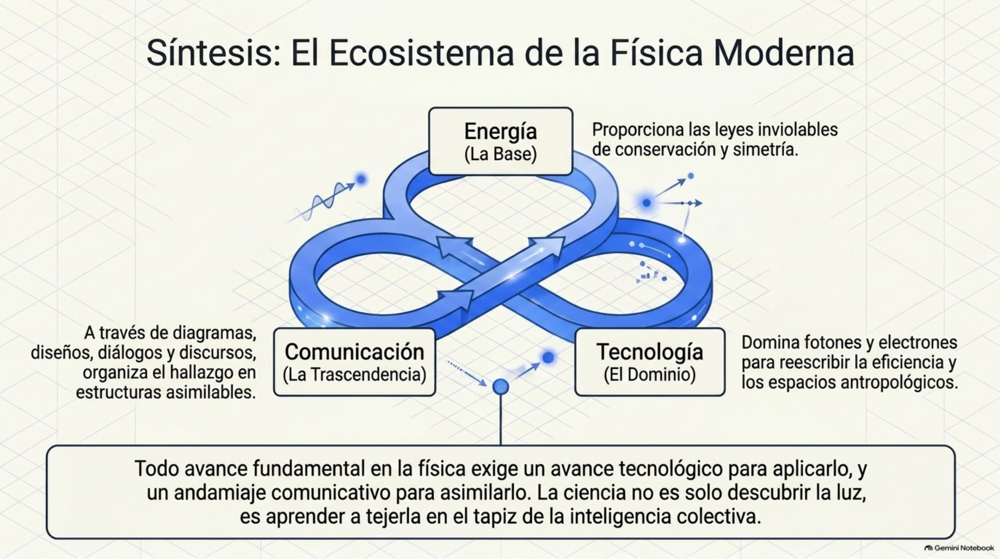

**6.2. Transformaciones de energía y funcionamiento de fotoceldas y
diodos emisores de luz (LED)**

La evolución de la humanidad contiene múltiples ejemplos de ideas y
desarrollos tecnológicos que han tenido impacto sociopolítico, económico
y cultural en relación con distintas manifestaciones de la energía y sus
procesos de transformación. A continuación, en el contexto del tema
Energía, Tecnología y Comunicación consideramos los desarrollos
conceptuales y las aplicaciones tecnológicas características de los
llamados espacios antropológicos descritos por Pierre Lévy en su libro
*La inteligencia colectiva*. Lévy asocia estos espacios a la Tierra (los
mitos, la identidad y la pertenencia cultural), el Territorio (la
organización política, las fronteras, la escritura y el Estado), las
Mercancías (la economía, la industria y los mercados globales) y el
Conocimiento (la cooperación, el aprendizaje permanente y la
inteligencia colectiva).

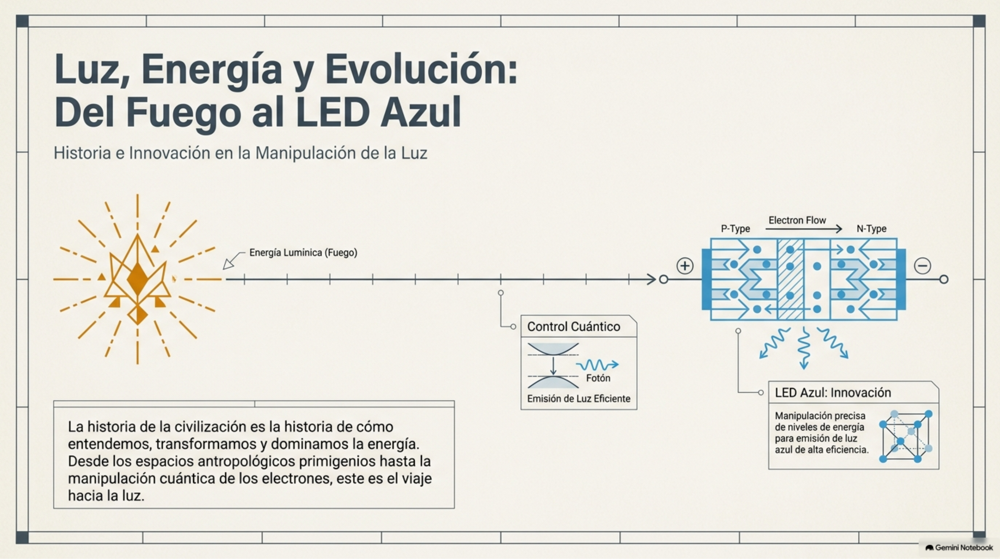

**Desarrollos conceptuales y aplicaciones tecnológicas en espacios
antropológicos**

Esta sección comprende una serie de diapositivas elaboradas por el
programa NotebookLM a partir de dos fuentes: un resumen de las
transformaciones energéticas ocurridas en los espacios antropológicos
descritos por Lévy en su libro *Inteligencia colectiva* y una selección
de información tomada de *The Scheduletables of Science. Una cronología
de las personas y eventos más importantes en la historia de la ciencia.*

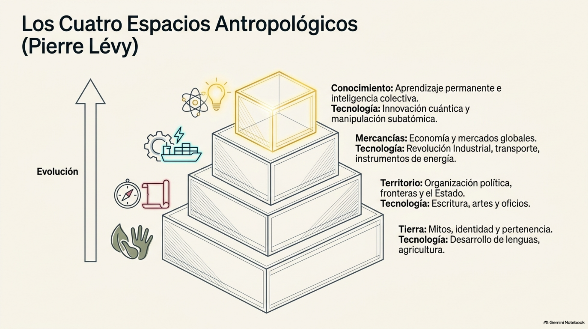

En relación con los espacios de la Tierra y el Territorio nos centramos
en aspectos conceptuales conectados con el desarrollo de las lenguas y
el desarrollo de la escritura y la imprenta; las aplicaciones
tecnológicas se refieren a desarrollos en agricultura, artes y oficios.
Para el espacio de las Mercancías, los desarrollos conceptuales están
relacionados con publicaciones relevantes que describen conceptos,
modelos y teorías relativas a la energía; las aplicaciones tecnológicas
comienzan con la Revolución Industrial y tratan acerca de dispositivos e
instrumentos útiles para el transporte y la transferencia de
información, así como para la comprensión y el uso de la energía. El
espacio del Conocimiento presenta algunos desarrollos conceptuales y
aplicaciones tecnológicas que han generado avances significativos
durante el último siglo.

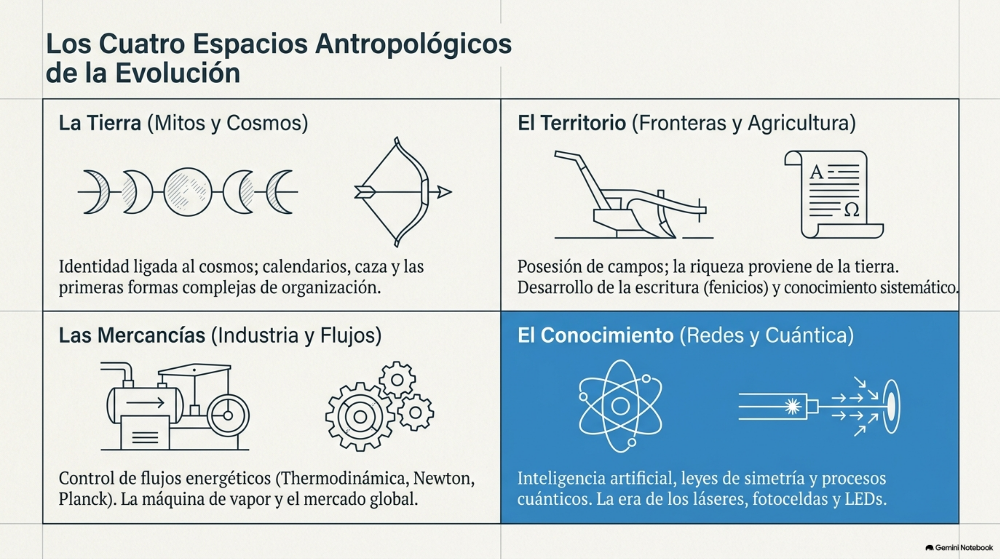

En lo que sigue, ilustramos cada uno de los cuatro espacios
antropológicos mediante dos diapositivas: la primera diapositiva se
refiere al espacio antropológico en consideración y la segunda
diapositiva ejemplifica los desarrollos conceptuales y las aplicaciones
tecnológicas más representativas de cada espacio antropológico.

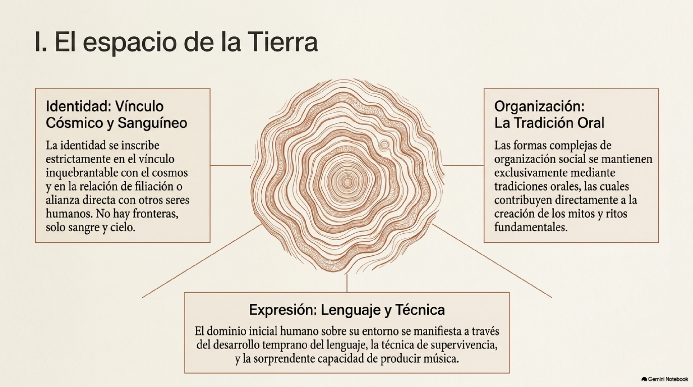

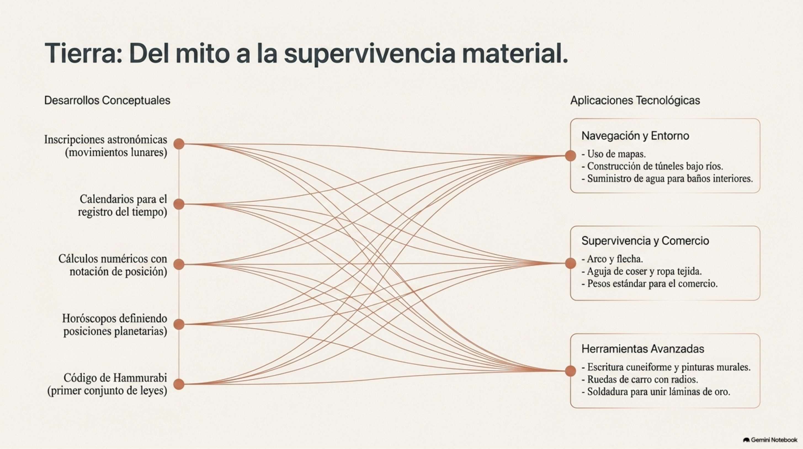

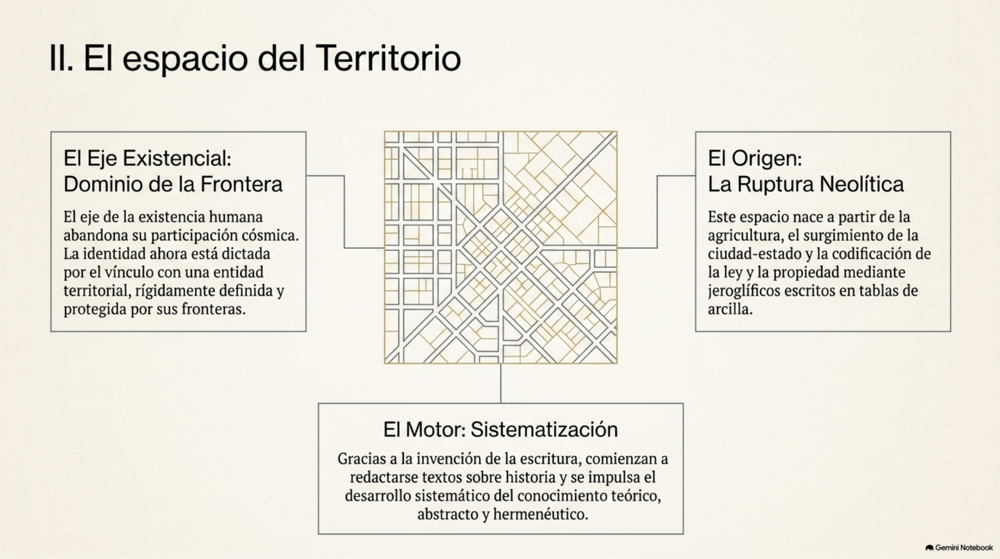

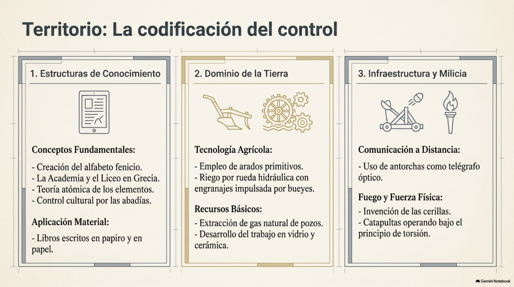

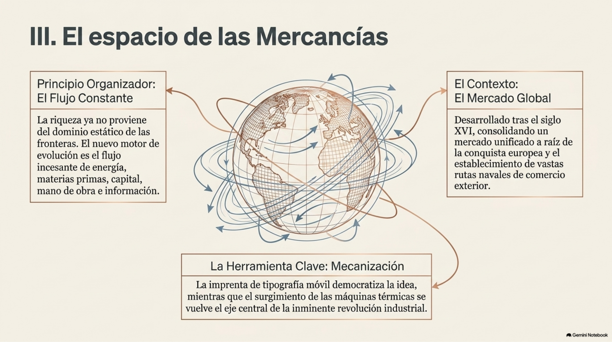

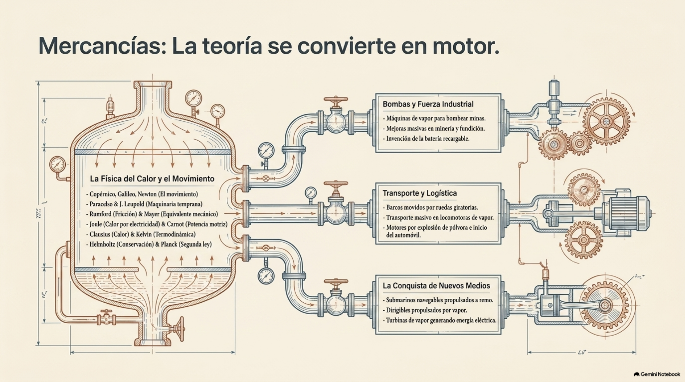

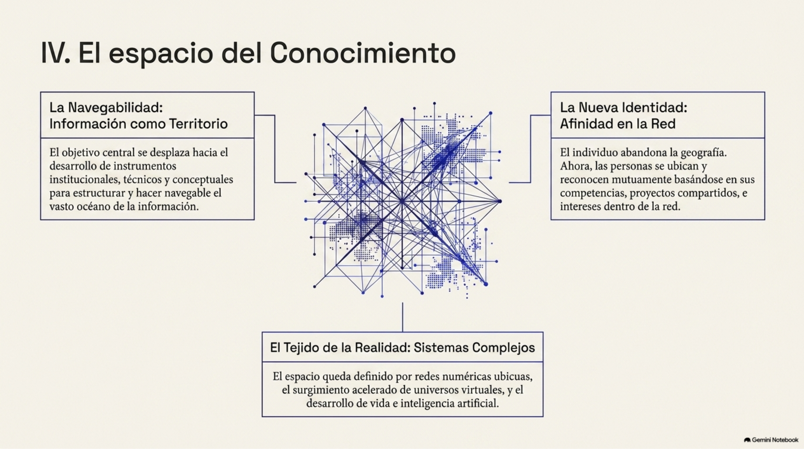

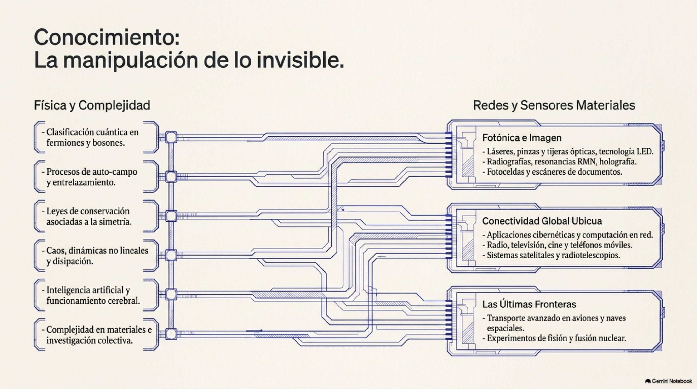

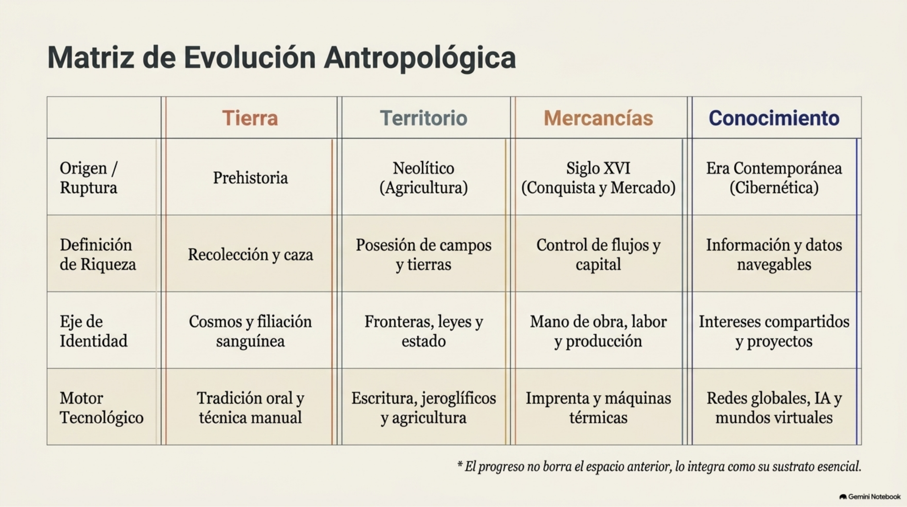

**Fotoceldas y diodos emisores de luz (LED)**

Las fotoceldas y los diodos emisores de luz (Light Emitting Diode: LED)
funcionan de manera inversa. En la fotocelda, una radiación
electromagnética incide sobre la superficie de un metal y los electrones
que se liberan constituyen una corriente eléctrica. Por el contrario, en
los diodos emisores de luz es la circulación de una corriente eléctrica
en el interior de un semiconductor la que produce la emisión de
radiación electromagnética. En el primer caso entra luz a un material y
sale una corriente de electrones y en el segundo caso una corriente de
electrones fluye en el interior de otro material y se produce luz.

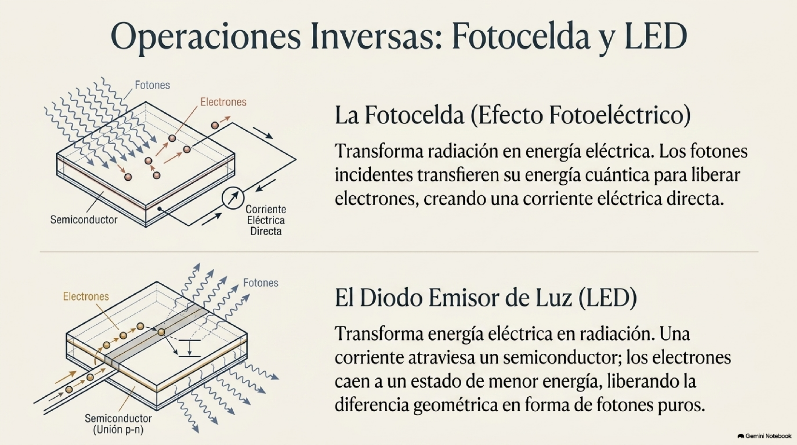

ADVERTENCIA: la primera imagen contiene un error porque el material es
un metal y no un semiconductor.

<u>La fotocelda como dispositivo transformador de energía</u>

Las fotoceldas convierten la energía de la radiación electromagnética
incidente en corriente eléctrica de manera similar al efecto
fotoeléctrico. Existen tres tipos principales de fotoceldas: las
fotoconductoras, las fotoemisivas y las fotovoltaicas

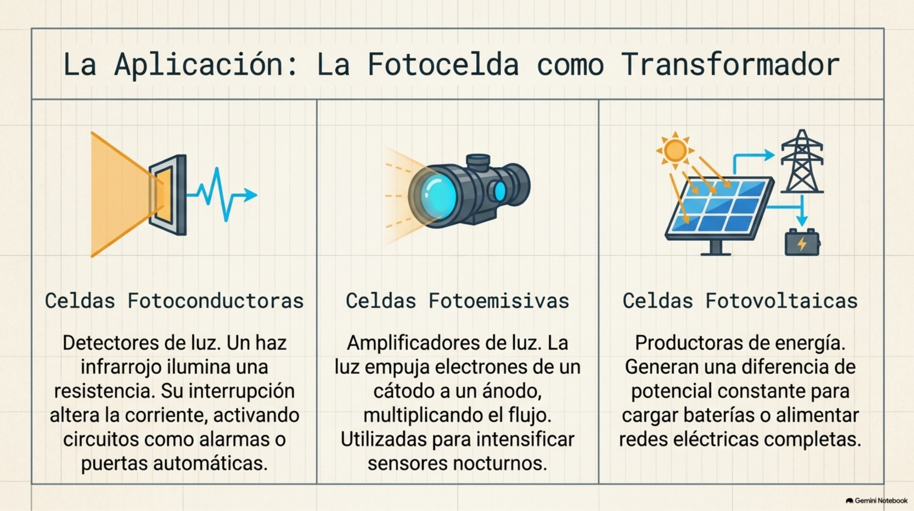

El funcionamiento de las fotoceldas se basa en el efecto fotoeléctrico.
Para entender este efecto se deben considerar tres factores: el fracaso
del electromagnetismo clásico para explicar las características del
efecto fotoeléctrico, la revolución conceptual de las ideas de Einstein
que resolvieron las limitaciones anteriores y la verificación
experimental efectuada por Millikan acerca de la validez de la ecuación
de Einstein *Ec =½m*v*2* = *eV0* = *hf
– φ.* Millikan comprobó que cuando V = 0 la frecuencia de umbral era
*f0 = φ/h y* además que *h/e* era la pendiente de la recta
*V0* = (*h/e)f – (φ/e).*

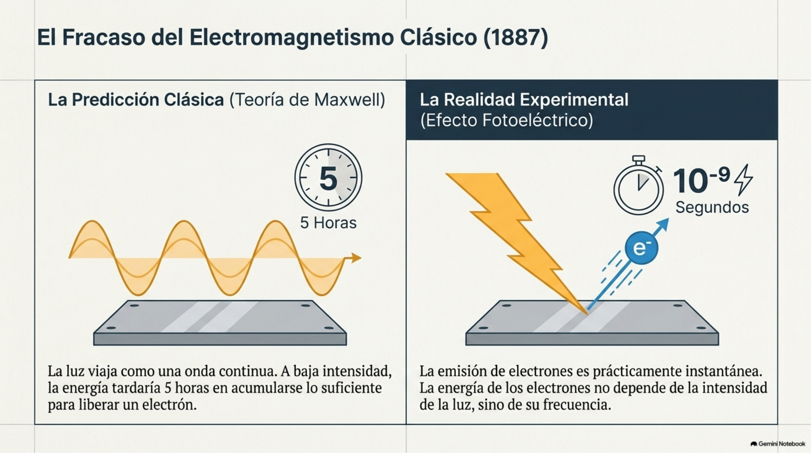

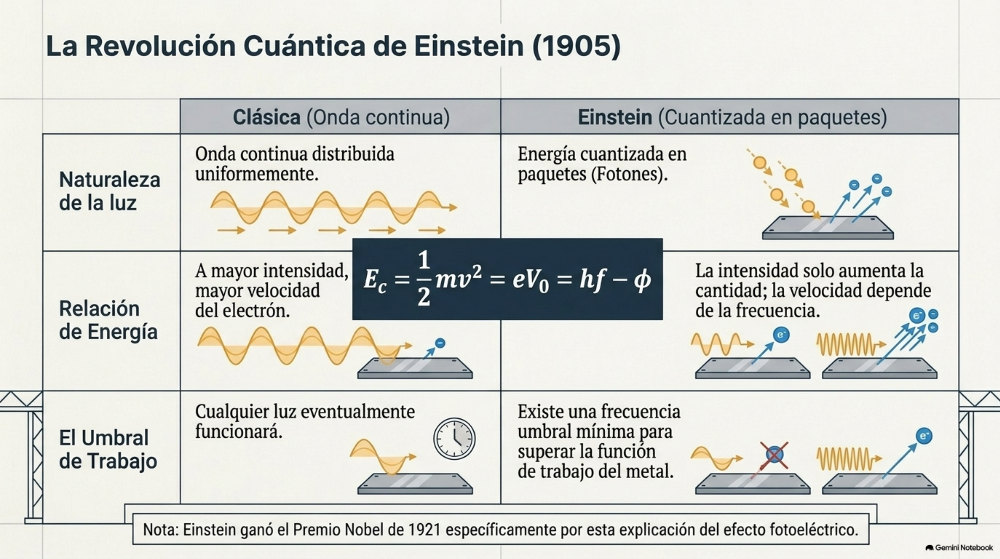

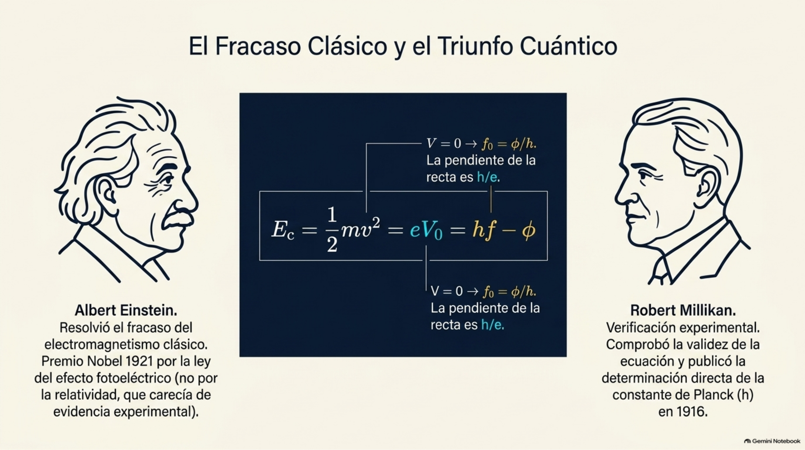

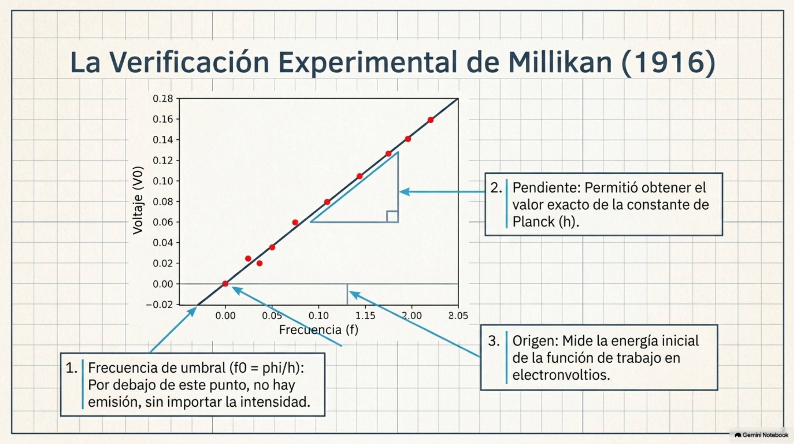

Millikan publicó sus resultados en un artículo titulado *A Direct
Photoelectric Determination of Planck's "h".* **Phys. Rev**. **7**, 355
(1916). Más adelante, Gerald Holton explicó cómo Robert Millikan probó
experimentalmente la teoría fotoeléctrica de Einstein y lo publicó en
[*Centennial Focus: Medición de la constante de Planck
por*](https://physics.aps.org/story/v3/st23) *Millikan*. **Phys. Rev**.
Focus **3**, 23, 22 de abril (1999).

Cabe aclarar que fue por la explicación del efecto fotoeléctrico que
Einstein recibió el Premio Nobel de Física en 1921. El Comité Nobel de
Física explicó que dicho Premio se le concedió "por sus servicios a la
Física Teórica, y especialmente por su descubrimiento de la ley del
efecto fotoeléctrico". Sin embargo, Einstein en su Conferencia Nobel
habló de la teoría de la relatividad. El Comité Nobel había considerado
que tal contribución teórica era insuficiente para otorgarle el Premio
Nobel, no así la explicación del efecto fotoeléctrico, porque en esa
época no había evidencias experimentales de que la teoría de la
relatividad tuviera sentido.

<u>El diodo emisor de luz como dispositivo ahorrador de energía</u>

El funcionamiento del LED se basa en un fenómeno de la
electroluminiscencia que consiste en que un material emite luz cuando es
atravesado por una corriente eléctrica o sometido a un campo eléctrico.
Esto ocurre dentro de un semiconductor en la unión p–n y comprende las
siguientes etapas: (1) Aplicación de un voltaje en polarización directa,
(2) Movimiento de portadores de carga, (3) Recombinación electrón-hueco
y (4) Emisión de un fotón. La energía que libera el fotón es
$E_{g} = h\nu = \frac{hc}{\lambda},\ $donde $E_{g}\ $es la energía de la
banda prohibida, $h$ es la constante de Planck, $\nu$ es la frecuencia
de la luz emitida, $c$ es la velocidad de la luz y $\lambda$ es la
longitud de onda.

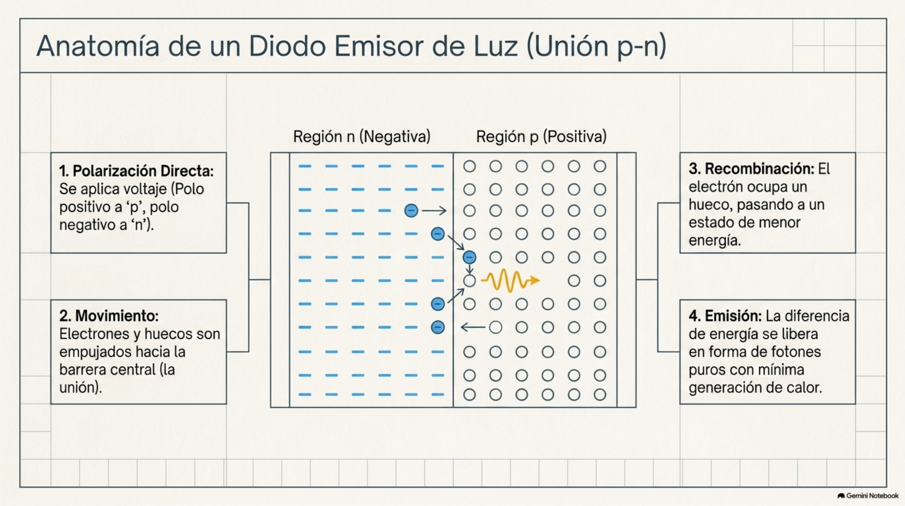

La electroluminiscencia demuestra que la energía en los sólidos está
cuantizada; es la emisión de luz originada por la recombinación de
electrones y huecos en un material semiconductor sometido a un voltaje.
Existen dos formas principales de electroluminiscencia: por inyección de
electrones y huecos en una unión p–n (se utiliza en los LED y los
láseres semiconductores) y por aplicación de un campo eléctrico intenso
que excita directamente centros luminiscentes sin necesidad de una unión
p–n (se emplea en algunos paneles y pantallas).

### **Premio Nobel de Física a** **Isamu Akasaki**, **Hiroshi Amano** y **Shuji Nakamura** 

Para dar una idea del trabajo desarrollado por los tres investigadores
laureados y sin entrar en demasiados detalles técnicos, presentamos tres
documentos basados en información contenida en la página de la Fundación
Nobel. El Documento D1 es la traducción de la sección denominada *WORK,*
donde se informa brevemente de la razón por la cual se ha otorgado el
premio en cuestión. El Documento D2 contiene extractos de la traducción
del *Comunicado de Prensa* donde se explican las contribuciones de los
galardonados con el Premio. El Documento D3 es una serie de diapositivas
que el Programa NotebookLM ha generado a partir de la lista de temas
desarrollados en cada una de las tres Conferencias Nobel. En todos los
casos se da como Fuente la referencia indicada en la página de la
Fundación.

D1: WORK: **“**La iluminación juega un papel fundamental en nuestra
calidad de vida. El desarrollo de diodos emisores de luz (LED) ha hecho
posibles fuentes de luz más eficientes. Crear luz blanca que pueda
usarse para iluminación requiere una combinación de luz roja, verde y
azul. Los LEDs azules resultaron ser mucho más difíciles de crear que
los diodos rojos y verdes. Durante las décadas de 1980 y 1990, Isamu
Akasaki, Hiroshi Amano y Shuji Nakamura utilizaron con éxito el
semiconductor nitruro de galio para crear LEDs azules eficientes.”

Fuente: Isamu Akasaki – Facts. NobelPrize.org.
<https://www.nobelprize.org/prizes/physics/2014/akasaki/facts/>

## D2: Comunicado de prensa Nobel de 2014: *Nueva luz para iluminar el mundo*.

Fuente:
\<https://www.nobelprize.org/prizes/physics/2014/press-release/\>

> “Cuando Isamu Akasaki**,** Hiroshi Amano **y** Shuji Nakamura
> produjeron haces de luz azul brillante desde sus semiconductores a
> principios de los años 90, provocaron una transformación fundamental
> en la tecnología de la iluminación. Los diodos rojos y verdes existían
> desde hacía mucho tiempo, pero sin luz azul no se podían crear
> lámparas blancas. A pesar de los considerables esfuerzos, tanto en la
> comunidad científica como en la industria, el LED azul siguió siendo
> un desafío durante tres décadas. Los tres investigadores japoneses
> tuvieron éxito donde todos los demás habían fracasado: Akasaki trabajó
> junto con Amano en la Universidad de Nagoya, mientras Nakamura
> trabajaba en Nichia Chemicals, una pequeña empresa de Tokushima. Sus
> inventos fueron revolucionarios.
>
> Las bombillas incandescentes encendieron el siglo XX; el siglo XXI
> estará iluminado por lámparas LED.
>
> Las lámparas LED blancas emiten una luz blanca intensa, son duraderas
> y energéticamente eficientes. Se mejoran constantemente, volviéndose
> más eficientes porque tienen un mayor flujo luminoso (medido en lúmen)
> por unidad de potencia eléctrica (medida en vatios). El récord más
> reciente es algo más de 300 lm/W, que se puede comparar con 16
> bombillas normales y cerca de 70 lámparas fluorescentes. “
>
>  src="../media/ch6/image58.png"
> style="width:6.1375in;height:3.42222in" />

D3: Diapositivas que resumen los contenidos de las Conferencias Nobel

ISAMU AKASAKI**:** *Viajes fascinantes hacia la luz azul***.**

Fuente: Isamu Akasaki – Conferencia Nobel. NobelPrize.org.
\<https://www.nobelprize.org/prizes/physics/2014/akasaki/lecture/\>

HIROSHI AMANO: *Crecimiento de GaN en zafiro mediante capa tampón
depositada a baja temperatura y realización de GaN tipo p mediante
dopaje Mg, seguida de irradiación de haz de electrones de baja energía.*

Fuente: Hiroshi Amano – Conferencia Nobel. NobelPrize.org.
\<https://www.nobelprize.org/prizes/physics/2014/amano/lecture/\>

SHUJI NAKAMURA**:** *Antecedentes de la invención de diodos emisores de
luz azul InGaN eficientes.*

Fuente: Shuji Nakamura – Conferencia Nobel. NobelPrize.org.

<https://www.nobelprize.org/prizes/physics/2014/nakamura/lecture/>

**6.3. La cuarteta de la comunicación**

Para aprender necesitamos comprender textos que comunican de manera
accesible el paso de la percepción de los hechos a la organización de la
información de la cual se espera habrá de surgir el conocimiento. Esto
requiere de una comunicación consistente y coherente en tiempo,
contenido y forma. Con tales propósitos, en esta sección consideramos
ejemplos de los textos que integran la cuarteta de la comunicación:
diagramas, diseños, diálogos y discursos.

**Componentes de la cuarteta de la comunicación**

Un **texto** (lat: *textus*-tela, estructura) es un documento escrito,
una intervención oral o una actuación escenificada que se elabora y
comunica en cierto **contexto** (lat. *contexere,* de *com-*junto +
*texere*-tejer). El texto se refiere al mensaje concreto que se produce
y transmite en toda comunicación y el contexto a las circunstancias y
condiciones en las que ocurre la comunicación. El texto es el tejido de
signos, palabras, imágenes, sonidos o símbolos y lo que va con el texto
(el **contexto**) determina las características del proceso creativo de
tejer su interpretación en respuesta a los factores que lo determinan.

En el proceso de representar e interpretar textos y sus contextos, los
elementos componentes de la cuarteta de la comunicación (diagramas,
diseños, diálogos y discursos) son cuatro formas de organizar y
representar significados. Cada componente de la cuarteta corresponde a
una manera distinta, aunque interrelacionada y a veces complementaria,
de construir y transmitir información y conocimiento. A continuación,
describimos cada componente de la cuarteta y después comparamos sus
principales características en la Tabla 6.1.

La preparación de texto suele acompañarse de la elaboración previa de
algún **diagrama** (gr. διάγαμμα-*diseño*, de *dia*-a través +
*graphein-* escribir) que presenta esquemáticamente el contenido y la
relación entre las partes que habrán de integrar el texto.

Ocurre que el autor de una comunicación suele basarse o parte de algún
tipo de **diseño** (ital. *disegno,* del lat. *designare-*dibujar), algo
así como la huella dactilar que permitirá identificar las etapas del
proceso de preparar, desarrollar, modificar y/o perfeccionar la
comunicación.

La elaboración de textos con frecuencia requiere de narrativas que
implican cierta forma de **diálogo** (lat: *dialogus*, del gr.
διάλογς-*dialegesthai,* de *dia-*a través + *legesthai-*hablar) en tanto
comunicación entre dos o más personas.

Ciertos textos de importancia personal o colegiada suelen comunicarse
como **discursos** (lat: *dis-*aparte + *cursus-* carrera); son
comunicaciones independientes, congruentes y propositivos que conllevan
mensajes personales o colegiados.

<table>
<colgroup>
<col style="width: 17%" />
<col style="width: 25%" />
<col style="width: 22%" />
<col style="width: 34%" />
</colgroup>
<thead>
<tr class="header">
<th colspan="4">Tabla 6.1. Características de las componentes de la
cuarteta de la comunicación</th>
</tr>
</thead>
<tbody>
<tr class="odd">
<td>Componente de la cuarteta</td>
<td>¿Qué representa?</td>
<td>Organización predominante</td>
<td>Función principal</td>
</tr>
<tr class="even">
<td><strong>Diagrama</strong></td>
<td>Relaciones entre elementos.</td>
<td><strong>Estructural</strong></td>
<td>Mostrar cómo se relacionan las partes de un sistema con el fin de
describir su composición y funcionamiento.</td>
</tr>
<tr class="odd">
<td><strong>Diseño</strong></td>
<td>Propuestas de posibilidades de construcción.</td>
<td><strong>Proyectiva</strong></td>
<td>Anticipar cómo convertir una idea o intención en una configuración
organizada de acciones, objetos o procesos.</td>
</tr>
<tr class="even">
<td><strong>Diálogo</strong></td>
<td>Interacciones de intercambio entre participantes para ajustar
posiciones.</td>
<td><strong>Interpersonal</strong></td>
<td>Construir significados para equilibrar contrastes, conflictos y
contradicciones.</td>
</tr>
<tr class="odd">
<td><strong>Discurso</strong></td>
<td>Exposiciones organizadas de ideas, planes o proyectos.</td>
<td>
<strong>Argumentativa/</strong>

<strong>Narrativa</strong>
</td>
<td>Explicar, convencer, interpretar o comunicar visiones, argumentos o
puntos de vista.</td>
</tr>
</tbody>
</table>

El desarrollo y elaboración de todos y cada uno de los componentes de la
cuarteta de la comunicación ha de ser la consecuencia de la
confrontación exitosa entre el querer expresar y el saber hacerlo; es el
desafío al cual se enfrenta todo proceso de redacción. Los escritos
resultantes son vehículos de información y catalizadores de
conocimientos que propician flujos cognitivos para pasar exitosamente de
la representación a la interpretación. Tal es el caso de los siguientes
ejemplos.

**Ejemplo de Diagrama: procesos tecnológicos de transformación
energética**

En los procesos tecnológicos de transformación energética una forma de
energía se convierte en otra para realizar trabajo útil. Para ilustrar
cuatro siglos de innovación tecnológica hemos seleccionado a las 12
máquinas o dispositivos que han provocado las transformaciones
energéticas y sociales de mayor impacto económico. En cada caso los
diagramas correspondientes relacionan los procesos de transformación
energética con las tecnologías resultantes.

**Ejemplo de Diseño: representación gráfica de** **estructuras y
procesos**

Tres elementos intervienen en la elaboración y presentación de
diseños:(1) los fundamentos físicos y procesos tecnológicos que dictan
el funcionamiento de la máquina o dispositivo, (2) el flujo de acciones,
materiales y procesos de construcción y ensamblaje necesarios para
materializar el concepto y (3) la secuencia detallada de los procesos de
transformación energética que tendrán que funcionar cuando opere la
máquina o dispositivo en cuestión.

La siguiente diapositiva muestra para cada una de las máquinas o
dispositivos seleccionados previamente las formas de energía que
intervienen en cada uno de los correspondientes procesos de
transformación energética.

Las diapositivas que se insertan a continuación ilustran propuestas de
diseños para cada una de las máquinas seleccionadas.

**Ejemplo de Diálogo: Albert Einstein y Willis Lamb acerca del concepto
de fotón**

Dialogar significa que dos o más personas intercambian opiniones
respecto de cierto tema y expresan ideas, manifiestan actitudes, se
refieren a acciones concretas., … Al documento que resulta de dialogar
se le llama diálogo. En esta sección, como integrante de la cuarteta de
la comunicación, presentamos un diálogo imaginario construido a partir
del trabajo publicado por dos físicos (ambos Premio Nobel de Física),
quienes en momentos diferentes se refirieron al efecto fotoeléctrico, o
más precisamente, a las interacciones entre la luz y la materia en
términos de "fotones".

Por una parte, Albert Einstein (1879 - 1955) publicó en 1905 en la
revista **Annalen der Physik** (volumen 17, páginas 132 – 148) el
artículo ***"**Über einen die Erzeugung und Verwandlung des Lichtes
betreffenden heuristischen Gesichtspunkt" (*Sobre un punto de vista
heurístico concerniente a la producción y transformación de la luz)*,*
donde explica el efecto fotoeléctrico*.*

Por otra parte, Willis E. Lamb (1913 - 2008) publicó en 1995 en la
revista **Applied Physics B: Lasers and Optics** (volumen 60, páginas
77–84) el artículo *Anti-photon*, donde critica la interpretación
intuitiva del fotón como una "pequeña partícula de luz”.

Veamos a continuación los planteamientos de Einstein y Lamb en un
diálogo imaginario acera de la interpretación del concepto de fotón.

Para Einstein en 1905 radiación electromagnética quería decir colección
de “cuantos de luz” "(Lichtquant). Recuérdese que el término fotón fue
introducido hasta 1926 por Gilbert N. Lewis (1875 - 1946). Lo que hizo
Einstein fue comparar el cambio de entropía de un gas ideal ante un
cambio de volumen con el correspondiente cambio de la entropía de la
radiación electromagnética. Simplemente comparando ecuaciones, concluyó
que el comportamiento físico de ambos sistemas debía ser equivalente: si
el gas ideal se refería a “partículas” materiales, la radiación
electromagnética también debería referirse a “partículas”, en este caso
los cuantos de luz.

La crítica de Lamb estaba dirigida a la interpretación excesivamente
"corpuscular" del fotón como una "pequeña partícula de luz" que se
comporta como proyectil microscópico que interacciona con la materia.

De acuerdo con el planteamiento de Lamb antes descrito, el efecto
fotoeléctrico se produce porque ocurre una transición cuántica que
comprende tres pasos que son prácticamente instantáneos:

\(1\) la luz que llega al metal es un campo electromagnético cuantizado
(se elimina la idea de que es un flujo de corpúsculos cuánticos, los
fotones que representan a los cuantos de luz),

\(2\) la energía de la radiación incidente es absorbida completamente
por el electrón (el campo incidente deja de existir porque cede toda su
energía al electrón) y

\(3\) el electrón aprovecha la energía que recibe y pasa de un estado
ligado al metal a un estado libre.

Esta manera de interpretar el efecto fotoeléctrico indica que la energía
se intercambia de forma cuantizada entre el campo de radiación incidente
y el electrón sin necesidad de imaginar al fotón como una partícula
clásica que "golpea" al electrón, tal como ocurre en una simple colisión
clásica entre una gran “canica” (el fotón) que golpea y transfiere
energía a otra “canica” más pequeña (el electrón).

La descripción anterior ayudará a comprender que el efecto
fotoeléctrico, en el lenguaje de la teoría cuántica de campos, consiste
simplemente en la absorción del fotón que representa la interacción de
la radiación con los electrones del metal y la liberación del metal de
un electrón al recibir toda la energía del campo de radiación incidente.
El fotón ya no es un corpúsculo que aparece de manera fenomenológica, es
la excitación elemental del campo electromagnético cuantizado.

**Ejemplo de Discurso: Conferencia Nobel de Kai Siegbahn acerca de
espectroscopía electrónica**

La Conferencia Nobel de Kai Siegbahn *Electron Spectroscopy for Atoms,
Molecules and Condensed Matter* es un texto muy técnico y extenso que
presenta con gran detalle numerosas descripciones de aparatos y
resultados experimentales acerca de la espectroscopía de alta
resolución, como aplicación del efecto fotoeléctrico a niveles
correspondientes de los rayos X.

Fuente:
<https://www.nobelprize.org/prizes/physics/1981/siegbahn/lecture/>

Está fuera del contexto de este capítulo abordar dicha Conferencia
Nobel. En su lugar presentamos dos documentos: Documento D1: la
traducción de documento *Press release* en la parte correspondiente al
Desarrollo de la espectroscopía electrónica y Documento D2: serie de
diapositivas preparadas por el programa NotebookLM tomando como fuente
una explicación de la espectroscopía de alta resolución.

D1: El documento *Press release* comenta la mitad del Premio otorgado a
Nicolaas Bloembergen y Arthur L. Schawlow por su contribución al
desarrollo de la espectroscopía láser y después la otra mitad del Premio
otorgado Kai M. Siegbahn, por su contribución al desarrollo de la
espectroscopía electrónica de alta resolución.

Fuente: <https://www.nobelprize.org/prizes/physics/1981/press-release/>

<u>Desarrollo de la espectroscopía electrónica</u>

> “Cuando una sustancia es irradiada con luz ultravioleta de rayos X,
> puede emitir electrones. Este efecto fotoeléctrico, como se le conoce,
> fue observado por primera vez por Heinrich Hertz en la década de 1880.
> La explicación correcta fue dada en 1905 por Albert Einstein usando la
> hipótesis cuántica introducida por Max Planck cinco años antes. La
> energía de los electrones emitidos es igual a la energía del fotón de
> la luz incidente, menos la energía con la que el electrón está unido a
> la muestra.
>
> Utilizando luz monocromática (todos los fotones tienen la misma
> energía) para estudiar los electrones emitidos es posible obtener
> información valiosa sobre la estructura electrónica de la muestra
> examinada. Este método comenzó a aplicarse ya en la década de 1910,
> principalmente por H. Robinson en Gran Bretaña.
>
> Sin embargo, resultó que los espectros obtenidos proporcionaban poca
> información sobre el material investigado, principalmente porque los
> electrones están expuestos a pérdidas de energía mayores o menores por
> colisiones al salir del material. Por tanto, el método no llegó a
> tener gran importancia en ese periodo. En su lugar, se desarrolló un
> método alternativo para estudiar el interior de los átomos, a saber:
> la espectroscopía de rayos X, donde se estudia la radiación que se
> emite cuando un electrón pasa de un nivel interno de energía a otro.
>
> El interés por el estudio serio de los fotoelectrones no resurgió
> hasta la década de 1950. El paso decisivo en ese momento se dio cuando
> Kai Siegbahn, junto con sus colaboradores Carl Nordling y Evelyn
> Sokolowski, comenzaron a analizar fotoelectrones con la ayuda de un
> espectrómetro de alta resolución y doble enfoque. Originalmente este
> aparato fue diseñado para el estudio preciso de electrones emitidos en
> la desintegración radiactiva de algunos núcleos atómicos, la llamada
> desintegración beta.
>
> El espectro de electrones contenía (además de las líneas amplias
> observadas previamente) una serie de líneas fuertes y extremadamente
> estrechas que no se habían observado antes. Estas provenían de
> electrones que habían salido de la muestra sin pérdida de energía.
> Como las pérdidas de energía se cuantizan (los electrones que salen
> emiten energía a la muestra solo en cantidades específicas) la
> probabilidad es considerable de que no se produzca ninguna pérdida de
> energía. Sin embargo, para descubrir estas líneas nítidas, la
> resolución del instrumento debe ser suficientemente alta, algo que no
> ocurrió en experimentos anteriores. Gracias a este descubrimiento se
> abrió el camino para una nueva forma de espectroscopía.
>
> Ahora esta nueva forma de espectroscopía electrónica podía competir
> seriamente con la técnica de espectroscopía de rayos X. Durante varios
> años, a finales de los años 50, Siegbahn, Nordling y Sokolowski
> realizaron un estudio sistemático de las energías electrónicas de
> enlace de diferentes elementos, un estudio que aún sigue siendo la
> mayor fuente de información.
>
> En un estudio más detallado de las energías electrónicas se descubrió
> que para un mismo átomo estas energías dependían en pequeña medida de
> la molécula o del cristal al que estaba unido el átomo, produciéndose
> un desplazamiento químico. Desplazamientos similares ya se habían
> observado en espectros de rayos X, pero estos desplazamientos eran
> considerablemente más difíciles de interpretar. Los desplazamientos
> químicos son causados por diferentes densidades electrónicas en las
> proximidades de los átomos. En el desarrollo de la espectroscopía
> electrónica se obtuvo un método analítico de utilidad práctica con el
> que era posible estudiar no solo qué átomos estaban incluidos en una
> muestra, sino también en qué entorno químico existían estos átomos. En
> ese momento se creó el concepto de "ESCA" (Espectroscopía Electrónica
> para Análisis Químico).
>
> Tras la etapa introductoria, la espectroscopía electrónica se ha
> desarrollado rápidamente. Este desarrollo ha sido muy influenciado por
> los esfuerzos de Siegbahn y sus colaboradores. Los espectrómetros
> electrónicos comerciales ya existen desde hace algunos años y la
> espectroscopía electrónica se aplica ahora en diversas formas en
> cientos de laboratorios de todo el mundo. El método ha encontrado
> varios campos de aplicación importantes, por ejemplo, el estudio de
> procesos de química de superficies como la catálisis y la corrosión.”

D2: Diapositivas que explican en qué consiste la espectroscopía de alta
resolución.

**REFERENCIAS**

LÉVY, P.. *Inteligencia colectiva*. Cambridge, MA: Perseus Books.
(1997).

LÉVY, P. *Inteligencia colectiva: por una antropología del
ciberespacio.* Biblioteca virtual en salud. Washington, D.C.
Organización Panamericana de la Salud. (2004).
\<<http://inteligenciacolectiva.bvsalud.org>\>.

HELLEMANS, A, y BUNCH, B*. Los horarios de la ciencia. Una cronología de
las personas y eventos más importantes en la historia de la ciencia.*
Nueva York. Simon and Schuster. (1988).
