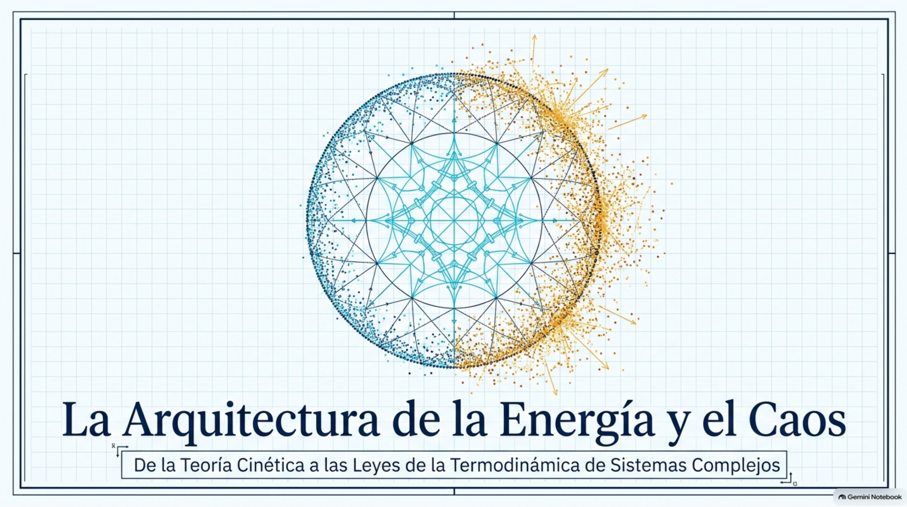

Para cambiar el estado de movimiento de los objetos físicos es necesario
realizar algún trabajo, ya sea que el trabajo entre al sistema o salga
hacia el exterior. Tales trabajos se generan cuando algunos de esos
agentes del cambio llamados fuerzas modifican el estado de movimiento de
algún objeto físico en relación con su posición, orientación u
oscilación. Se necesita energía para producir trabajo.

¿De qué energía se trata? Se estima que el universo contiene el 72% de
materia oscura (responsable de los efectos gravitatorios en galaxias y
cúmulos de galaxias), el 23% es energía oscura (atribuida a la expansión
acelerada del universo) y el 4.6% corresponde a la materia común. Este
capítulo se refiere a ese 4.6% de la energía y al desarrollo de la
Termodinámica, como ciencia fenomenológica que se ocupa de las
relaciones entre energía y trabajo. También considera los procesos de
almacenamiento, transferencia y transformación de la energía.

La energía es la capacidad de un sistema para producir trabajo; permite
la transferencia de calor, la emisión o absorción de radiación, la
producción de sonidos y vibraciones, la generación de campos eléctricos
y magnéticos y de interacciones gravitacionales, químicas y nucleares,
así como las transformaciones del estado de movimiento de los objetos
físicos.

Las formas más comunes de energía son: la cinética que tiene un objeto
por estar en movimiento, la potencial que posee un objeto debido a su
posición o estado, la térmica relacionada con el calor, la eléctrica
producida por el movimiento de cargas eléctricas, la luminosa que
transporta la luz, la química que almacenan sustancias como los
alimentos o combustibles y la nuclear que se encuentra en el núcleo de
los átomos.

Desde el punto de vista de la física moderna, el concepto de energía ha
sufrido dos grandes revoluciones. La primera revolución fue la
cuantización de la energía: a principios del siglo pasado la
Termodinámica clásica era insuficiente para resolver el problema de la
radiación del cuerpo negro. Fue entonces que Max Planck propuso la
hipótesis de que la energía está cuantizada, sólo toma valores
discretos, no continuos. Esta propuesta marcó el inicio de la física
cuántica.

La segunda revolución se debió a que según la teoría de la relatividad
especial de Albert Einstein la masa y la energía son equivalentes; es
decir $E = mc^{2},$ donde $E\ $es la energía, $m\ $la masa y $c\ $la
velocidad de la luz. Además, un hecho experimental suficientemente
confirmado, la conservación de la energía, se interpretó como una
consecuencia de la existencia de una relación de simetría en la
naturaleza: las leyes físicas no cambian con el tiempo porque la energía
es homogénea; es decir, no existen instantes privilegiados para medir el
tiempo.

Dejando a un lado la revolución relativista, en este capítulo
consideraremos los primeros eventos que marcaron el inicio de la
revolución cuántica, asociados fundamentalmente con la solución al
problema de la radiación del cuerpo negro.

Las diapositivas e infogramas incluidos en este capítulo han sido
generadas por el programa NotebookLM a partir de documentos elaborados
por el autor.

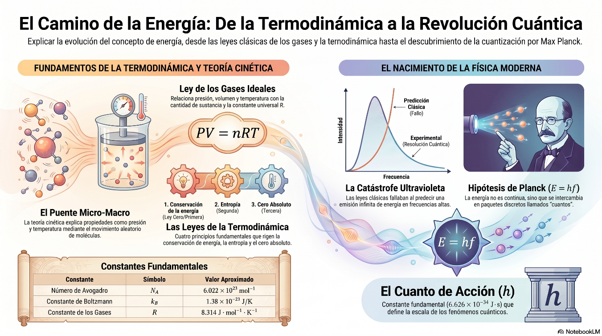

**OBJETIVOS Y CONTENIDOS DE LAS SECCIONES**

**7.1. Teoría cinética de gases y Termodinámica**

Revisar las primeras aportaciones al desarrollo de la teoría cinética de
los gases y considerar las contribuciones a la construcción de la
Termodinámica realizadas por James Prescott Joule, Julius Robert Mayer,
Nicolas Léonard Sadi Carnot, William Thomson Primer Barón Kelvin, Rudolf
Julius Emanuel Clausius y Hermann Ludwig Ferdinand von Helmholtz,
[Walther Hermann
Nernst](https://www.nobelprize.org/prizes/chemistry/1920/nernst/facts/),
[William Francis
Giauque](https://www.nobelprize.org/prizes/chemistry/1949/giauque/facts/),
[Lars
Onsager](https://www.nobelprize.org/prizes/chemistry/1968/onsager/facts/)
e [Ilya
Prigogine](https://www.nobelprize.org/prizes/chemistry/1977/prigogine/facts/).

- Desarrollo inicial de la teoría cinética de los gases

- Desarrollo de la Termodinámica

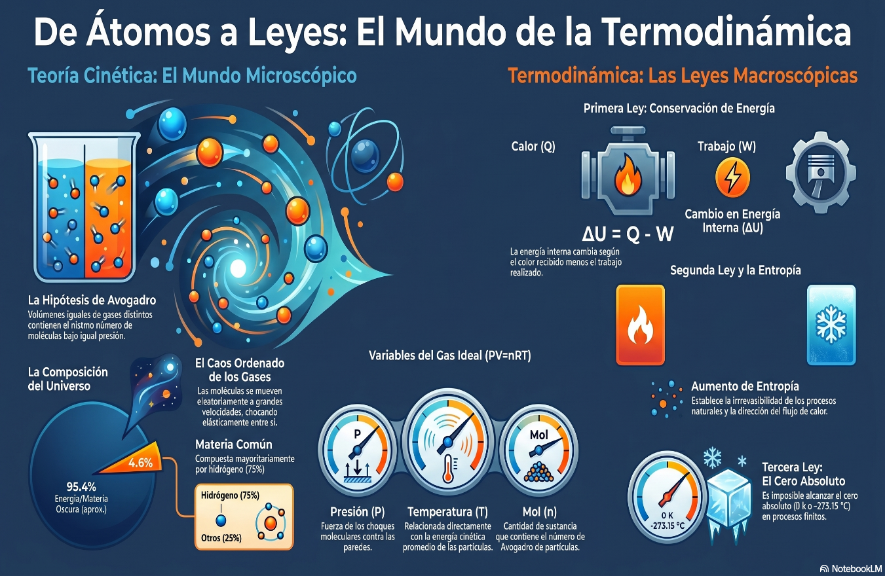

**7.2. Energía cuantizada de la radiación del cuerpo negro**

Describir cómo y porqué la solución al problema de la radiación
electromagnética del cuerpo negro requirió de la cuantización de la
energía.

Considerar las aportaciones a la construcción de la nueva mecánica
cuántica de Einstein, Bohr, Heisenberg y Schrödinger.

- Cuantización de la energía en la radiación del cuerpo negro

- Cambios y contribuciones de la revolución científica de la mecánica
  cuántica

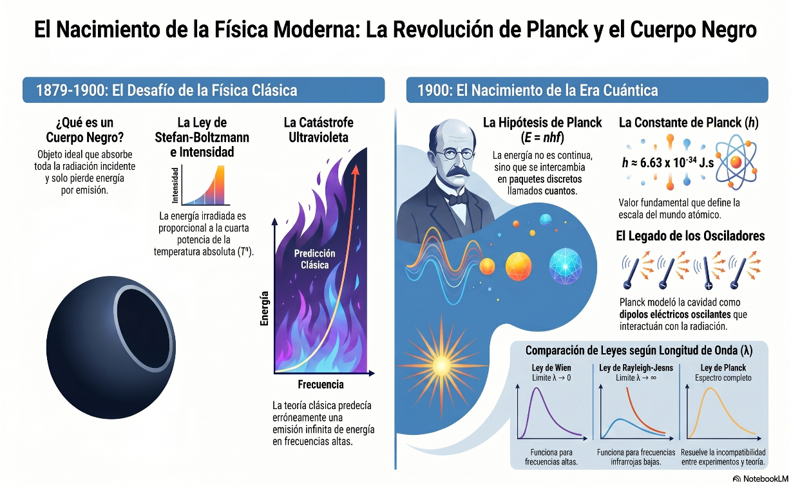

**7.3. Componentes de la Conferencia Nobel de Max Planck**

Describir el contenido de la Conferencia presentada en 1919 por [Max
Karl Ernst Ludwig
Planck](https://www.nobelprize.org/prizes/physics/1918/planck/facts/), a
quien se le otorgó el Premio Nobel de Física en 1918 "en reconocimiento
a los servicios prestados al avance de la física mediante su
descubrimiento de cuantos de energía".

- Conferencia: *Génesis y Estado Actual del Desarrollo de la Teoría
  Cuántica*

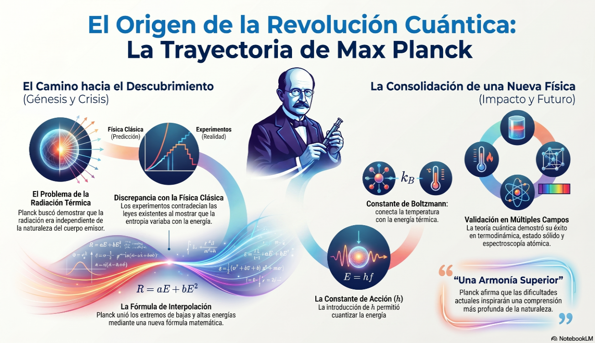

**7.1. Teoría cinética de gases y Termodinámica**

Esta sección 7.1 está dedicada al tratamiento del concepto de energía y
consta de dos partes: (1) la descripción básica del desarrollo inicial
de la teoría cinética de los gases y (2) un breve resumen de las leyes
de la Termodinámica y el análisis de las contribuciones realizadas por
diez de los investigadores que más han contribuido a la construcción de
la Termodinámica: Joule, Mayer, Carnot, Kelvin, Clausius, Helmholtz,
Nerst,
[Giauque](https://www.nobelprize.org/prizes/chemistry/1949/giauque/facts/),
[Onsager](https://www.nobelprize.org/prizes/chemistry/1968/onsager/facts/)
y
[Prigogine](https://www.nobelprize.org/prizes/chemistry/1977/prigogine/facts/).

**Desarrollo inicial de la teoría cinética de los gases**

Aunque Amedeo Avogadro (1776-1856) no formuló ninguna de las leyes de la
Termodinámica, su hipótesis molecular constituyó una de las bases
conceptuales más importantes en la formulación de la teoría cinética de
los gases y posteriormente, en la interpretación microscópica de las
leyes termodinámicas. Al proponer lo que hoy se conoce como la hipótesis
de Avogadro, su autor abrió el camino para explicar las propiedades
macroscópicas de los gases a partir de su estructura microscópica.

En 1811, Avogadro introdujo el término molécula y formuló la hipótesis
que lleva su nombre: *"Volúmenes iguales de gases diferentes, bajo las
mismas condiciones de presión y temperatura, contienen el mismo número
de moléculas."* Como consecuencia de esta hipótesis fue posible
determinar masas moleculares relativas, explicarse por qué distintos
gases obedecen relaciones semejantes entre presión, volumen y
temperatura y establecerse una conexión entre las propiedades
macroscópicas de un gas y su estructura microscópica.

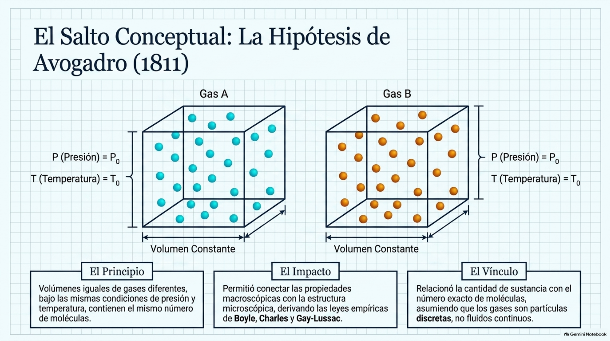

La hipótesis de Avogadro permite interpretar las leyes empíricas de los
gases suponiendo que los gases están constituidos por partículas
discretas, que el número de partículas es proporcional al volumen cuando
la presión y la temperatura permanecen constantes y que las propiedades
macroscópicas surgen del comportamiento colectivo de esas partículas.
Estas ideas hicieron posible relacionar el concepto macroscópico de
cantidad de sustancia con el número de moléculas, interpretar la presión
como resultado de los choques moleculares, conectar la temperatura con
la energía cinética promedio de las partículas y desarrollar la teoría
cinética de los gases.

De la hipótesis de Avogadro se han derivado las leyes experimentales de
Boyle, Charles. Gay-Lussac y Avogadro.

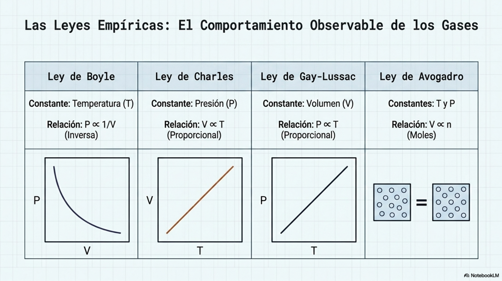

La teoría cinética de los gases explica propiedades macroscópicas de los
gases tales como la presión, la temperatura y el volumen, a partir del
movimiento y las interacciones microscópicas de las moléculas que los
constituyen, asumiendo que se satisfacen las leyes reversibles de la
mecánica clásica. Esta teoría establece un puente entre el
comportamiento de las partículas individuales y las propiedades
observables de los llamados gases ideales, los cuales satisfacen las
siguientes condiciones a bajas presiones y altas temperaturas:

- Los gases están formados por un gran número de diminutas partículas
  puntuales sólidas (moléculas o átomos) que se mueven continuamente y
  de manera aleatoria.

- Las moléculas están separadas entre sí por distancias relativamente
  grandes.

- Las moléculas se mueven a grandes velocidades caóticamente en todas
  direcciones, chocando continuamente entre sí y con las paredes del
  contenedor. Entre colisiones, las moléculas se desplazan libremente en
  línea recta, mientras que las colisiones de las partículas con las
  paredes del recipiente son perfectamente elásticas, es decir, se
  conserva la energía cinética.

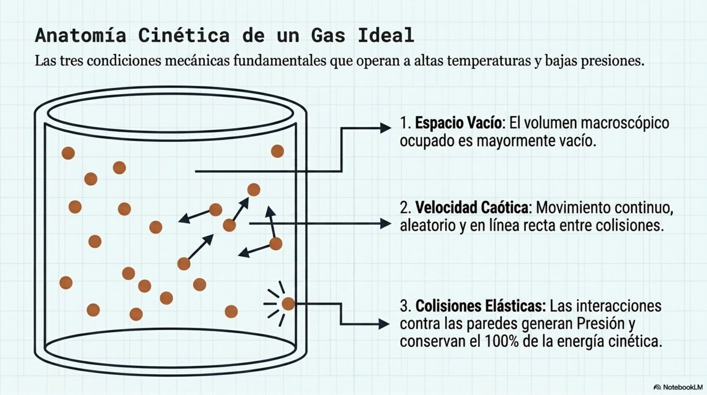

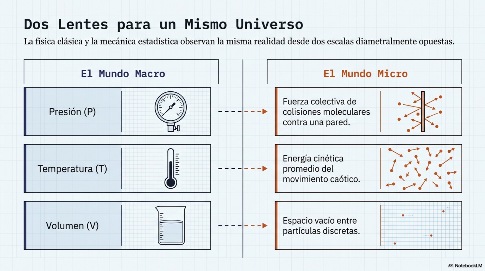

En condiciones de bajas presiones y altas temperaturas se satisface la
ecuación de estado del gas ideal: $PV = nRT$.

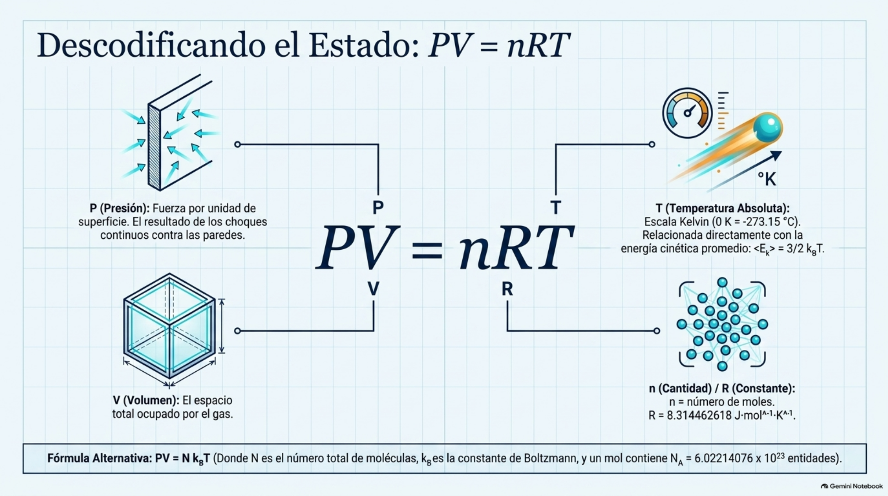

Usualmente la temperatura se mide en kelvins (K). Un kelvin tiene el
mismo tamaño que un grado Celsius, pero las dos escalas tienen distintos
puntos de origen: la escala Kelvin comienza en el cero absoluto,
mientras que la escala Celsius fija el valor 0 °C en 273.15 K.

Por otra parte, una de las unidades más utilizadas para medir energías
es el Joule (J): cuantifica la capacidad de realizar trabajo o producir
cambios físicos; corresponde al trabajo realizado por una fuerza de 1
Newton (N) que desplaza un objeto una distancia de 1 metro (m) en la
dirección de la fuerza: $1\text{~J} = 1\text{~N} \cdot \text{m.}$ Dado
que la unidad de fuerza es
$1\text{~N} = 1\text{~kg} \cdot \text{m/s}^{2},$
entonces$\ 1\text{~J} = 1\text{~kg} \cdot \text{m}^{2}/\text{s}^{2}.$

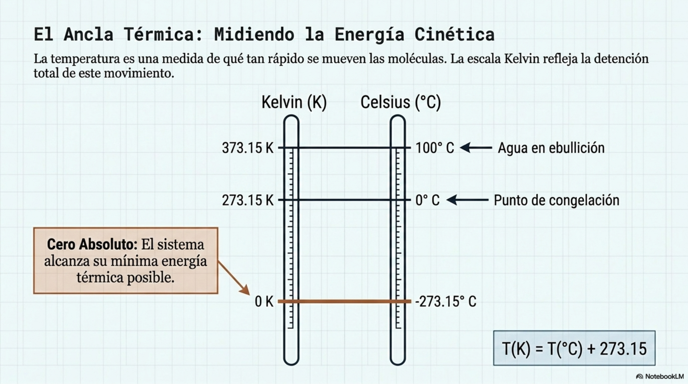

La ecuación de estado de un gas ideal $PV = nRT$ puede escribirse en
forma equivalente como: $PV = Nk_{B}T,\ $donde $N\ $es el número total
de moléculas y $k_{B}$ es la constante de Boltzmann. Si $N_{A}$es el
número de Avogadro se tiene que $R = N_{A}k_{B}\ $cuando n = 1.

La cantidad de sustancia ($n$) representa el número de moles del gas. Un
mol contiene
exactamente$\ N_{A} = \ N_{0} = 6.02214076 \times 10^{23}\ \text{mol}^{- 1}\ ($entidades
elementales como átomos, moléculas o partículas). Este valor es conocido
como el número de Avogadro,

| La constante universal de los gases ($R$) relaciona las propiedades macroscópicas del gas con la cantidad de sustancia y tiene el valor de 8.314462618 J·mol⁻¹·K⁻¹. |
|---------------------------------------------------------------------------------------------------------------------------------------------------------------------|

La mayor utilidad de la hipótesis de Avogadro fue la de permitir que la
teoría cinética de los gases se desarrollara en forma experimental. Dos
eventos sirvieron de antecedente a tal desarrollo: (1) en 1738 Daniel
Bernoulli (1700-1782) explicó que la presión en los gases se debía a las
colisiones de sus moléculas con las paredes del recipiente que los
contiene y (2) en 1851, James Prescot Joule (1818-1889) calculó que la
velocidad media con la cual se desplazan las moléculas de un gas a
temperaturas ordinarias es de 400 m/s.

Posteriormente, James Clerk Maxwell (1831-1879) y Ludwig Edward
Boltzmann (1844-1906) establecen formalmente la teoría cinética de los
gases, utilizando nociones probabilísticas para tratar los movimientos
aleatorios de las moléculas. Introdujeron conceptos como la probabilidad
de colisión, el camino libre medio, la equipartición de la energía y la
ley de distribución de velocidades.

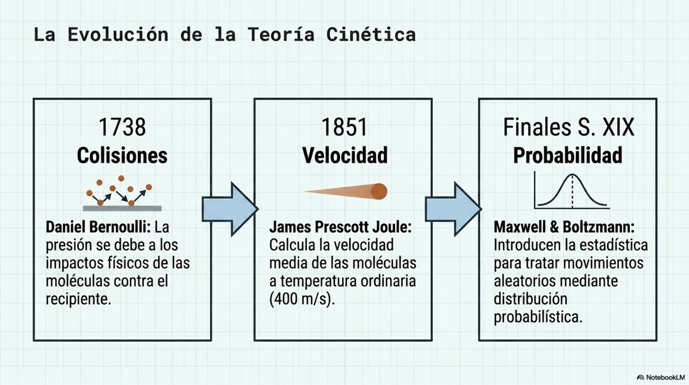

Fue Boltzmann quien estableció la conexión entre los estados
macroscópicos que describe la Termodinámica y los estados microscópicos
que trata la mecánica estadística. Por ejemplo, la entropía (S) del
sistema es una variable macroscópica que es función de tres variables:
la energía (E), el volumen (V) y el número de partículas (N). Estas
variables están relacionadas con el número de configuraciones
microscópicas o posibles estados (Ω) tales que la entropía es la función
S(E, N, V) = kBlog(Ω), donde kB es la llamada
constante de Boltzmann.

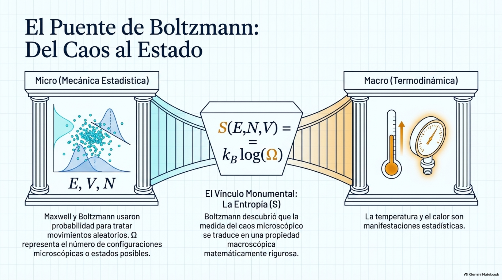

**Desarrollo de la Termodinámica**

La Termodinámica estudia cómo se comporta la energía y cuáles son las
leyes que rigen sus transformaciones; estudia los intercambios de calor
y trabajo entre los sistemas físicos y su entorno. Los principales
conceptos básicos de la Termodinámica son: Sistema termodinámico (la
parte del universo que se elige para estudiar), Entorno (todo lo que
rodea al sistema), Estado termodinámico (condición del sistema descrita
por variables como presión, volumen y temperatura), Temperatura (medida
relacionada con el estado térmico del sistema), Calor (energía
transferida debido a una diferencia de temperaturas), Trabajo (energía
generada por la acción de fuerzas o por cambios macroscópicos del
sistema) y Energía interna (energía total asociada a las partículas que
componen el sistema, incluyendo sus movimientos e interacciones
microscópicas).

Las cuatro leyes de la Termodinámica se enuncian a continuación:

**Ley cero** (transitividad): si dos cuerpos separados están en
equilibrio termodinámico con un tercero (tienen la misma temperatura),
entonces ambos cuerpos tienen la misma temperatura. Esta ley proporciona
la base para definir el concepto de temperatura.

**Primera ley (**expresa la conservación de la energía): el cambio en la
energía interna en un sistema cerrado ($\Delta U$) es igual a la
diferencia del calor que recibe ($Q$) menos el trabajo que realiza
($W$): $\Delta U = Q - W.\ \ Si\ $el trabajo es realizado sobre el
sistema $\Delta U = Q + W$.Principio del formulario

Final del formulario

**Segunda ley** (sentido de irreversibilidad): establece que los
procesos naturales tienen una dirección preferente y que los únicos
cambios posibles en un sistema aislado son aquellos en los que la
entropía no disminuye, aumenta o permanece constante. La entropía, que
en griego significa evolución o transformación, mide el grado de
organización en las componentes de un sistema; es decir, qué tanto se
dispersa la energía entre tales componentes. La entropía indica el
número de configuraciones microscópicas compatibles con un estado
macroscópico y manifiesta la dirección natural en que evolucionan los
procesos espontáneos. Esta ley explica por qué el calor fluye de los
cuerpos calientes a los fríos y por qué ninguna máquina térmica puede
ser 100 % eficiente.

**Tercera ley** (el cero absoluto es inalcanzable en un número finito de
procesos): cuando la temperatura se aproxima al cero absoluto
(T0) la entropía tiende a un valor constante mínimo,
habitualmente tomado como cero. El cero absoluto es la temperatura a la
que un sistema alcanza su mínima energía térmica posible. El valor de
T0 en distintas escalas de temperatura es: 0 kelvin (0 K),
−273.15 °C (grados Celsius) y −459.67 °F (grados Fahrenheit).

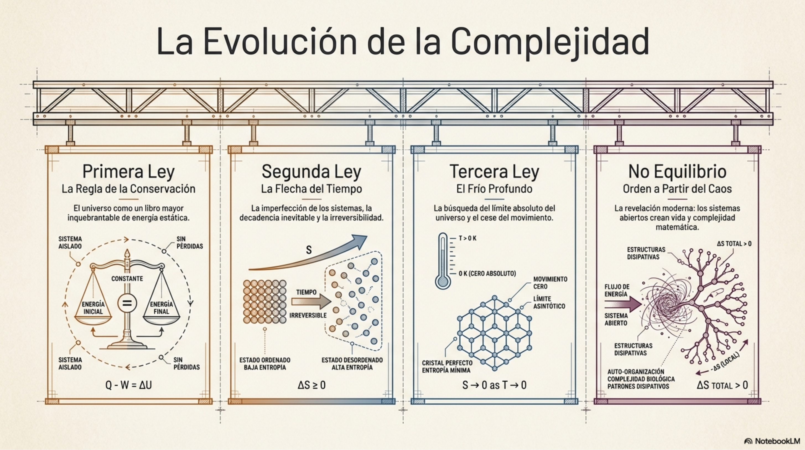

Los siguientes cuadros describen las principales contribuciones de diez
científicos que participaron de manera crítica en la construcción de la
Termodinámica.

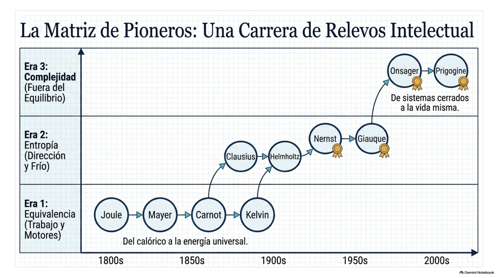

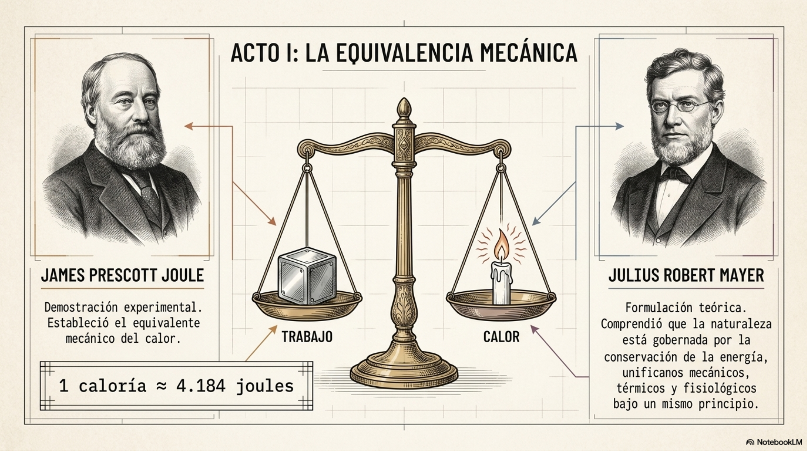

<table>
<colgroup>
<col style="width: 20%" />
<col style="width: 79%" />
</colgroup>
<thead>
<tr class="header">
<th colspan="2">James Prescott Joule (1818-1889)</th>
</tr>
</thead>
<tbody>
<tr class="odd">
<td>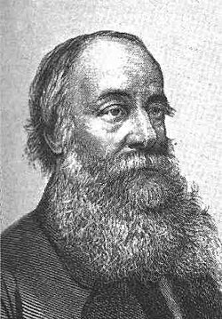</td>
<td><ul>
<li>
Demostró experimentalmente la equivalencia entre trabajo mecánico
y calor: el calor es una forma de energía y existe una equivalencia
precisa entre el trabajo mecánico y el calor. Esto sentó las bases de la
primera ley de la termodinámica que expresa el principio de conservación
de la energía.
</li>
<li>
Cuantificó la relación entre trabajo y calor, obteniendo el
llamado equivalente mecánico del calor.
</li>
</ul></td>
</tr>
<tr class="even">
<td colspan="2"><ul>
<li>
Estudió la expansión libre de los gases y mostró que, para un gas
ideal, la energía interna depende únicamente de la temperatura y no del
volumen (efecto Joule).
</li>
<li>
Investigó el calentamiento producido por el paso de corriente
eléctrica a través de un conductor y concluyó que el calor generado es
proporcional al cuadrado de la corriente, a la resistencia eléctrica y
al tiempo durante el cual circula la corriente (efecto
Joule–Lenz).
</li>
</ul></td>
</tr>
<tr class="odd">
<td colspan="2">Fuente:
https://upload.wikimedia.org/wikipedia/commons/thumb/7/71/Joule.jpg/330px-Joule.jpg</td>
</tr>
</tbody>
</table>

<table>
<colgroup>
<col style="width: 15%" />
<col style="width: 84%" />
</colgroup>
<thead>
<tr class="header">
<th colspan="2">Julius Robert Mayer (1814-1878)</th>
</tr>
</thead>
<tbody>
<tr class="odd">
<td>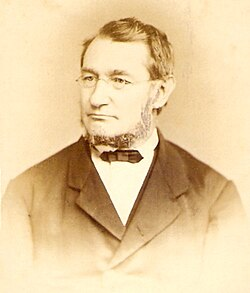</td>
<td><ul>
<li><blockquote>

Formuló el principio universal de conservación de la energía y
unificó fenómenos mecánicos, térmicos, químicos y biológicos bajo este
mismo principio general.

</blockquote></li>
<li><blockquote>

Contribuyó a la formulación del principio de conservación de la
energía aportando argumentos teóricos y conceptuales más que realizando
experimentos cuantitativos.

</blockquote></li>
<li><blockquote>

Propuso que el calor y el trabajo mecánico son manifestaciones
diferentes pero equivalentes de una misma magnitud física.

</blockquote></li>
</ul></td>
</tr>
<tr class="even">
<td colspan="2"><ul>
<li><blockquote>

Partió de observaciones fisiológicas y razonamientos físicos cuando
advirtió que el calor corporal procede de transformaciones químicas y
que existe una equivalencia general entre diferentes formas de
energía.

</blockquote></li>
</ul></td>
</tr>
<tr class="odd">
<td
colspan="2">Fuente:https://upload.wikimedia.org/wikipedia/commons/thumb/0/05/Julius_Robert_Mayer_von_Friedrich_Berrer_%28portrait%29.jpg/500px-Julius_Robert_Mayer_von_Friedrich_Berrer_%28portrait%29.jpg</td>
</tr>
</tbody>
</table>

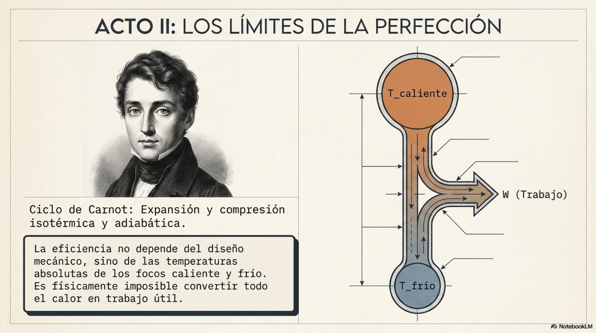

<table>
<colgroup>
<col style="width: 23%" />
<col style="width: 76%" />
</colgroup>
<thead>
<tr class="header">
<th colspan="2">Nicolas Léonard Sadi Carnot (1796-1832)</th>
</tr>
</thead>
<tbody>
<tr class="odd">
<td>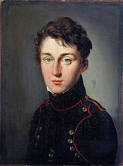</td>
<td><ul>
<li>
Analizó procesos físicos más que tratar de describir cómo ocurren
e identificó los límites fundamentales impuestos por las leyes de la
naturaleza.
</li>
<li>
Estudió la eficiencia de las máquinas térmicas para transformar
calor en trabajo mecánico e imaginó una máquina ideal que realiza un
ciclo completamente reversible que consta de cuatro procesos: expansión
isotérmica a temperatura alta, expansión adiabática, compresión
isotérmica a temperatura baja y compresión adiabática (ciclo de
Carnot).
</li>
<li>
Introdujo el concepto de reversibilidad al explicar cómo debían
operar las máquinas ideales mediante procesos reversibles, es decir,
procesos que pueden invertirse sin pérdidas de energía.
</li>
</ul></td>
</tr>
<tr class="even">
<td colspan="2"><ul>
<li>
Pese a haber utilizado la teoría del calórico, sus razonamientos
inspiraron a Rudolf Clausius y William Thomson, Lord Kelvin para
formular la segunda ley de la termodinámica, la cual establece límites
para la conversión de calor en trabajo y conduce al concepto moderno de
entropía.
</li>
</ul></td>
</tr>
<tr class="odd">
<td colspan="2">Fuente:
https://upload.wikimedia.org/wikipedia/commons/8/80/Sadi_Carnot.jpeg</td>
</tr>
</tbody>
</table>

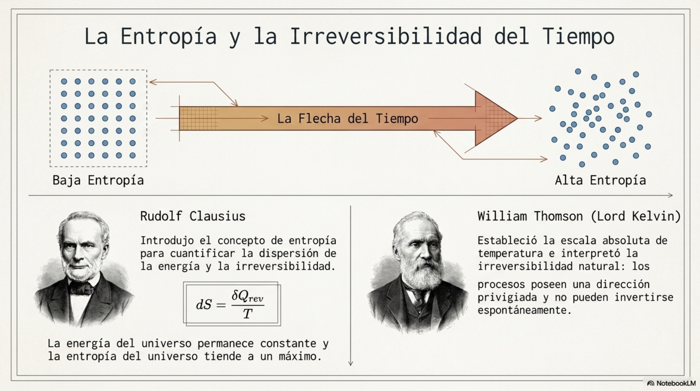

<table>
<colgroup>
<col style="width: 22%" />
<col style="width: 77%" />
</colgroup>
<thead>
<tr class="header">
<th colspan="2">Rudolf Julius Emanuel Clausius (1822-1888)</th>
</tr>
</thead>
<tbody>
<tr class="odd">
<td>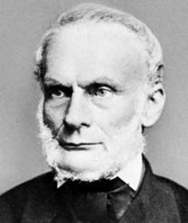</td>
<td><ul>
<li>
Enunció una formulación rigurosa de la segunda ley de la
Termodinámica e introdujo el concepto de entropía.
</li>
<li>
Reformuló las ideas de Carnot acerca de la conservación de la
energía con el fin de integrar las máquinas térmicas, la conversión
entre calor y trabajo, la conservación de la energía y una descripción
coherente de los procesos térmicos.
</li>
<li>
Propuso un enunciado diferente de la segunda ley: el calor no
puede pasar espontáneamente de un cuerpo frío a otro caliente.
</li>
</ul></td>
</tr>
<tr class="even">
<td colspan="2"><ul>
<li>
Contribuyó al desarrollo de la teoría cinética de los gases al
formular el concepto de camino libre medio de las moléculas, estudiar el
movimiento molecular en los gases y relacionar propiedades microscópicas
con variables macroscópicas como presión y temperatura. Preparó el
terreno para los trabajos posteriores de Maxwell y Boltzmann.
</li>
<li>
Consolidó matemáticamente la Termodinámica al utilizar un
lenguaje preciso para describir procesos reversibles e irreversibles y
propició la comprensión de su estructura lógica; estableció relaciones
cuantitativas entre calor, trabajo y energía interna.
</li>
</ul></td>
</tr>
<tr class="odd">
<td colspan="2">Fuente:
https://upload.wikimedia.org/wikipedia/commons/4/40/Clausius.jpg</td>
</tr>
</tbody>
</table>

<table>
<colgroup>
<col style="width: 21%" />
<col style="width: 78%" />
</colgroup>
<thead>
<tr class="header">
<th colspan="2">William Thomson, Primer Barón Kelvin (1824-1907)</th>
</tr>
</thead>
<tbody>
<tr class="odd">
<td>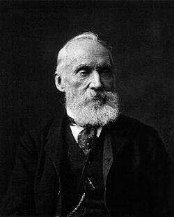</td>
<td><ul>
<li>
Desarrolló una Termodinámica como teoría con fundamentos
matemáticos sólidos para integrar el principio de conservación de la
energía, la teoría de las máquinas térmicas, los resultados
experimentales de Joule y las ideas de Carnot sobre procesos
reversibles.
</li>
</ul>
<ul>
<li>
Reformuló la segunda ley de la termodinámica para establecer un
límite fundamental a la eficiencia de las máquinas térmicas y demostró
que ninguna máquina que opere en un ciclo puede convertir todo el calor
en trabajo útil.
</li>
</ul></td>
</tr>
<tr class="even">
<td colspan="2"><ul>
<li>
Colaboró con Joule en el estudio de la expansión de los gases y
juntos descubrieron el ahora denominado efecto Joule–Thomson: la
temperatura de un gas real cambia cuando se expande a través de una
válvula, un tapón poroso o una pequeña abertura, sin intercambiar calor
con el entorno y sin realizar trabajo mecánico externo. Esto constituye
el proceso de expansión por estrangulamiento
<strong>(</strong><em>throttling process</em>).
</li>
</ul></td>
</tr>
<tr class="odd">
<td colspan="2">Fuente:
https://upload.wikimedia.org/wikipedia/commons/thumb/a/a0/Lord_Kelvin_photograph.jpg/500px-Lord_Kelvin_photograph.jpg</td>
</tr>
</tbody>
</table>

<table>
<colgroup>
<col style="width: 22%" />
<col style="width: 77%" />
</colgroup>
<thead>
<tr class="header">
<th colspan="2">Hermann Ludwig Ferdinand von Helmholtz (1821 -
1894)</th>
</tr>
</thead>
<tbody>
<tr class="odd">
<td>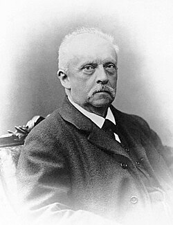</td>
<td><ul>
<li>
Desarrolló una visión unificada de los fenómenos físicos,
químicos y biológicos y mostró que procesos aparentemente distintos
podían interpretarse como transformaciones de la misma magnitud física:
la energía.
</li>
<li>
Propuso una formulación general del principio de conservación de
la energía insistiendo en la idea de que la energía no se crea ni se
destruye, únicamente cambia de una forma a otra.
</li>
</ul></td>
</tr>
<tr class="even">
<td colspan="2"><ul>
<li>
Proporcionó una base conceptual sólida para interpretar la
primera ley de la Termodinámica como una manifestación particular de un
principio universal.
</li>
<li>
Introdujo una perspectiva energética en la fisiología al
demostrar que los procesos biológicos obedecen los mismos principios
físicos que los sistemas inanimados, que el metabolismo implica
transformaciones de energía química y que el calor producido por los
organismos puede analizarse mediante las leyes de la física. Además,
rechazó el vitalismo en fisiología.
</li>
<li>
Introdujo la función termodinámica conocida como energía libre de
Helmholtz <em>F</em> = <em>U</em> − <em>T</em><em>S</em>,
donde <em>U</em> es la energía interna,
<em>T</em> es la temperatura absoluta y
<em>S</em> es la entropía. En sistemas
que evolucionan a temperatura y volumen constantes una disminución de
<em>F</em> indica una evolución
espontánea y el mínimo de <em>F</em> corresponde al equilibrio
termodinámico.
</li>
</ul></td>
</tr>
<tr class="odd">
<td colspan="2">Fuente:
https://upload.wikimedia.org/wikipedia/commons/c/c7/Hermann_von_Helmholtz.jpg</td>
</tr>
</tbody>
</table>

<table>
<colgroup>
<col style="width: 24%" />
<col style="width: 75%" />
</colgroup>
<thead>
<tr class="header">
<th colspan="2">Walther Hermann Nernst Görbitz (1864 - 1941)</th>
</tr>
</thead>
<tbody>
<tr class="odd">
<td>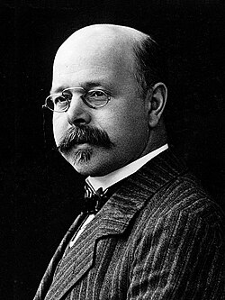</td>
<td><ul>
<li>
Formuló la tercera ley de la Termodinámica que permite definir
una referencia absoluta para la entropía y plantea límites para los
procesos de enfriamiento.
</li>
<li>
Desarrolló la termodinámica química para estudiar, por ejemplo,
la dirección espontánea de las reacciones químicas, las condiciones del
equilibrio químico y las transformaciones energéticas en sistemas
químicos.
</li>
<li>
Calculó entropías absolutas de sustancias mediante mediciones
experimentales de sus capacidades caloríficas y de las transiciones de
fase.
</li>
</ul></td>
</tr>
<tr class="even">
<td colspan="2"><ul>
<li>
Formuló una ecuación que lleva su nombre para relacionar el
potencial eléctrico de una celda con la concentración de las especies
químicas involucradas.
</li>
<li>
Estableció relaciones entre conceptos tales como energía libre,
temperatura, equilibrio químico, potencial eléctrico y espontaneidad de
las reacciones químicas.
</li>
<li>
Impulsó el estudio de la criogenia y de la física del estado
sólido.
</li>
</ul></td>
</tr>
<tr class="odd">
<td colspan="2">Fuente:
https://upload.wikimedia.org/wikipedia/commons/thumb/7/7d/Walther_Nernst_1900s.jpg/500px-Walther_Nernst_1900s.jpg</td>
</tr>
</tbody>
</table>

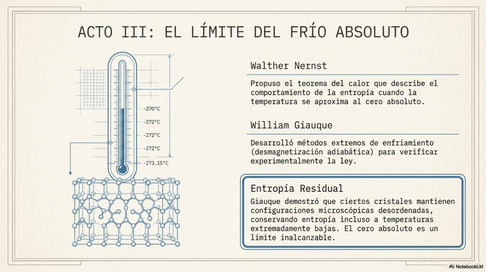

<table>
<colgroup>
<col style="width: 24%" />
<col style="width: 75%" />
</colgroup>
<thead>
<tr class="header">
<th colspan="2"><a
href="https://www.nobelprize.org/prizes/chemistry/1949/giauque/facts/">William
Francis Giauque</a> (1895 – 1982)</th>
</tr>
</thead>
<tbody>
<tr class="odd">
<td>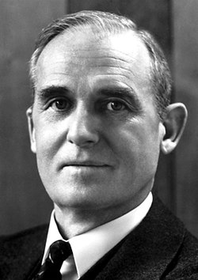</td>
<td><ul>
<li>
Desarrolló la termodinámica de bajas temperaturas y contribuyó a
la verificación experimental de la tercera ley de la Termodinámica
realizando mediciones calorimétricas extremadamente precisas.
</li>
<li>
Calculó entropías absolutas de numerosas sustancias a partir de
mediciones de capacidades caloríficas, cambios de fase, transiciones
cristalinas y propiedades térmicas a muy bajas temperaturas.
</li>
<li>
Fortaleció la conexión entre la Termodinámica clásica, la
mecánica estadística y la estructura molecular de la materia.
</li>
</ul></td>
</tr>
<tr class="even">
<td colspan="2">Fuente:
https://upload.wikimedia.org/wikipedia/en/2/20/William_Giauque_Nobel.jpg</td>
</tr>
</tbody>
</table>

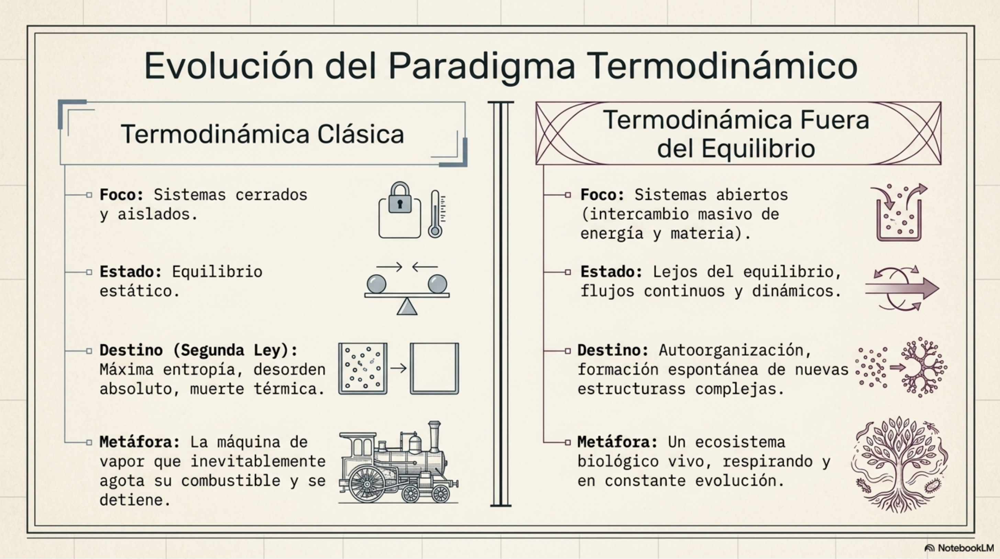

<table>
<colgroup>
<col style="width: 25%" />
<col style="width: 74%" />
</colgroup>
<thead>
<tr class="header">
<th colspan="2"><a
href="https://www.nobelprize.org/prizes/chemistry/1968/onsager/facts/">Lars
Onsager</a> (1903- 1976)</th>
</tr>
</thead>
<tbody>
<tr class="odd">
<td></td>
<td><ul>
<li>
Desarrolló la Termodinámica de los procesos irreversibles o
Termodinámica fuera del equilibrio para estudiar procesos en los que
existen gradientes de temperatura, concentración o carga eléctrica que
producen flujos continuos.
</li>
<li>
Descubrió las relaciones de reciprocidad que llevan su nombre las
cuales indican que distintos procesos de transporte (calor, materia,
carga eléctrica, etc.) pueden influirse mutuamente de manera simétrica,
implicando que para sistemas que están suficientemente cercanos al
equilibrio, las relaciones entre flujos y fuerzas son lineales.
</li>
</ul></td>
</tr>
<tr class="even">
<td colspan="2"><ul>
<li>
Demostró que las leyes macroscópicas de la Termodinámica
irreversible pueden derivarse de principios microscópicos relacionados
con la reversibilidad de las ecuaciones del movimiento y con las
fluctuaciones estadísticas. Esto fortaleció el vínculo entre las leyes
macroscópicas de la Termodinámica y la dinámica microscópica de las
partículas.
</li>
<li>
Obtuvo una solución exacta para el Modelo de Ising bidimensional
sin campo magnético externo que le permitió comprender las transiciones
de fase, explicar matemáticamente el comportamiento crítico de ciertos
materiales y abrir nuevas líneas de investigación sobre fenómenos
colectivos y sistemas complejos.
</li>
</ul></td>
</tr>
<tr class="odd">
<td colspan="2">Fuente:
https://upload.wikimedia.org/wikipedia/en/f/f9/Lars_Onsager2.jpg</td>
</tr>
</tbody>
</table>

<table>
<colgroup>
<col style="width: 25%" />
<col style="width: 74%" />
</colgroup>
<thead>
<tr class="header">
<th colspan="2">Ilya Romanovich Prigogine (1917-2003)</th>
</tr>
</thead>
<tbody>
<tr class="odd">
<td>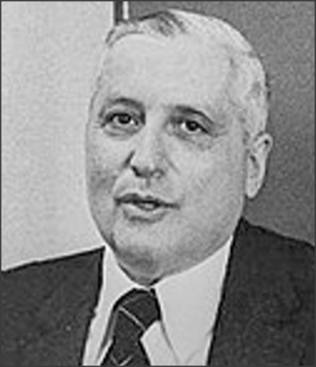</td>
<td><ul>
<li>
Desarrolló un marco teórico para explicar cómo pueden surgir
orden, organización y nuevas estructuras en sistemas alejados del
equilibrio sometidos a flujos continuos de materia y energía. Demostró
que los sistemas abiertos y alejados del equilibrio pueden evolucionar
espontáneamente hacia formas más complejas de organización.
</li>
<li>
Introdujo el concepto de estructura disipativa como sistema
organizado que permanece lejos del equilibrio, intercambia continuamente
energía y materia con su entorno, mantiene su organización gracias
precisamente a esos intercambios y produce entropía mientras conserva un
elevado grado de orden interno.
</li>
</ul></td>
</tr>
<tr class="even">
<td colspan="2"><ul>
<li>
Demostró que los sistemas abiertos pueden desarrollar
espontáneamente patrones organizados mediante procesos de
autoorganización que se presentan cuando el sistema recibe continuamente
energía desde el exterior y en consecuencia se amplifican pequeñas
fluctuaciones, aparecen nuevos estados estables, pueden surgir patrones
espaciales o temporales complejos y el sistema puede evolucionar hacia
formas de organización inexistentes en el equilibrio.
</li>
<li>
Aportó a la comprensión del significado físico del tiempo una
perspectiva según la cual la irreversibilidad no es simplemente una
consecuencia de nuestra ignorancia microscópica, sino que constituye una
característica fundamental de muchos procesos naturales de manera que la
"flecha del tiempo" desempeña un papel creativo en la evolución de
sistemas complejos.
</li>
<li>
Desarrolló una formulación rigurosa de la producción de entropía
para sistemas abiertos y procesos irreversibles mostrando que los
sistemas pueden exportar entropía hacia el entorno, que el orden interno
puede mantenerse gracias al intercambio continuo con el exterior y que
el aumento global de la entropía del universo sigue siendo compatible
con la aparición local de estructuras altamente organizadas.
</li>
<li>
Amplió las ideas de Onsager y trabajó en sistemas muy alejados
del equilibrio, relaciones no lineales, inestabilidades, bifurcaciones y
formación espontánea de nuevas estructuras.
</li>
</ul></td>
</tr>
<tr class="odd">
<td colspan="2">Fuente:
https://upload.wikimedia.org/wikipedia/commons/7/7b/Ilya_Prigogine_1977c.jpg</td>
</tr>
</tbody>
</table>

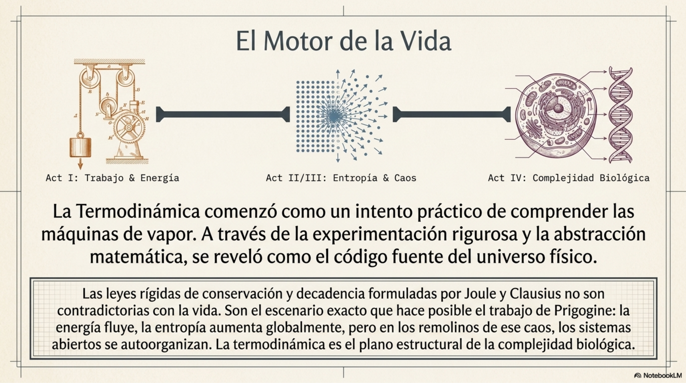

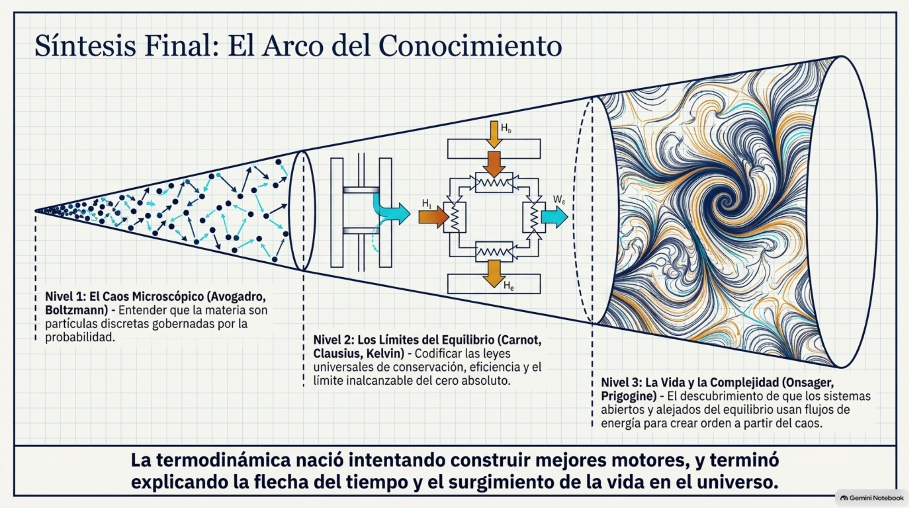

Cabe aclarar que a los últimos cuatro científicos de la lista antes
considerada se les otorgó el Premio Nobel de Química: en 1920 a Walther
Hermann Nerst "en reconocimiento a su trabajo en termoquímica", en 1949
a William Francis Giauque "por sus contribuciones en el campo de la
termodinámica química, particularmente en lo relativo al comportamiento
de sustancias a temperaturas extremadamente bajas", en 1968 a Lars
Onsager “por el descubrimiento de las relaciones recíprocas que llevan
su nombre, que son fundamentales para la termodinámica de procesos
irreversibles" y en 1977 a Ilya Romanovich Prigogine "por sus
contribuciones a la termodinámica fuera del equilibrio, particularmente
a la teoría de estructuras disipativas".

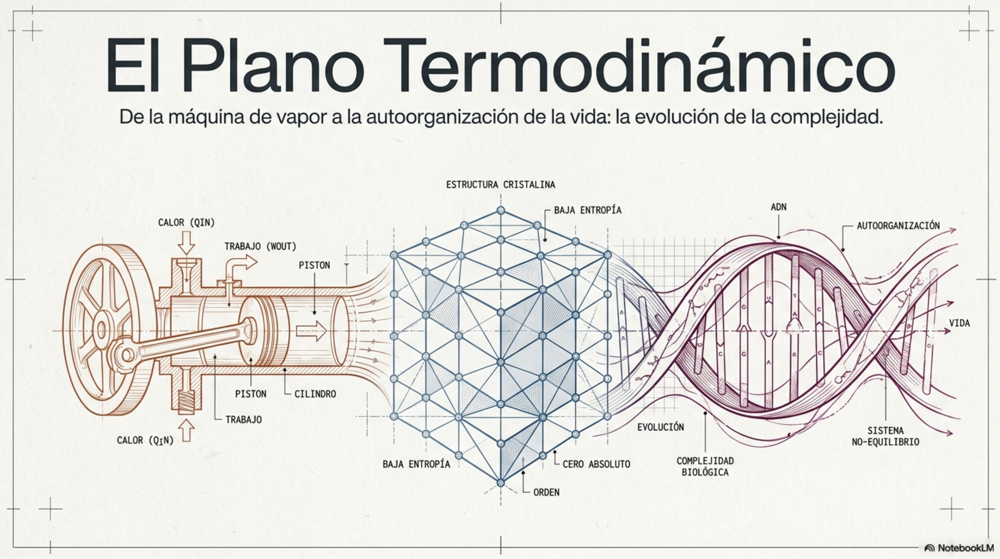

**7.2. Energía cuantizada de la radiación del cuerpo negro**

Se dice que una cantidad física está cuantizada cuando únicamente toma
valores discretos que corresponden a un número entero de veces cierta
unidad.

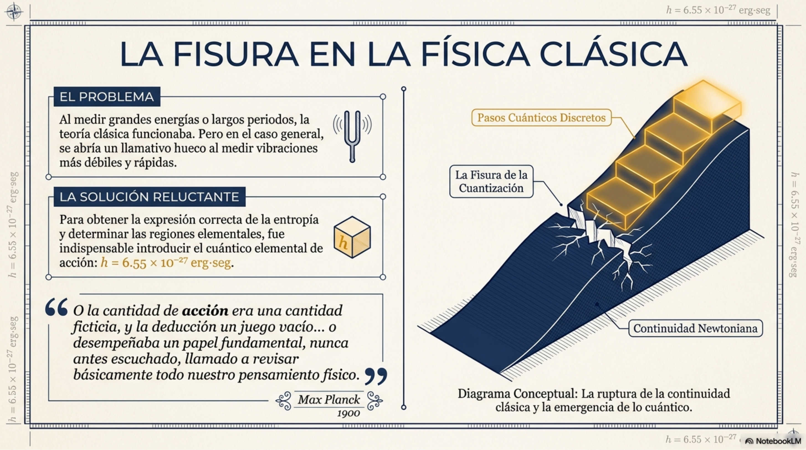

En la física clásica, generalmente el espectro de valores de las
variables que se miden corresponde a un continuo. Sin embargo, un caso
importante de cuantización es el de las ondas estacionarias que se
observan cuando se hace vibrar una cuerda de longitud L que está fija en
sus extremos.

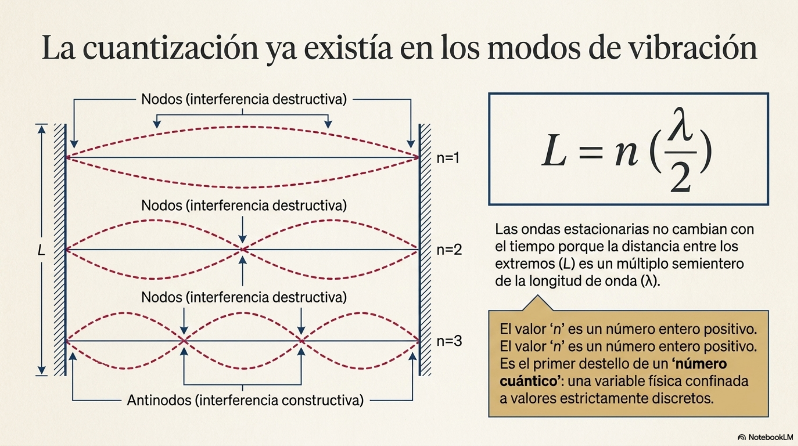

**Cuantización de la energía en la radiación del cuerpo negro**

La discrepancia conceptual y experimental entre los valores continuos y
discretos de las variables físicas se hizo evidente cuando nació la
física moderna el 14 de diciembre de 1900. Ese día, Max Planck presentó
a la Sociedad de Física Alemana (la Deutsche Physikalische
Gesellschaft*)* un trabajo en el que describía su hipótesis de la
cuantización de la energía. Ahí introdujo la constante h = 6.62607015 x
10-34 J.s (aproximadamente 6.63 x 10-34 Js) que se
mide en unidades de acción (energía por tiempo) y que ahora lleva su
nombre. A continuación, presentamos en cinco etapas un análisis de la
contribución revolucionaria de Planck para resolver un problema crítico:
la cuantización de energía en la radiación del cuerpo negro.

ETAPA 1: *Descripción en un lenguaje cotidiano común de las nociones
básicas y relaciones conceptuales necesarias para interpretar y resolver
un problema dado. Cuando es necesario, se describen los principales
antecedentes del problema y se consideran sus dificultades.*

Un cuerpo negro es un objeto físico que no pierde energía por reflexión
o transmisión sino solamente por emisión; es decir, absorbe toda la
energía que le cae encima. Como no refleja la luz incidente, se presenta
al observador como algo oscuro (negro). Dependiendo de las temperaturas
a las que se calientan los objetos físicos, éstos emiten radiaciones,
unas visibles al ojo humano (lo que determina el color del objeto) y
otras en regiones del espectro electromagnético como el infrarrojo.

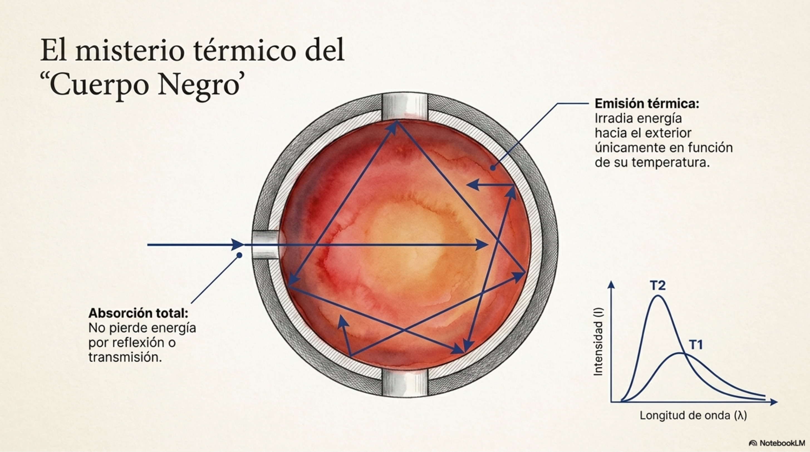

En 1879, Josef Stefan (1835-1893) dedujo a partir de sus observaciones
que la velocidad a la que irradia energía un cuerpo al calentarse debe
ser proporcional a la cuarta potencia de su temperatura absoluta. Más
tarde, en 1884, un asistente de Stefan en la Universidad de Viena,
Ludwig Edward Boltzmann (1844-1906), calculó la velocidad de las
partículas de un gas para obtener la presión de radiación ejercida por
un pistón sobre las moléculas del gas contenido en un cilindro. De estas
dos contribuciones, una inferencia a partir de datos experimentales y
una derivación teórica, se derivó la ley de Stefan-Boltzmann: I(T) =
σT4, donde σ es la constante de Stefan.

Según los resultados experimentales, la intensidad máxima de la
radiación emitida por el cuerpo negro ocurre para un λmax y
su posición se desplaza hacia la izquierda (hacia el azul) a medida que
aumenta la temperatura. Esto fue especificado por Wilhelm Carl Werner
Otto Fritz Franz Wien (1864-1928) cuando en 1893 propuso la relación
λmaxT = *a*, donde *a* es una constante. Esta relación se
conoce como la ley de desplazamiento de Wien.

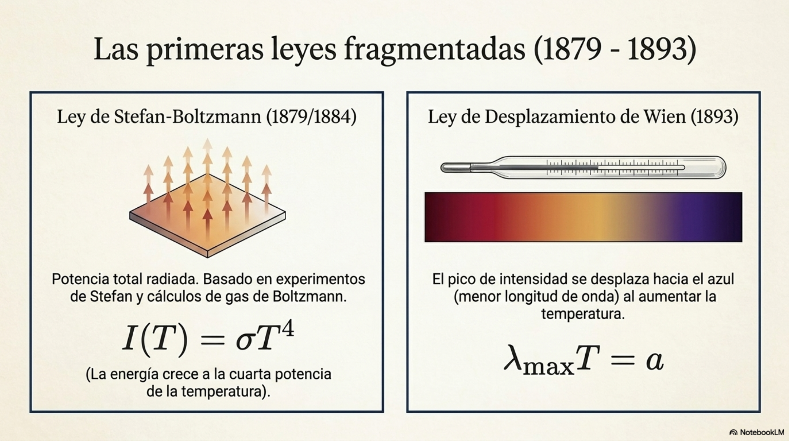

ETAPA 2: *Explicación contextualizada en un lenguaje técnico de las
suposiciones y aproximaciones necesarias para caracterizar el escenario,
los objetos y los agentes que se describen en el enunciado del problema.
Se incluye una idea de cuál debería ser la solución al problema.*

En 1893, Wien propuso una función para describir la densidad de energía
espectral (u), o energía por unidad de volumen por unidad de frecuencia
de radiación dentro de la cavidad del cuerpo negro: *u(f,T) =
α\[(f)3exp(-βf/T)\],* donde f es la frecuencia, T es la
temperatura; α y β son constantes.

Mientras tanto, el físico británico John William Strutt, tercer Barón
Rayleigh (1842 – 1919), obtuvo en junio de 1900 una fórmula para
calcular el número de modos libres de vibración electromagnética por
unidad de volumen en la cavidad, por unidad de longitud de onda. Más
tarde, el astrónomo británico Sir James Hopwood Jeans (1877 – 1946)
realizó algunas correcciones, obteniendo la expresión *u =
8πkBT/(λ4)* para la densidad de energía por unidad
de intervalo de longitud de onda, más tarde llamada ley de
Rayleigh–Jeans (*kB *es la constante de Boltzmann*)*. Esta
ley era consistente con valores experimentales para frecuencias
infrarrojas bajas, donde la ley de Wien fallaba, pero para longitudes de
onda cortas o frecuencias altas predecía una emisión infinita en el
ultravioleta, denominada "catástrofe ultravioleta".

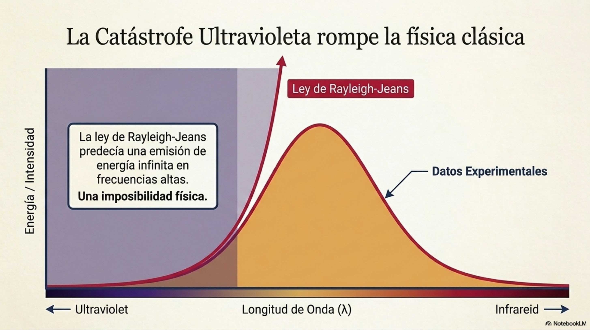

Más tarde, en un intento de obtener una ecuación general, Thiesen,
Lummer, Jahnke y Prigshein propusieron a principios del siglo XX una
ecuación general en términos de constantes (C4 y b) y los
parámetros μ y $\kappa$. La siguiente Tabla resume las expresiones de
las tres leyes descritas anteriormente.

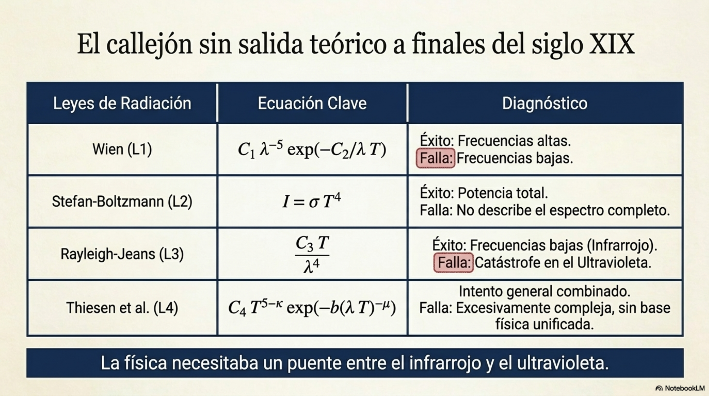

En el límite de λ→0 la ley de Planck IP conduce a la ley de
Wien si exp{hc/(kTλ)} \>\> 1; mientras que en el límite λ→∞ la ley de
Rayleigh-Jeans se obtiene si hc/(kTλ)\] \<\< 1 y usamos la aproximación
exp(x) = 1 + x.

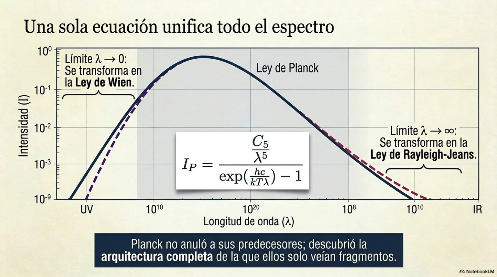

ETAPA 3*: Descripción en un lenguaje formal correspondiente al proceso
de razonamiento que conduce a la solución Se propone el uso de
diagramas, esquemas y otros elementos icónicos.*

A continuación se describe un posible razonamiento seguido por Planck :

1.  <u>Incompatibilidad entre experimentos y teorías:</u> los valores
    experimentales obtenidos por espectroscopistas son compatibles con
    las predicciones teóricas solo para bajas frecuencias (ley de Wien)
    o para altas frecuencias (ley de Rayleigh-Jeans).

2.  <u>Modelo del cuerpo negro:</u> para cada valor de la longitud de
    onda, la intensidad de la radiación emitida por el cuerpo negro
    depende únicamente de la temperatura y es independiente del material
    de la cavidad.

3.  <u>Modelo de la interacción entre la radiación y las paredes de la
    cavidad del cuerpo negro:</u> la cavidad está constituida por un
    conjunto de osciladores, representados por su frecuencia
    característica *f*, todos los cuales interactúan con la radiación
    electromagnética que llega a la cavidad.

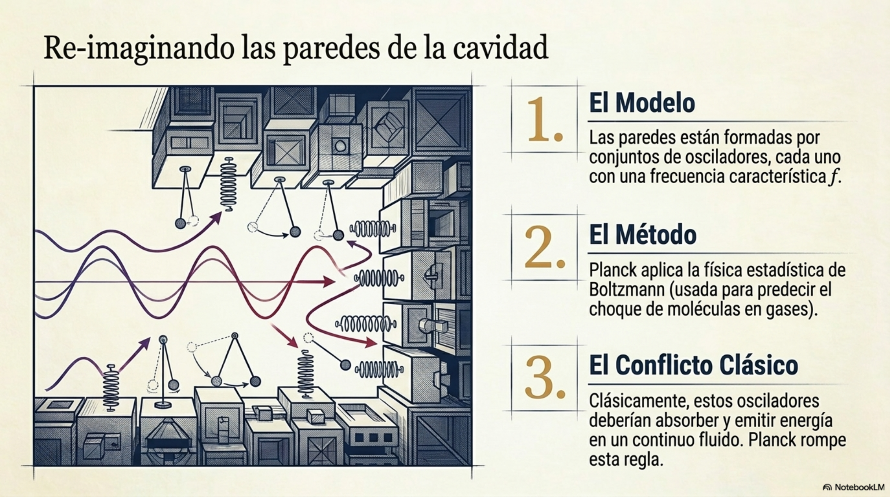

4.  <u>Estructura cuántica de los osciladores:</u> sí los osciladores
    son dipolos eléctricos oscilantes, clásicamente sus frecuencias de
    vibración pueden corresponder a emisiones o absorciones en un
    continuo de frecuencias. Esto constituye el llamado Conflicto
    Clásico.

5.  <u>Cálculo de Boltzmann:</u> El conjunto de osciladores representa
    partes de la cavidad en equilibrio térmico con la radiación
    electromagnética contenida en la cavidad. Para tener en cuenta la
    energía de estos osciladores, se aplica el método estadístico
    seguido por Boltzmann, quien calculó el comportamiento de un gas
    ideal compuesto por muchas moléculas que se mueven rápida y
    desordenadamente dentro de un recipiente, colisionando
    frecuentemente entre sí y con las paredes del recipiente.

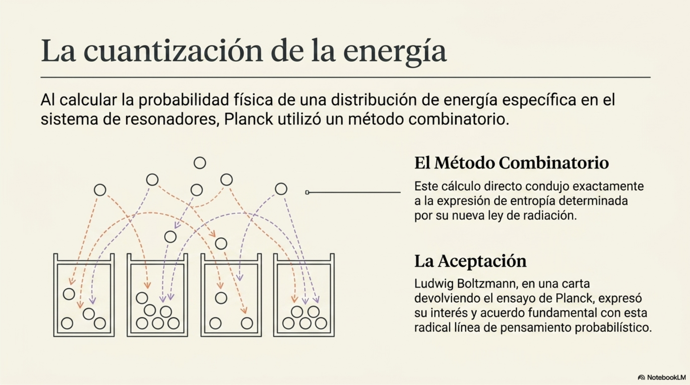

6.  <u>Intercambio discreto de energía:</u> El intercambio de energías
    entre los osciladores que constituyen la cavidad y la radiación
    electromagnética contenida en ella NO corresponde a un continuo de
    valores, sino que es consistente con la hipótesis de Planck (*E =
    nhf*): el cuanto de radiación debe ser un múltiplo entero (*n*) de
    la frecuencia (*f*).

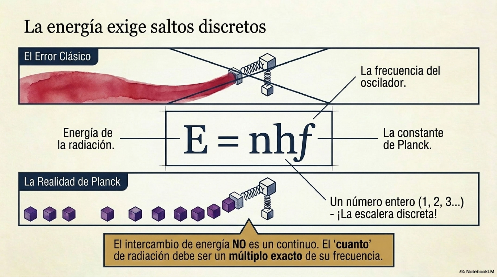

ETAPA 4: *El plan de solución presentado esquemáticamente en la etapa
anterior se pone en práctica aplicando los procedimientos y técnicas
matemáticas necesarias (véase la Conferencia del Premio Nobel de Planck
en la sección 7.3).*

ETAPA 5: *Etapa final dedicada a reflexionar metacognitivamente con dos
propósitos: repensar las cuatro etapas previas y analizar posibles
modificaciones o extensiones de la formulación del problema. Esta
revisión requiere de un análisis crítico de la solución completa que
comprende su implementación y su evaluación.*

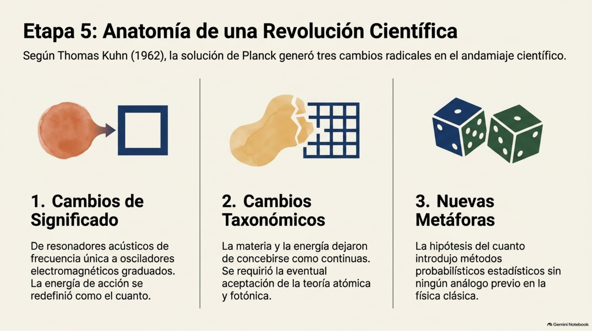

Según Kuhn (1962), las revoluciones científicas generan tres tipos de
cambios, mismos que corresponden a lo siguiente en el tratamiento de la
hipótesis de la cuantización de la energía propuesta por Max Planck:

1)  Cambios en el significado de términos básicos y en la forma en que
    las palabras y frases se relacionan con la naturaleza*.*

En su propuesta inicial, Planck habló de "resonadores"; más tarde se
refirió a osciladores. En aquel momento, los resonadores se
identificaban principalmente con la acústica, ya que aún no se habían
encontrado resonadores electromagnéticos. Mientras que los resonadores
responden a una sola frecuencia, los osciladores pueden tener múltiples
frecuencias y excitaciones graduadas. Por otro lado, también cambió el
término "energía de acción" que corresponde a un intervalo de energía
por el término de "cuanto de energía".

2)  Cambios en las categorías taxonómicas utilizadas para descripciones
    científicas y generalizaciones*.*

En cuanto a las categorías taxonómicas, la teoría atómica era poco
aceptada y tanto la materia como la energía se concebían como continuas.
Se necesitaban pruebas experimentales de la existencia del átomo para
que tuviera sentido pensar en distribuciones discretas de materia. Para
Planck, la cuantización era una propiedad de la interacción entre los
osciladores de la cavidad y la radiación en su interior, mientras que
para Einstein la cuantización se convirtió en una propiedad de toda
radiación electromagnética; posteriormente los fotones serán
considerados como los cuantos de energía del campo electromagnético.

3)  Cambios en metáforas, analogías o modelos explicativos.

Planck resolvió el problema de la radiación del cuerpo negro tratándolo
de manera similar al problema probabilístico que abordó Boltzmann,
aunque partió de diferentes planteamientos. Su hipótesis del cuanto de
energía no tiene análogo en la física clásica.

**Cambios y contribuciones de la revolución científica de la mecánica
cuántica**

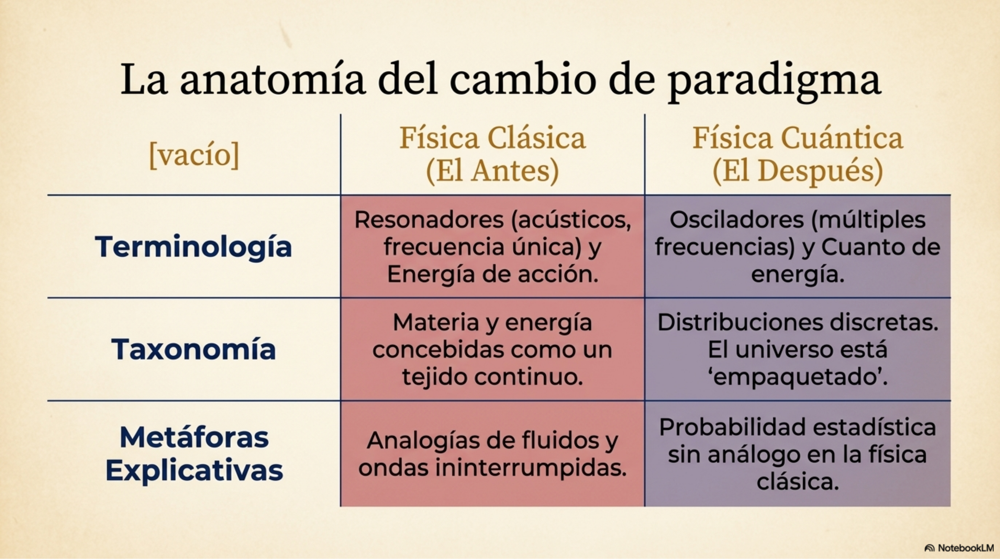

Los cambios que generan las revoluciones científicas transforman los
conceptos, los métodos y los criterios con los que opera una comunidad
científica en cierta época y en relación con determinada problemática.
La cuantización de la energía resolvió la anomalía experimental que
presentaba la radiación del cuerpo negro; después, dejó de ser hipótesis
para incorporarse fructíferamente al desarrollo de la mecánica cuántica
y generar cambios como los siguientes:

Cambio conceptual al introducirse la novedad de la cuantización de la
energía: la física clásica suponía que la energía podía variar de manera
continua. Por el contrario, Planck introdujo la hipótesis de que los
osciladores materiales sólo podían intercambiar energía en cantidades
discretas: $E = nh\nu,con\ n = 0,1$, 2, …donde $h\ $es la constante de
Planck y $\nu\ $la frecuencia.

Cambio en la explicación de la radiación: la ley de Rayleigh-Jeans
predecía una emisión infinita de energía para altas frecuencias (la
llamada «catástrofe ultravioleta»), mientras que la ley de Wien
funcionaba bien sólo para bajas frecuencias. La ley de Planck superó
ambas dificultades y describió correctamente los valores experimentales
del espectro de radiación para todas sus frecuencias.

Cambio en la metodología de investigación: la solución de Planck
incorporó ideas estadísticas desarrolladas por Ludwig Boltzmann. Aunque
Planck inicialmente consideró la cuantización como un artificio
matemático, después amplió los recursos explicativos disponibles cuando
introdujo métodos probabilísticos y combinatorios.

Cambio en los problemas y preguntas de investigación: la presentación de
la hipótesis de la cuantización de la energía planteó preguntas tales
como: ¿La cuantización de la energía es un hecho físico o un artificio
matemático para resolver un problema?, ¿La radiación electromagnética
también posee estructura discreta? ¿Cómo describir la estructura atómica
y la generación de los espectros de emisión y absorción?

Cambio en los criterios de aceptabilidad de las teorías: la física
clásica estaba basada en principios como la continuidad y el
determinismo; además, se ocupaba de trayectorias definidas no
probabilísticas. Con la teoría cuántica emergente, se tuvieron que
aceptar conceptos que no poseían una interpretación clásica y que
frecuentemente resultaban más que novedosos, contradictorios e
insospechados, como: cuantización del momento angular y del espín,
dualidad onda-partícula, estados cuánticos, superposición, probabilidad,
principio de incertidumbre., operadores y funciones de onda.

La siguiente Tabla 7.1 presenta algunas de las diferencias que pueden
señalarse entre dos maneras de ver la física: el paradigma clásico
tradicional y el cuántico incipiente.

| **Tabla 7.1. Diferencias de paradigmas en relación con la cuantización de la energía** |                               |                                         |
|----------------------------------------------------------------------------------------|-------------------------------|-----------------------------------------|
| Aspecto                                                                                | Paradigma clásico tradicional | Paradigma cuántico incipiente           |
| Naturaleza de la energía                                                               | Continua                      | Discreta (cuantizada)                   |
| Explicación de la radiación                                                            | Ondulatoria clásica           | Cuantos de energía (fotones)            |
| Métodos                                                                                | Mecánica y Electromagnetismo  | Estadística y cuantización              |
| Problemas fundamentales                                                                | Continuidad y determinismo    | Estructura atómica y procesos cuánticos |
| Conceptos básicos                                                                      | Variables continuas           | Cuantos y niveles de energía            |

La solución de Planck al problema de la radiación del cuerpo negro
significó una primera etapa en el proceso de construcción del mundo
cuántico; fue determinante en su desarrollo e interpretación. En lo que
sigue nos concentraremos en las aportaciones de cuatro de los grandes
constructores de la mecánica cuántica: Albert Einstein, Niels Bohr,
Werner Heisenberg y Erwin Schrödinger.

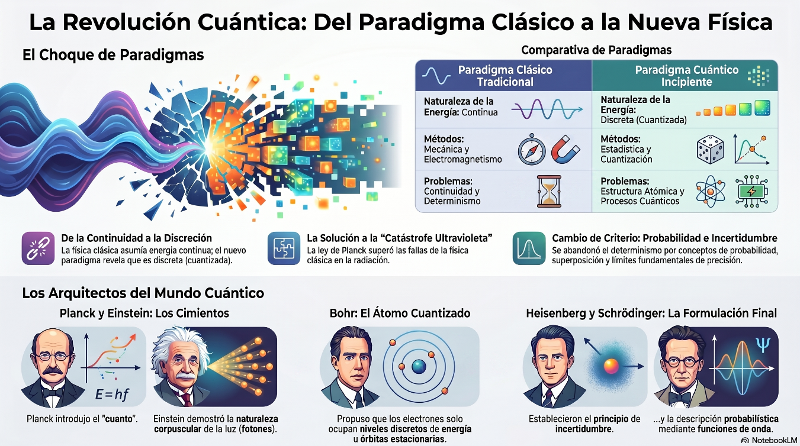

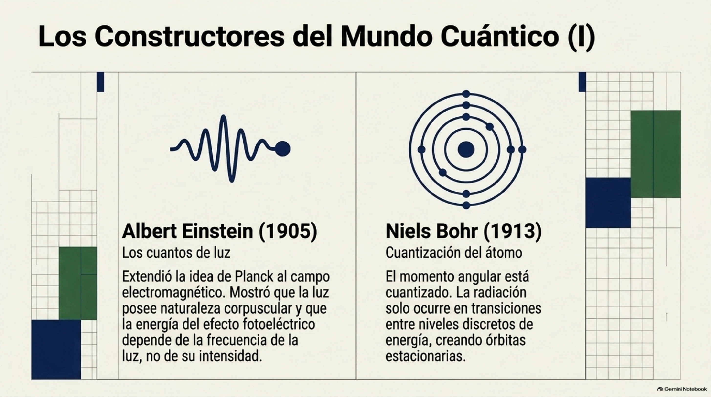

<u>Albert Einstein</u>: los cuantos de luz y la realidad física de la
cuantización

En 1905, Einstein extendió la idea de Planck al campo electromagnético y
propuso que la luz está constituida por cuantos de energía
(posteriormente llamados fotones). Explicó el efecto fotoeléctrico y
mostró que la energía de los electrones emitidos depende de la
frecuencia de la luz y no de su intensidad.

<u>Niels Bohr</u>: cuantización del átomo

En 1913, Bohr aplicó las ideas cuánticas al cálculo de la estructura
atómica y la explicación de su espectroscopía. Propuso que los
electrones sólo pueden ocupar ciertas órbitas estacionarias y que el
momento angular está cuantizado: $L = n\hslash,\ $con *n* un número
entero. La emisión o absorción de radiación ocurre cuando el electrón
transita de un nivel energético discreto a otro: $h\nu = E_{i} - E_{f}.$

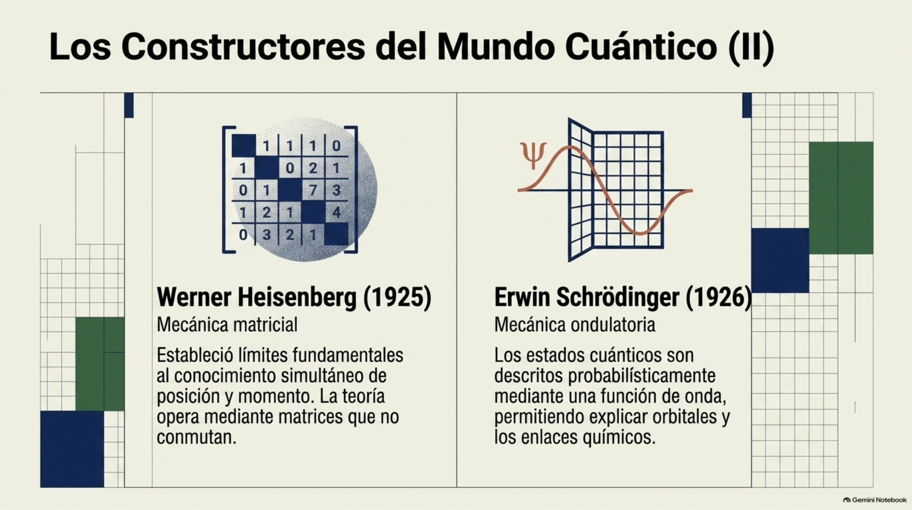

<u>Werner Heisenberg</u>: la mecánica matricial y el principio de
incertidumbre

En 1925, Heisenberg desarrolló la mecánica matricial, primera
formulación completa de la mecánica cuántica, implicando entre otras
suposiciones que: la teoría debía construirse únicamente sobre
magnitudes observables, las cantidades físicas se representan mediante
operadores que no conmutan y el principio de incertidumbre establece que
$\Delta x\text{ }\Delta p \geq \frac{\hslash}{2}.\ $ Este principio
establece límites fundamentales a la precisión simultánea con que pueden
conocerse las magnitudes de dos variables tales como la posición
(indeterminación *Δx*) y el momento lineal (indeterminación $\Delta$p).

<u>Erwin Schrödinger</u>: la mecánica ondulatoria

En 1926, Schrödinger desarrolló una formulación alternativa basada en la
suposición de que una función de onda $\psi$ describe
probabilísticamente a sistemas cuyas evoluciones temporales se calculan
al resolver la ecuación
i$\hslash\frac{\partial\psi}{\partial t} = \widehat{H}\psi$. Esta teoría
permite obtener valores de niveles de energía electrónicos y de los
correspondientes orbitales, así como explicar los enlaces químicos.

La siguiente Tabla 7.2 resume las principales contribuciones de los
cinco físicos antes considerados.

| **Tabla 7.2. Contribuciones al desarrollo de la mecánica cuántica** |                                                 |                                                                     |
|---------------------------------------------------------------------|-------------------------------------------------|---------------------------------------------------------------------|
| Físico                                                              | Aportación principal                            | Cambio conceptual introducido                                       |
| Planck                                                              | Cuantización de la energía                      | La energía se intercambia en cuantos cuyas energías son discretas.  |
| Einstein                                                            | Fotones y efecto fotoeléctrico                  | La radiación posee naturaleza corpuscular.                          |
| Bohr                                                                | Modelo atómico cuantizado                       | Existen niveles discretos de energía.                               |
| Heisenberg                                                          | Mecánica matricial y principio de incertidumbre | Límites fundamentales al conocimiento y descripción probabilística. |
| Schrödinger                                                         | Mecánica ondulatoria                            | Estados cuánticos descritos por funciones de onda.                  |

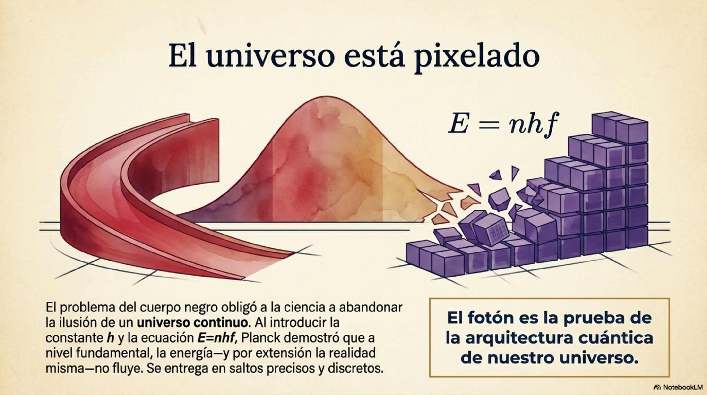

**7.3. Componentes de la Conferencia Nobel de Max Planck**

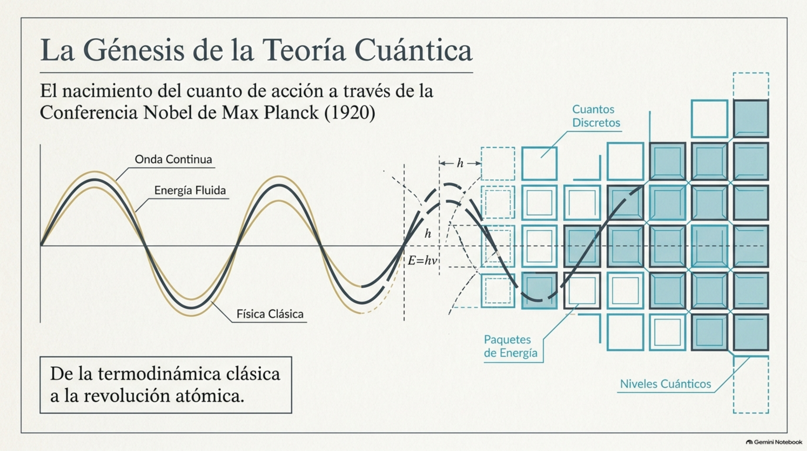

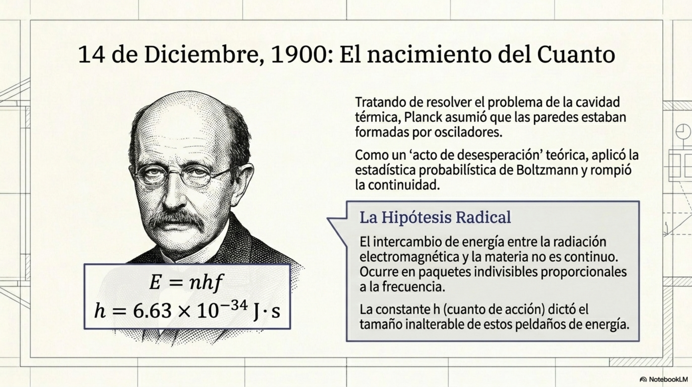

Para describir el contenido de la Conferencia Nobel de Max Planck hemos
procedido en dos etapas:

Etapa 1: dividimos el texto completo de la traducción al español de la
Conferencia en seis secciones que incluyen temas y subtemas, en tanto
componentes de un marco metodológico propuesto para explicar una teoría
científica, mismo que mostramos a continuación.

El resultado de la división de temas y subtemas se en la siguiente
lista:

# Descripción de hechos relevantes

> Origen del concepto de cuanto de acción

## Ley de Kirchhoff

# 

# Análisis de conceptos críticos

> Emisión y absorción de resonadores lineales

# 

# Propuesta de relaciones significativas

# Cambio de energía de los resonadores

## Punto de vista de Boltzmann

# 

# Solución a preguntas desafiantes 

##  Uso de resultados de la experiencia 

##  Discrepancias con los resultados experimentales

## En busca de una nueva fórmula de radiación

## Entropía y probabilidad

# 

# Explicación de nuevos resultados

> Existencia del cuanto de energía

# 

# Creación de posibilidades para una comprensión más profunda

> Aplicaciones en procesos térmicos y químicos

## Consecuencias en física atómica

> Importancia del cuanto de acción

Etapa 2: en lugar de reproducir el texto original, siguiendo la
estructura del marco metodológico antes indicado e incluyendo la
correspondiente lista de temas y subtemas, reemplazamos o resumimos los
párrafos que integran cada subtema por un grupo pequeño de frases
descriptivas de carácter general e insertamos diapositivas
correspondientes a presentaciones elaboradas por el programa NotebookLM.

*Génesis y Estado Actual del Desarrollo de la Teoría Cuántica*

\[Max Planck – Conferencia Nobel. NobelPrize.org.
\<<https://www.nobelprize.org/prizes/physics/1918/planck/lecture/>\>\]

# **Descripción de hechos relevantes**

## <u>Origen del concepto de cuanto de acción</u>

- Se trata de cumplir con la tarea de contar la historia del origen de
  la teoría cuántica y describir su estado actual y su importancia para
  la física.

- Han transcurridos 20 años desde que el concepto y la magnitud del
  cuanto físico de acción empezaron a destacar entre el conjunto de
  hechos experimentales; analizar esa trayectoria parece ser una
  ilustración de la frase de Goethe de que el hombre se equivoca tantas
  veces como se esfuerza.

- El trabajo intelectual de un investigador parecería vano e ilustre a
  no ser por los viajes cruzados que acercan a la verdad. Una hipótesis
  es explicativa cuando trata de la búsqueda de un objetivo específico.

## 

## <u>Ley de Kirchhoff</u>

- La conexión entre energía y temperatura es el principal problema en
  termodinámica.

- Las principales tareas a realizar son: buscar substancias con poder
  emisivo y absorbente conocido, calcular las propiedades de la
  radiación térmica en el intercambio de energía estacionaria y
  demostrar que es independiente de la naturaleza del cuerpo.

# **Análisis de conceptos críticos**

## 

## <u>Emisión y absorción de resonadores lineales</u>

- Problema: obtener la radiación del cuerpo negro dentro de la cavidad y
  entender los intentos de solución para calcular los cambios de energía
  en el resonador.

# **Propuesta de relaciones significativas**

#  

## <u>Cambio de energía de los resonadores</u>

- Establecer la conexión entre la energía de un resonador y la radiación
  energética de la región espectral correspondiente en el campo
  circundante, lo cual define las condiciones de intercambio de energías
  estacionarias.

## 

## <u>Punto de vista de Boltzmann</u>

- Ante la necesidad de abandonar las leyes de la física clásica, aplicar
  los criterios de simetría en los procesos de emisión y de absorción de
  ondas emitidas por el resonador.

# **Solución a preguntas desafiantes** 

## 

## <u>Uso de resultados de la experiencia</u> 

- Explorar otros caminos para encontrar la solución: apoyarse en la
  conexión entre entropía y probabilidad y confiar en resultados
  experimentales existentes, como los que expresa la ley de distribución
  de energía establecida por Wien.

## 

## <u>Discrepancias con los resultados experimentales</u>

- Se ha supuesto inicialmente que la ley que establece la cantidad
  R indica que es proporcional a la energía; sin embargo, los resultados
  experimentales mostraban que la cantidad R dependía del cuadrado de la
  energía.

## <u>En busca de una nueva fórmula de radiación</u>

- Se busca una solución aplicando una fórmula de interpolación entre los
  extremos de bajas energías y altas energías.

## <u>Entropía y probabilidad</u>

- En la fórmula de la radiación de Planck *R = a E + bE2* las
  constantes son *a = h/kB, b = h* y $E$ es la energía media
  del resonador; la constante de Planck $h$ introduce la cuantización de
  la energía (*E = hf*) y la constante de Boltzmann *kB*
  conecta la temperatura con la energía térmica (*E = kBT*).
  $R\ $representa la curvatura de la entropía respecto de la energía de
  un resonador $R = - \frac{1}{\partial^{2}S/\partial E^{2}}$

# **Explicación de nuevos resultados**

<u>Existencia del cuanto de energía</u>

## Si el cuanto de radiación es una cantidad ficticia, entonces la deducción de la ley de radiación es improcedente, aunque explique ciertos resultados experimentales. Ya otros resultados experimentales servirán para confirmar la existencia del cuanto de radiación, confirmando que la cuantización es una propiedad de la naturaleza. Ttomarla en consideración es una verdadera revolución científica.

# 

# **6. Creación de posibilidades para una comprensión más profunda**

## 

## <u>Aplicaciones en procesos térmicos y químicos</u>

- Numerosas aplicaciones en termodinámica, estado sólido y química
  demostraron la fecundidad del concepto de cuantización de la energía
  que ha pasado a ser una componente esencial en el desarrollo y
  explicación de múltiples teorías, cálculos y experimentos.

## <u>Consecuencias en física atómica</u>

- La hipótesis cuántica ha mostrado su validez e importancia en los
  dominios de la espectroscopía atómica y en las numerosas
  manifestaciones de las interacciones con la materia de los cuanto de
  luz (los fotones).

<u>Importancia del cuanto de acción</u>

*“Sea como sea, en cualquier caso, no cabe duda de que la ciencia
dominará el dilema, por grave que sea, y que lo que hoy parece tan
insatisfactorio acabará de hecho, visto desde un punto de vista
superior, por su especial armonía y sencillez. Hasta que se logre este
objetivo, el problema del cuanto de acción no dejará de inspirar la
investigación y fructificarlo, y cuantas mayores sean las dificultades
que se opongan a su solución, más significativa será finalmente para la
ampliación y profundización de todo nuestro conocimiento en física.”*

Max Planck

**Referencia**

| Kuhn, T. *La estructura de las revoluciones científicas.* University of Chicago Press. (1962). |
|------------------------------------------------------------------------------------------------|
